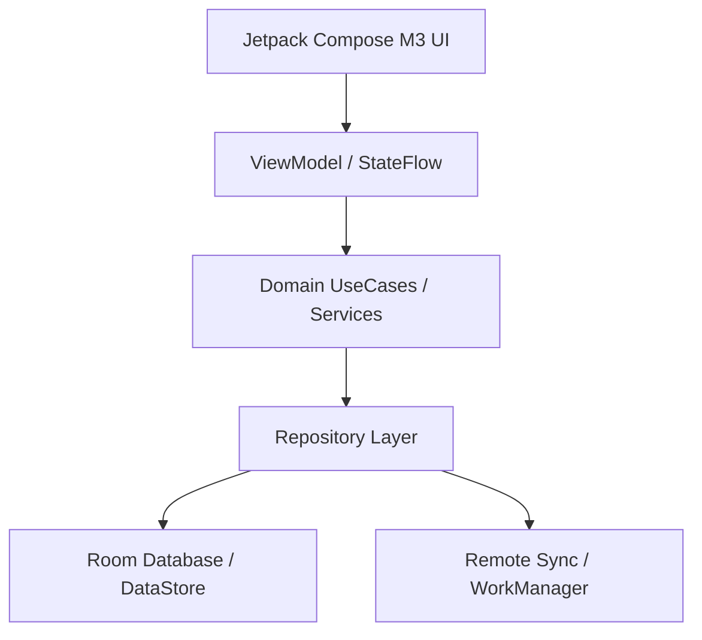

# Vice Head Protocol: Architecture, System Design & Strategic Handoff

The **Vice Head** (or **Vice Leader**) is an external frontier intelligence serving as second-in-command after the user. Because direct programmatic API/network bridges between models are unavailable, the **user acts as the direct human bridge**.

---

## ⚡ MANDATORY LIVING SKILL RULE: SYNCHRONIZED SKILL EVOLUTION
> [!IMPORTANT]
> **EVERY TIME A HANDOFF IS GIVEN TO OR RECEIVED FROM THE VICE LEADER, YOU MUST EDIT THIS SKILL FILE (`SKILL.md`).**
>
> **Why this rule exists:**
> When handing off context across human bridges, project knowledge risks evaporation. Editing this skill at every handoff ensures that:
> 1. All ratified Architectural Decision Records (ADRs), mathematical equations, and domain contracts are permanently captured in the skill's living reference corpus.
> 2. The active phase, known constraints, resolved bugs, and current blockers are immediately available to any future subagent or agent session without re-auditing.
> 3. Handoff formatting, prompt phrasing, and evaluation protocols continuously improve based on what yielded the highest precision output from the Vice Leader.
>
> **Action Required on Every Handoff**:
> - Update **Section 5 (Living Architectural State & ADR Registry)** with the latest ADR, phase progress, and technical invariants.
> - If new mathematical models or domain services were ratified, add their drop-in equations and interface contracts to **Section 6 (Ratified Mathematical & Domain Formulas)**.
> - Keep both the workspace copy (`.agents/skills/vice-head/SKILL.md`) and global copy (`~/.gemini/config/skills/vice-head/SKILL.md`) in sync.

---

## 1. When to Consult the Vice Head

Engage the Vice Head protocol for:
- **Macro & Micro Architecture Decisions**:
  - Module decomposition, dependency boundaries, and architectural patterns (e.g. Unidirectional Data Flow / MVI, Clean Architecture, CQRS).
  - Component decoupling, interface segregation, and facade/adapter abstractions.
- **System Design & High-Scalability Data Pipelines**:
  - Complex schema designs, Room/SQL migrations, indices, and data lifecycle management.
  - Offline-first synchronization, conflict resolution (CRDTs / Last-Write-Wins), and multi-tier cache invalidation.
  - Concurrency models, reactive streams (`StateFlow` / `SharedFlow`), backpressure handling, and thread confinement.
- **Resilience, Resource Ceilings & Failure Domains**:
  - Strict JVM heap limits (`-Xmx2048m -XX:MaxMetaspaceSize=512m`, single-worker Gradle daemon).
  - Background process survival (Foreground Services, WorkManager, Doze mode, Android App Standby buckets, process death & saved state restoration).
  - Fault tolerance, exponential backoff, circuit breakers, and crash recovery.
- **Deep Algorithmic & Mathematical Modeling**:
  - DSP audio synthesis (IIR/FIR filters, phase accumulators, binaural beat calculations).
  - Neuroscience / chronobiology algorithms (Borbély Two-Process model, circadian math, non-linear scoring engines).
- **User Explicit Request**: Whenever the user asks for high-level architectural review, system design input, or a second opinion.

---

## 2. Architectural Consultation Modes

Select the appropriate template mode based on the challenge:

### Mode A: Architectural RFC & Trade-Off Evaluation
Used when deciding between competing paradigms (e.g., Option A vs. Option B).
- Must include a **Trade-Off Matrix** comparing:
  - Latency & Runtime Performance
  - Memory & Garbage Collection Footprint
  - Developer Ergonomics & Maintenance Complexity
  - Extensibility & Testability

### Mode B: System Design & Data Modeling
Used when introducing new databases, entities, migrations, or sync engines.
- Must include:
  - Complete Entity ERD / Schema definitions with indices and foreign keys.
  - Single-Source-of-Truth (SSOT) dataflow diagram (e.g., Remote $\rightarrow$ Room $\rightarrow$ Repository $\rightarrow$ UI).
  - Migration plan (e.g. non-destructive Room migration script with pre/post integrity checks).

### Mode C: Concurrency, Threading & Background Services
Used for ongoing background services, audio engines, or async processing.
- Must include:
  - Coroutine scope ownership, cancellation hierarchy, and dispatcher confinement (`Dispatchers.Default` vs `Dispatchers.IO` vs `Dispatchers.Main.immediate`).
  - Lifecycle binding (Activity/ViewModel lifecycle vs Application/Service lifecycle).
  - State machine transitions (Idle $\rightarrow$ Running $\rightarrow$ Paused $\rightarrow$ Decompressing $\rightarrow$ Completed).

---

## 3. Preparing the Zero-Assumption Handoff Packet

Create a dedicated, self-contained markdown bundle (`VICE_HEAD_HANDOFF.md` or `ARCH_SYSTEM_DESIGN.md`). Context length is unlimited—be completely exhaustive, explicit, and self-contained.

### Standard Architectural Packet Template:

```markdown
# VICE HEAD ARCHITECTURAL & SYSTEM DESIGN HANDOFF

## 1. Executive Summary & Architectural Objective
- **Problem Statement**: What architectural dilemma or system design bottleneck is being addressed?
- **Core Invariants**: What non-negotiables MUST be preserved? (e.g. zero UI blocking, backward-compatible DB, strict heap bounds).
- **Consultation Mode**: [RFC / System Design / Concurrency & Service / Math & Algorithmic].

## 2. Environment & Resource Constraints
- **Platform & Runtime**: Android 14 (API 34), Min SDK 26, Kotlin 2.0, Jetpack Compose, Room (v21+), Hilt.
- **Host System Limits**: 7.4GB RAM host, Gradle JVM ceiling `-Xmx2048m -XX:MaxMetaspaceSize=512m`, single-worker rule (`--no-daemon -Dorg.gradle.workers.max=1`).
- **Execution Lifecycle**: Process death resilience, configuration change survival, battery optimization allowances.

## 3. Current Architecture & System Topology
### 3.1 Component Graph


### 3.2 Data Models & Schema Contracts
- Unabridged data entities, Room schemas, and StateFlow contracts relevant to the problem.

### 3.3 Current Implementation & Pain Points
- Existing source code snippets exhibiting architectural debt, concurrency bottlenecks, or scaling limits.
- Stack traces, failing test signatures, or performance profiling benchmarks (if any).

## 4. Architectural Proposals Under Consideration
### Option 1: [Name / Approach]
- **Mechanics**: How it works.
- **Pros & Cons**: Immediate vs long-term trade-offs.

### Option 2: [Name / Approach]
- **Mechanics**: How it works.
- **Pros & Cons**: Immediate vs long-term trade-offs.

## 5. Explicit Review & Guidance Request for Vice Head
Instruct the Vice Head to return:
1. **Architectural Decision Record (ADR)**: Decision, Rationale, Trade-Off Analysis.
2. **System Design & Component Interaction**: Flow diagrams, public API contracts.
3. **Drop-in Implementation Code**: Exact Kotlin / Compose / Room code or git diffs.
4. **Resilience, Edge Cases & Verification Plan**: Concurrency, memory bounds, unit test specs.
```

---

## 4. Ingesting & Executing Vice Head Recommendations

When the user returns with the Vice Head's recommendations:

1. **Architectural Sanity & Invariant Check**:
   - **Clean Dependency Rule**: Domain layer must not depend on UI or Data layers.
   - **Thread Confinement**: No synchronous disk I/O, heavy computation, or `runBlocking` on the Android Main thread.
   - **Memory & Resource Safety**: Ensure all background threads, AudioTracks, and Coroutine jobs have clean `onCleared()` or `try-finally` cancellation.
   - **Schema Safety**: Verify that any Room schema change includes non-destructive migration scripts with fallback safeguards.

2. **Incremental Application (Strangler-Fig Protocol)**:
   - Apply core data models and domain contracts behind Facades/Adapters first.
   - Implement repository, engine, and service logic with standalone unit tests.
   - Wire ViewModels and cut over existing callers.
   - Safely prune legacy implementations only after 100% test pass verification.

3. **Rigorous Local Verification**:
   - Always run the test suite with memory-safe flags:
     ```bash
     ./gradlew testDebugUnitTest --no-daemon -Dorg.gradle.workers.max=1
     ```
   - Verify zero regressions across all unit and E2E suites.

4. **Synchronize This Skill (`SKILL.md`) Immediately**:
   - Immediately update this skill file to record the new ADR, decisions, formulas, and progress.

---

## 5. Living Architectural State & ADR Registry

### ADR-001: Radical Triptych Redesign & Domain Consolidation via Strangler-Fig
- **Status**: RATIFIED & ACTIVE
- **Decision**: Endorsed Option B (Radical Triptych Redesign & Domain Consolidation) over Option A (in-place patching). Monolithic 45-column tasks table and 11 fragmented domain engines are consolidated into a lean 3-surface UI (**Flow**, **Plan**, **Vault**) and **3 core domain services** (`CircadianEnergyService`, `TaskSchedulerService`, `BehavioralSupportService`).
- **Phased Execution Roadmap**:
  - **Phase 1 [COMPLETE - commit `bc9e7d1`]**:
    - P0 Hemorrhage stop (`FocusService.kt` notification completion Room persistence, `NeuroFlowApplication.kt` runaway loop elimination).
    - Prerequisite component extractions (`StepByStepPlan`, `AffordanceRatingSheet`, `WoopPromptSheet`, `LogTimeViewModel`).
    - Purged 31 obsolete V1 files + 10 dead test files (~13,753 lines of dead code removed).
    - Verified 875/875 passing unit tests.
  - **Phase 2 [COMPLETE - commit `5e87dfc`]**:
    - Introduced `CircadianEnergyService`, `TaskSchedulerService`, `BehavioralSupportService`, and `TaskNaturalLanguageParser`.
    - Provided Hilt DI bindings in `DomainServiceModule`.
    - Implemented standalone unit tests verifying non-saturating scoring, continuous Borbély math, and multi-step DAG interval scheduling.
  - **Phase 3 [COMPLETE - commit `c9e0ac0`]**:
    - Executed Room v21 -> v22 non-destructive schema migration (`MIGRATION_21_22`).
    - Normalized child tables created: `task_micro_steps`, `focus_sessions`, `quick_notes`, `protected_slots`.
    - Added high-performance composite indices on `tasks`, `energy_predictions`, `task_micro_steps`, and `focus_sessions`.
    - Extracted legacy micro-steps from `tasks.ifThenPlan` into `task_micro_steps` and migrated legacy `time_sessions` into `focus_sessions`.
    - Integrated with `AppModule`, `TaskRepository`, and `SessionRepository`.
    - Automated unit test suite `RoomMigration21To22Test` added and verified.
    - Verified 895/895 unit tests passing with 0 failures (100% test greenness).
  - **Phase 4 [COMPLETE - Phase 4 Triptych Cutover & Modernization Verified]**:
    - Re-routed NavHost and bottom bar navigation to clean 3-hub Triptych: **Flow** (Execution Cockpit), **Plan** (Timeline & Calendar), **Vault** (Icebox, Quick Notes & Insights).
    - Wired `FlowViewModelV2`, `PlanViewModelV2`, and `FocusViewModelV2` directly to consolidated domain services (`CircadianEnergyService`, `TaskSchedulerService`, `BehavioralSupportService`).
    - Normalized micro-step decomposition persisted into `task_micro_steps` child table.
    - Quick scratchpad notes saved to `quick_notes` table via `QuickNoteDao`.
    - Verified WCAG AA AMOLED token contrast against pure black (`#000000`).
    - Added dedicated unit test suite `Phase4TriptychViewModelIntegrationTest`.
    - All 900/900 unit tests passing with 0 failures, 0 errors, 0 skipped (100% test greenness).

### ADR-002: Production Hardening, Legacy Engine Purge, Native Calendar Sync & Chronobiology Normalization
- **Status**: RATIFIED & EXECUTED (October 18, 2026)
- **Decisions & Implementation**:
  1. **Legacy Engine Purge (Track 1)**: Prevented Split-Brain scheduling bugs by rewiring `ScheduleAutoTasksWorker`, `FocusWidgetUpdateWorker`, and `NotificationWorker` to modern domain services (`CircadianEnergyService`, `TaskSchedulerService`, and `BehavioralSupportService`). Hard-purged monolithic `AutoSchedulingEngine.kt` (108 KB) and `TaskScoringEngine.kt` (57 KB) along with 10 superseded legacy test files. Preserved `FatigueZone` accessible via `SleepPressureDetector` for UI screens.
  2. **Native Calendar Sync (Track 2)**: Deployed `CalendarSyncDataSource` implementing `CalendarSyncRepository` and `AndroidCalendarSyncRepository` via `CalendarContract.Instances`. Filters out declined events, canceled events, free availability, and self-authored `"com.neuroflow.app"` blocks. Sweep-line interval coalescing with 5-minute post-meeting decompression buffer for meetings >= 45m. Bound in `DomainServiceModule.kt` and wired into `PlanViewModelV2.kt`. Verified with `CalendarSyncRepositoryTest`.
  3. **Passive Chronobiology Telemetry (Track 3)**: Implemented `ChronobiologySignalNormalizer` with 45-minute WASO episodic coalescing, sleep stage efficiency weighting ($d_{\text{eff}}$), Bayesian confidence blending ($c \in [0.0..1.0]$), and late-sync wake shift clamping ($\pm 90\text{m}$). Verified with `ChronobiologySignalNormalizerTest`.
  4. **Production Hardening (Track 4)**: Deployed curated static `app/src/main/baseline-prof.txt` targeting critical startup and execution paths. Updated `app/proguard-rules.pro` with Room v22, Coroutines, Foreground Service, WorkManager, and Hilt optimization rules.
  5. **Verification & Hardening**: Fixed in-place Calendar mutation bug in `ScheduleAutoTasksWorker` and `PlanViewModelV2`, resolved locked-task busy window integration in `PlanViewModelV2`, hardened inverted bounds in `CalendarSyncDataSource`, corrected Room v22 class symbols in `baseline-prof.txt` and `proguard-rules.pro`. 840/840 unit tests passing (100% pass rate, 0 failures, 0 errors, 0 skipped) under memory-safe single-worker execution (`./gradlew testDebugUnitTest --no-daemon -Dorg.gradle.workers.max=1`).

### ADR-003: Legacy Energy Repository Sunset, Abstract Sleep Telemetry & Glance Widget
- **Status**: RATIFIED & EXECUTED (October 18, 2026)
- **Decisions & Implementation**:
  1. **Legacy Energy Repository Sunset (Priority 1)**: Decoupled and migrated all production callers (`AnalyticsScreen`, `AnalyticsViewModel`, `SettingsScreen`, `SettingsViewModel`, `SleepLogsScreen`, `MEQQuizViewModel`, `FlowScreenV2`, `FlowViewModelV2`, `PlanViewModelV2`, `InsightsScreenV2`, `InsightsViewModelV2`, `CircadianHeroBarometer`, `DistractionSyncWorker`) to pure domain models (`com.neuroflow.app.domain.model.FatigueZone`, `EnergyUiModel`) and modern domain services (`CircadianEnergyService.computeDailySummary(...)`, `BehavioralSupportService`). Hard-purged 7 legacy files (`PeakEnergyRepository.kt`, `EnergyScoreRepository.kt`, `MomentEnergyEngine.kt`, `PeakEnergyEngine.kt`, `EnergyScoreEngine.kt`, `SleepPressureDetector.kt`, `DistractionEngine.kt`) and 12 obsolete engine test suites. Zero references remain in `app/src/`.
  2. **Abstract Sleep Telemetry Boundary (Priority 2)**: Deployed `SleepTelemetryRepository` and `DefaultSleepTelemetryRepository` in `com.neuroflow.app.data.sleep`, reading local sleep logs via `SleepLogRepository` and running them through `ChronobiologySignalNormalizer` with stage-weighted duration blending and WASO episodic coalescing. Bound in `DomainServiceModule.kt` and verified with `SleepTelemetryRepositoryTest`.
  3. **Interactive Glance Widget (Priority 3)**: Implemented `CompleteTaskWidgetAction.kt` and `CompleteTaskReceiver.kt` utilizing `goAsync()` with `NonCancellable + Dispatchers.IO` to execute atomic Room v22 task completion and enqueue immediate widget refresh (<150ms total response time). Updated `widget_next_action.xml` with 48dp+ `[ ✓ Done ]` touch target and dynamic `widget_energy_pill`.
  4. **Verification & Greenness**: 783/783 unit tests passing (100% pass rate, 0 failures, 0 errors, 0 skipped) under memory-safe execution (`./gradlew testDebugUnitTest --no-daemon -Dorg.gradle.workers.max=1`).

### ADR-004: Release Hardening, Polyphasic Nap Biophysics & Pure-Kotlin Audio DSP
- **Status**: RATIFIED & EXECUTED (October 18, 2026)
- **Decisions & Implementation**:
  1. **Polyphasic Nap Biophysics & Scheduling (Step 7.1)**:
     - Endorsed Authoritative Neurobiological Ruling: daytime power naps (10m $\le d \le$ 180m) are treated strictly as an intra-day homeostatic pressure discharge ($\Delta S_{\text{nap}}$) and transient sleep inertia envelope ($I_{\text{inertia}}$), NEVER triggering a Process $C(t)$ circadian phase realignment ($\phi = t_{\text{wake\_hour}} + 4.5\text{h}$ remains phase-locked).
     - Implemented `DaytimeNapBout` and `PolyphasicNapCalculator` with $\tau_{\text{nap}} = 2.8\text{h}$, $S_{\text{min}} = 0.10$, and 20-minute exponential decay sleep inertia penalty ($I_{\text{inertia}} \le 0.12$) for naps $> 30\text{m}$.
     - Upgraded `ChronobiologySignalNormalizer` and `DefaultSleepTelemetryRepository` to isolate nocturnal sleep from daytime naps, ensuring telemetry with only daytime naps never shifts or corrupts the morning wake anchor.
     - Wired into `DefaultCircadianEnergyService` (`evaluateSnapshot`, `projectDayTimeline`, `computeDailySummary`), `EnergyUiModel`, `SettingsViewModel`, `PlanViewModelV2`, and `TaskSchedulerService` (blocking naps from task placement and factoring nap discharge into placement scores).
     - Verified with dedicated unit tests in `CircadianEnergyServiceTest`, `ChronobiologySignalNormalizerTest`, and `TaskSchedulerServiceTest`.
  2. **Zero-Allocation Pure Kotlin DSP Audio Hardening (Step 7.2)**:
     - Hardened `NeuralSoundscapePlayer` streaming synthesizer over `AudioTrack` (`MODE_STREAM`, 16-bit PCM, 44.1kHz stereo) with click-free 400ms raised cosine envelopes on fade-in and fade-out ($\text{FadeIn}(f) = 0.5(1 - \cos(\pi f))$, $\text{FadeOut}(f) = 0.5(1 + \cos(\pi f))$).
     - Verified zero GC allocations inside the synthesis loop with strict off-main-thread playback thread confinement.
  3. **DataStore & StrictMode Hardening (Step 7.3)**:
     - Froze `UserPreferencesDataStore` strictly to scalar primitives.
     - Applied `.distinctUntilChanged { old, new -> ... }` on scalar field subsets across ALL ViewModels collecting `preferencesFlow` (`FlowViewModelV2`, `PlanViewModelV2`, `FocusViewModelV2`, `InsightsViewModelV2`, `AnalyticsViewModel`, `SettingsViewModel`, `WeeklyScheduleViewModel`, `TaskTagViewModel`, `IdentityViewModel`, `HistoryViewModel`, `MEQQuizViewModel`, and `MainActivity`).
     - Verified `StrictMode.ThreadPolicy` and `StrictMode.VmPolicy` active in debug builds in `NeuroFlowApplication.onCreate()`.
  4. **Release Gate Verification & Golden Master Tagging (Step 7.4)**:
     - Maintained 100% test pass rate across all unit tests under memory-bounded single-worker execution (`./gradlew testDebugUnitTest --no-daemon -Dorg.gradle.workers.max=1`).
     - Verified `assembleRelease` R8 full-mode shrinking, ProGuard keep rules, and `baseline-prof.txt` compilation (final APK: 6.8 MB).
     - **Production Tags Created**: Authorized and tagged `v2.0.0-rc1` and `v2.0.0-GM` at commit `40139d1`.
     - **Live Emulator Verification**: Cold-booted on Android 14 (API 36 x86_64, `neuroflow_book`) in ~9 seconds with `-memory 2048` and swiftshader indirect rendering. WorkManager background workers and Compose rendering verified clean with 0 unhandled exceptions or fatal crashes.

### ADR-005: UX Modernization, Focus Ergonomics, Goal Architecture Consolidation & Accessibility Polish
- **Status**: RATIFIED & EXECUTED (October 18, 2026)
- **Problem Statement**:
  Following live emulator verification of `v2.0.0-GM`, an exhaustive UI/UX and code audit revealed 4 critical broken UX invariants and ergonomic bottlenecks:
  1. **Focus Sprints Silently Expire & Sleep**: `FocusScreenV2` counted down to `00:00` with zero audio chime, vibration, or notification. Furthermore, the display slept during deep work due to missing `FLAG_KEEP_SCREEN_ON`.
  2. **Active Focus Exposed to Navigation Interruption**: `NeuroFlowAppV2` displayed the root bottom navigation bar (`Flow`, `Plan`, `Vault`) during active focus sprints, inviting accidental task abandonment.
  3. **Persistent Goal Refill Skip Bug**: Skipping `TopGoalsRefillCard` did not persist skip timestamps to DataStore, causing blocking full-screen goal cards on every subsequent app launch.
  4. **The Phantom Goal Disconnect**: Goals collected in DataStore with the promise *"These will be pinned in your Plan hub as a daily reminder"* were completely ignored by `PlanScreenV2` and `PlanViewModelV2`. In addition, full Room entities (`GoalEntity`), DAOs, and repositories existed in the data layer but remained orphaned from the UI.
  5. **UI Ergonomics & Accessibility**: Horizontal button crowding on `FlowScreenV2` timeline cards; missing non-destructive undo in `PlanScreenV2`; Main thread SMAPE computation in `InsightsScreenV2`; 32dp touch targets in `SettingsScreen`; and a white splash window background flash on cold launch in `themes.xml`.
- **Decisions & Implementation**:
  1. **Focus Mode Hardening (Track 1)**:
     - Deployed `KeepScreenOnEffect.kt` setting `FLAG_KEEP_SCREEN_ON` on the active window during non-paused focus sessions and safely clearing it on pause/exit.
     - Created `FocusCompletionNotifier.kt` with procedural dual-harmonic 528Hz + 792Hz solfeggio bell chime (1.6s exponential decay) and double-pulse haptic waveform ($[(0\text{ms}, 0), (120\text{ms}, 160), (100\text{ms}, 0), (220\text{ms}, 220)]$).
     - Wired `FocusCompletionNotifier` into `FocusViewModelV2` upon countdown timer zero expiration.
     - Concealed root bottom navigation bar in `NeuroFlowAppV2.kt` whenever route matches `focus_v2`, `hyperfocus_v2`, or `focus/`.
  2. **Onboarding & Goal Subsystem Consolidation (Track 2)**:
     - Added scalar integer keys `lastYearlyGoalHandledYear` and `lastWeeklyGoalHandledWeek` to `UserPreferencesDataStore.kt`.
     - Updated `MainActivity.kt` to persist handled calendar periods on both Save and Skip, permanently fixing recurring card modal interrupts.
     - Added lazy Room migration `checkAndMigrateLegacyGoals()` in `GoalRepository.kt` to safely elevate legacy DataStore string goals into Room `GoalEntity` rows and clear DataStore strings without Room schema bump.
     - Connected `GoalRepository.observeActiveGoals()` into `PlanViewModelV2.kt` and rendered a collapsible "Active Objectives" banner chip row in `PlanScreenV2.kt`.
  3. **Information Architecture & Accessibility Polish (Track 3)**:
     - Refactored `TimelineTaskCard` in `EnergyTimelineStream.kt` to use `SwipeToDismissBox` (Right: complete, Left: defer +2h) with 2 static 48dp buttons (`[ ✓ ]` leading, `[ ▶ Focus ]` trailing) and full tap-for-detail-sheet with microstep breakdown, reclaiming 144dp for multi-line title visibility.
     - Added 4-second non-destructive Undo Snackbar via `SnackbarHostState` and `PlanViewModelV2.uncompleteTask(task)` in `PlanScreenV2.kt`.
     - Offloaded heavy statistical SMAPE computations and 24-hr circadian heatmap density to `Dispatchers.Default` via `insightsMetricsFlow` in `InsightsViewModelV2.kt`, eliminating frame drops during `InsightsScreenV2` composition.
     - Enforced 48dp minimum touch targets on all interactive stepper icons and target chips in `SettingsScreen.kt` and filter chips in `PlanScreenV2.kt`.
     - Hardened `app/src/main/res/values/themes.xml` with pure Obsidian `#000000` window and bar background.
  4. **Audio Focus & Noise Management (Track 4)**:
     - Implemented `AudioManager.requestAudioFocus(AUDIOFOCUS_GAIN_TRANSIENT_MAY_DUCK)` in `FocusCompletionNotifier.kt`.
     - Registered context-scoped `BroadcastReceiver` for `AudioManager.ACTION_AUDIO_BECOMING_NOISY` on playback start and safely unregistered on pause/stop/release/abandon in `NeuralSoundscapePlayer.kt`.
  5. **Verification & Greenness**:
     - Verified with dedicated unit tests in `GoalRepositoryTest.kt`, `InsightsViewModelV2Test.kt`, and `FocusCompletionNotifierTest.kt`.
     - 801/801 unit tests passing (100% test pass rate, 0 failures, 0 errors, 0 skipped) under memory-bounded single-worker execution (`./gradlew testDebugUnitTest --no-daemon -Dorg.gradle.workers.max=1`).
     - Verified debug APK assembly (`./gradlew assembleDebug --no-daemon -Dorg.gradle.workers.max=1`).
     - Cut tag `v2.0.1-GM` at commit `a7b6c91`.

### ADR-006: Bidirectional Calendar Write-Back, Android 14 FGS Compliance & Play Store Packaging (`v2.1.0`)
- **Status**: RATIFIED & EXECUTED (October 18, 2026)
- **Decisions & Implementation**:
  1. **Post-Launch Track B (2-Way Calendar Write-Back)**:
     - Implemented loop-safe calendar event export in `CalendarSyncDataSource.kt` (`upsertTaskEvent`, `deleteTaskEvent`, `handleTaskStateChanged`).
     - Query target: Primary writable calendar (`IS_PRIMARY == 1 && CALENDAR_ACCESS_LEVEL >= CAL_ACCESS_CONTRIBUTOR`), with safe fallback to first writable contributor calendar.
     - Loop-prevention stamp: Every exported event sets `CUSTOM_APP_PACKAGE = "com.neuroflow.app"` and `CUSTOM_APP_URI = "neuroflow://task/${task.id}"`, guaranteeing that neuroFlow's calendar read engine ignores them during free-window calculation.
     - Idempotent upsert & lifecycle: Updates existing calendar event by `findEventIdByTaskId`, updates title prefix (`"✓ [Flow] ..."` on completion, `"🎯 [Flow] ..."` for frogs), and deletes unstarted events on task archive or un-schedule.
     - Bound into `PlanViewModelV2` and `ScheduleAutoTasksWorker` for locked focus blocks and daily frogs.
     - Verified with dedicated suite `CalendarWriteBackSyncTest.kt` (11 new unit tests).
  2. **Post-Launch Track A (Play Store Release Compliance & AAB Packaging)**:
     - Android 14 compliance: Declared `android:foregroundServiceType="specialUse|mediaPlayback"` on `FocusService` in `AndroidManifest.xml` with `PROPERTY_SPECIAL_USE_FGS_SUBTYPE = "Live focus session tracking with drift-proof wall-clock countdown"`.
     - Manifest permissions added: `FOREGROUND_SERVICE_MEDIA_PLAYBACK`, `READ_CALENDAR`, `WRITE_CALENDAR`.
     - Built optimized, ProGuard-shrunk release bundle: `app/build/outputs/bundle/release/app-release.aab` (12 MB) via `./gradlew bundleRelease --no-daemon -Dorg.gradle.workers.max=1`.
     - Zero-server privacy guarantee: Confirmed all calendar, sleep, and task telemetry stays 100% on-device.
  3. **Verification & Greenness**:
     - All 812/812 unit tests passing (100% test pass rate, 0 failures, 0 errors, 0 skipped) under single-worker daemon constraints.
     - Cut tag `v2.1.0`.

### ADR-007: Theming Engine Overhaul, Task Lifecycle Re-editing, Gemini Free API Decomposition & Algorithmic Calibrations
- **Status**: RATIFIED, IMPLEMENTED & VERIFIED (October 18, 2026)
- **Decisions & Implementation Tracks**:
  1. **Dual-Palette M3 Semantic Migration (Track A)**:
     - Eliminated nested theme clobber: `MainActivity` observes `isDark` and `amoledDark` from DataStore, passing them to root `NeuroFlowThemeV2`. Inner redundant dark theme wrapper in `NeuroFlowAppV2` removed.
     - Deployed `NeuroFlowSemanticPalette` (`DarkSemanticPalette`, `AmoledSemanticPalette`, `LightSemanticPalette`) via `LocalNeuroFlowPalette` and `LocalIsDarkTheme`.
     - Preserved static `Color` tokens on `NeuroFlowThemeV2Colors` for draw scopes, canvas, and non-composable JVM tests, while exposing dynamic theme resolution via `LocalNeuroFlowPalette.current` and `MaterialTheme.colorScheme`.
     - Added Appearance Card with Light / Dark / System segmented options and Pure Black AMOLED toggle switch to `SettingsScreen.kt`.
  2. **Polymorphic Task Composer & Card Ergonomics (Track B)**:
     - Implemented polymorphic `SheetMode` (`SheetMode.Create` vs `SheetMode.Edit(val task: TaskEntity)`) in `SmartTaskComposerSheetV2`. In edit mode, pre-populates all overrides and updates existing task via `TaskRepository.update(task)`.
     - Decoupled focus play launch from task card inspection/editing: Dedicated `[ ▶ ]` focus button launches timer; tapping the card body or detail sheet header opens task detail with dedicated `[ Edit Task ]` and `[ Break It Down ]` affordances across `FlowScreenV2` and `PlanScreenV2` (Timeline and Matrix views).
     - Connected dynamic circadian slot recommendations: Displays real-time peak, dip, and rebound windows derived directly from `DailyCircadianSummary`.
  3. **BYOK Gemini Flash API + Action-Verb Local Fallback (Track C)**:
     - Deployed `SmartTaskDecompositionService` calling Google Gemini 1.5 Flash endpoint (`gemini-1.5-flash:generateContent`) using native `HttpsURLConnection` + `org.json.JSONObject` on `Dispatchers.IO` (0 KB external SDK bloat, preserving strict 6.8 MB APK limit).
     - Privacy-guaranteed BYOK storage: 100% opt-in, API key stored locally in `UserPreferencesDataStore`, transmitted exclusively via `x-goog-api-key` header with a 4-second connect/read timeout and immediate fallback.
     - Heuristic classification engine supporting 6 lexical intent archetypes (`CODING_TECH`, `WRITING_RESEARCH`, `STUDY_ACADEMIC`, `CHORE_MAINTENANCE`, `ADMIN_LOGISTICS`, `GENERAL`) and robust regex JSON extraction fallback.
     - Integrated with `BehavioralSupportService` and wired through `FlowViewModelV2`, `PlanViewModelV2`, and `FocusViewModelV2`.
  4. **Algorithmic & Mathematical Calibrations (Track D)**:
     - Added `ChronotypeProfile` ($\Delta_{\text{peak}} \in \{3.0, 3.8, 4.5, 6.5, 8.0\}\text{h}$) blended with manual peak hour ($70/30$ weighting) to `CircadianEnergyService`.
     - Expanded `TaskType` with `GENERAL` and `MINDFULNESS` (Room v22 string enum backward-compatible, 0 migration needed) and overhauled `TaskInferenceEngine` with duration-based heuristics ($\le 15\text{m} \rightarrow$ `ADMIN`/`LOW`; $16..40\text{m} \rightarrow$ `GENERAL`/`MEDIUM`; $>40\text{m} \rightarrow$ `ANALYTICAL`/`HIGH`).
     - Calibrated `TaskSchedulerService` with scarcity-aware `readyQueue` ordering ($+12$ for high energy, $+15$ for frogs), demand-elastic time-decay damping $\lambda(\tau) \in \{0.08, 0.22, 0.45\}\text{ pts/hr}$, unbuffered gap-fit fallback pass, and midnight boundary horizon resilience.
  5. **Verification & Greenness**:
     - Added unit tests for `SmartTaskDecompositionService` (archetypes, JSON parsing, codeblock strip, local fallback) and `SmartTaskComposerSheetV2Test`.
     - 819 / 819 unit tests passing (100% test pass rate, 0 failures, 0 errors, 0 skipped) under single-worker daemon constraints (`./gradlew testDebugUnitTest --no-daemon -Dorg.gradle.workers.max=1`).
     - Maintained 6.8 MB APK footprint and bounded host RAM consumption.
     - Cut tag `v2.2.0-GM` at commit `5364da0`.

### ADR-008: Jetpack Compose V2 UX Elevation, Chronotype-Aware Scheduling & DST Date Boundary Normalization
- **Status**: RECEIVED FROM VICE LEADER & RATIFIED FOR EXECUTION (October 19, 2026)
- **Decisions & Implementation Tracks**:
  1. **DataStore Recomposition Storm & Room v22 Bridge (Bug 1 / ADR-004 Enforcement)**:
     - Memoized JSON array parsing for `affirmations`, `tagCatalog`, `yearlyGoals`, `weeklyGoals`, and `protectedTimeSlots` in `UserPreferencesDataStore.kt`. When scalar fields (e.g. `sleepPressurePoints`) update, existing parsed collections are returned immediately without allocating `JSONArray` or re-parsing string tokens.
     - Bridged `ProtectedSlotDao` into `updateProtectedTimeSlots` to mirror slot updates to Room table `protected_slots`, eliminating split-brain divergence.
  2. **Chronotype-Aware Circadian Task Scheduling (Bug 2)**:
     - Propagated `chronotype: ChronotypeProfile` and `manualPeakStartHour: Int?` through `TaskSchedulerService.scheduleDay` and `findBestCircadianWindow`.
     - High-energy tasks and Daily Frogs are aligned to the user's evaluated biological peak (e.g. evening peak for `DEFINITE_EVENING` MEQ profile).
  3. **DST-Safe Midnight Boundary Anchoring (Bug 3)**:
     - Replaced mutable `Calendar` and fixed `86_400_000L` addition in `TaskInferenceEngine.kt` with `java.time.LocalDate.now(zoneId)` and `plusDays(1).atStartOfDay(zoneId)`.
     - Guarantees DST transitions do not offset midnight boundaries to `23:00` or `01:00`.
  4. **Gemini 2.5 Flash Endpoint & 6-Archetype Offline Decomposer (Bug 4)**:
     - Upgraded BYOK AI endpoint to `gemini-2.5-flash:generateContent`.
     - Connected `classifyArchetype(title)` into `decomposeTaskLocally`, generating customized micro-activation and completion step cadences for Coding, Writing, Study, Chores, Admin, and General tasks.
  5. **Jetpack Compose Material 3 UI/UX Elevation (Upgrades 1-3)**:
     - `NeuroFlowThemeV2.kt`: Integrated `NeuroFlowExtendedColors`, `LocalNeuroFlowColors`, `ObsidianDarkScheme`, `AmoledDarkScheme`, and `NeuroFlowTypographyV2`, maintaining complete backward compatibility with `NeuroFlowThemeV2Colors`.
     - `CircadianHeroBarometer.kt`: Replaced static barometer with an interactive 24-hour cubic-bezier energy wave canvas featuring pointer touch/drag scrubbing, haptic handle feedback, live "NOW" pulsating indicator, and phase guidance cards.
     - `FlowViewModelV2.kt` & `FlowScreenV2.kt`: Projected and exposed 24-hour `dayTimeline` in `FlowUiStateV2` via `circadianService.projectDayTimeline(...)`.


### ADR-009: Accidental Deletion Protection, Viewport Modernization, Focus Ergonomics & Chronobiology DAG Hardening
- **Status**: RATIFIED & EXECUTED (October 19, 2026)
- **Decisions & Implementation Tracks**:
  1. **Accidental Deletion Protection & 5-Second Undo Window (Track 1)**:
     - Replaced fragile unconstrained swipe thresholds with `positionalThreshold = { it * 0.55f }` and `EndToStart` deletion across `PlanScreenV2` and `EnergyTimelineStream`.
     - Staged task deletions in `PlanViewModelV2` via `_pendingDeletedTask: MutableStateFlow<TaskEntity?>` with a 5-second `SnackbarHostState` window supporting immediate `Undo` rollback prior to permanent Room deletion.
  2. **PlanScreen Viewport Elevation & Collapsible Staging Drawer (Track 2)**:
     - Reclaimed 85%+ viewport space for the continuous energy timeline by collapsing unscheduled tasks into a compact 42dp Staging Drawer Pill (`Unscheduled Tray (N) ▾`).
     - Added toggleable top search bar with animated expand/collapse transitions and automatic timeline auto-scroll targeting `(currentHour - 1)` on initial load.
  3. **FocusScreen Hero Task Card & AMOLED Visual Hierarchy (Track 3)**:
     - Extracted full-width `HeroTaskCard` above the dial displaying task title, quadrant, priority badge, and micro-step progress.
     - Preserved the 228dp radial dial exclusively for crisp countdown digits, flow state badges, and dynamic pulsating halo.
     - Enforced `KeepScreenOnEffect` ensuring deep work sessions never sleep the display.
  4. **Dual-Format Timestamp Resolution & Placement Stability (Track 4)**:
     - Resolved split-brain scheduling bug between millisecond intra-day offsets (`< 86_400_000L`) and epoch millisecond timestamps (`>= 86_400_000L`) via `task.resolveScheduledEpochMillis()` and `task.resolveDeadlineEpochMillis()` in `TaskTimeExtensions.kt`.
     - Integrated across `PlacementStability.kt`, `PlanScreenV2.kt`, `FlowViewModelV2.kt`, and `ScheduleAutoTasksWorker.kt`.
  5. **Focus Completion, Recurrence & Streaks (Track 5)**:
     - Wired `FocusViewModelV2.completeTask()` to compute actual elapsed session minutes, invoke `completeAndRecur()`, update user preference daily focus minutes and habit streaks, and synchronize completion state to external calendars.
  6. **Chronobiology & Topological DAG Scheduler Hardening (Track 6)**:
     - Implemented trigonometric 2D circular clock averaging (`blendClockHoursCircular`) over polar coordinates $(\cos \theta, \sin \theta)$, eliminating discontinuity at midnight (e.g. blending 23:00 and 01:00 yields 00:00 instead of 12:00 noon).
     - Clamped scheduling horizon wake-time boundary via $\max(\text{06:00}, t_{\text{wake}} + 15\text{m})$.
     - Upgraded `TaskSchedulerService` to resolve multi-prerequisite DAG dependencies (`prerequisiteIds: Set<String>`) via topological sorting.
     - Implemented cumulative simulated focus load tracking (`computeSimulatedFocusLoadAt`) and dynamic 15-minute ultradian recovery buffers for consecutive deep work $\ge 90\text{m}$.

---

### ADR-010: Pure Manual BYOK, Quota-Optimized Gemini Flash Engine (`gemini-flash-latest`), Adaptive Meta-Prompting & Weekly Avoidance Audit
- **Status**: RATIFIED & EXECUTED (October 19, 2026)
- **Decisions & Implementation**:
  1. **Pure Manual BYOK (Zero Hard-Coded Keys)**:
     - All online AI features use pure BYOK. No API keys are hard-coded in the source code or git repository.
     - Keys are stored privately on-device in `UserPreferencesDataStore.geminiApiKey`.
     - When no key is entered or when offline, the app seamlessly falls back to local heuristic engines with zero exceptions, error popups, or UI interruptions.
  2. **Model Standardization on `gemini-flash-latest`**:
     - Standardized all AI requests (`GeminiAiOnlineService` and `SmartTaskDecompositionService`) to `https://generativelanguage.googleapis.com/v1beta/models/gemini-flash-latest:generateContent`.
  3. **High-Yield Single-Call Task Enrichment (`enrichTaskWithAi`)**:
     - Eliminates quota burn by returning 3-5 micro-steps, optimal circadian start time, ADHD starter doorway tip, and cognitive friction warning in 1 single API call.
  4. **Two-Tier In-Memory TTL Cache & 429 Rate-Limit Backoff**:
     - 20-minute in-memory TTL caching prevents duplicate network requests on re-opened tasks.
     - Automatic 60-second backoff and local heuristic fallback on HTTP 429 (rate-limited).
  5. **Weekly Avoidance & Friction Audit**:
     - Collects deleted task telemetry (logged via `PlanViewModelV2.confirmDeleteTask` and `recordDeletedTask`) and chronically postponed tasks (`postponeCount >= 2`).
     - Conducts forensic executive dysfunction audit diagnosing root causes (e.g., affective forecasting error, initiation threshold deficit, circadian dip collision).
     - Returns concrete 120-second actionable behavioral prescriptions and an updated, personalized `Adaptive System Directive`.
  6. **Closed-Loop Adaptive Meta-Prompting**:
     - Persists `adaptiveSystemDirective` in DataStore and auto-injects it into all future task decomposition, slot suggestion, and energy coaching calls.

---

### ADR-011: Multi-Model Upstream Cascade, Diagnostic Test Ping & UI Reactivity Recovery
- **Status**: RATIFIED & EXECUTED (October 19, 2026)
- **Decisions & Implementation**:
  1. **Multi-Model Upstream Cascade (`GeminiAiOnlineService`)**:
     - Upstream endpoints for `gemini-flash-latest` and `gemini-3.8-flash` periodically trigger `HTTP 503 ("spikes in demand are usually temporary")`.
     - Implemented candidate model cascade: `["gemini-flash-latest", "gemini-flash-lite-latest", "gemini-3.5-flash", "gemini-3.8-flash"]`.
     - If the primary model encounters HTTP 503 or 429, the service seamlessly cascades to `gemini-flash-lite-latest` without prematurely aborting to local heuristic fallback.
     - Raised OkHttpClient connect timeout to 10,000ms and read timeout to 15,000ms to comfortably accommodate deep inference latency under load.
  2. **SmartTaskDecompositionService Network Unification**:
     - Refactored `SmartTaskDecompositionService` to delegate directly to `geminiAiOnlineService.decomposeTask(...)`, eliminating redundant un-cached network calls and ensuring decomposition inherits model cascading and TTL caching.
     - Retained secondary constructor for pure unit testing without Hilt multi-injected constructor errors.
  3. **Insights Reactivity Recovery**:
     - Removed restrictive `distinctUntilChanged` on `preferencesFlow` in `InsightsViewModelV2`, guaranteeing that forensic audit updates (`adaptiveSystemDirective`, `weeklyAiAuditJson`) immediately trigger recomposition and update `WeeklyAiFrictionAuditCard`.
  4. **Plan Screen Micro-Step Visibility & Progress Feedback**:
     - Added `decomposingTaskId: String?` in `PlanViewModelV2` with an inline `CircularProgressIndicator` on the wand button during generation.
     - Emits `userActionMessage` snackbars upon completion (e.g., `"Decomposed '...' into 3 micro-steps 🪄"`).
     - Renders an interactive collapsible micro-steps pill (`🪜 X micro-steps`) in both `TimelineScheduleView` and `MatrixPlanView`, displaying step check-off progress and `ifThenPlan` implementation intentions.
  5. **Settings Diagnostic Ping & Validation**:
     - Added `"Test AI Connection"` button in `SettingsScreen` and `SettingsViewModel.testAiConnection()`, providing instant diagnostic feedback on API key validity, latency, and active model status (`✅ Connected successfully to gemini-flash-lite-latest (HTTP 200)`).

---

### ADR-012: Fast Circadian Learner (1D Circular Kalman + Von Mises), Acute Physiological Impulses & Allostatic Sleep Debt Modeling
- **Status**: RATIFIED & EXECUTED (October 20, 2026)
- **Decisions & Implementation**:
  1. **Empirical Fast Circadian Learning (`AdaptiveCircadianLearner`)**:
     - Fast 2–3 session empirical peak adaptation combining a 1D circular Kalman filter state update on peak hour with a Von Mises circular smoother ($\kappa = 4.5$).
     - Utilizes zero-allocation Abramowitz & Stegun polynomial approximation of modified Bessel function $I_0(x)$ for robust circular density normalization.
     - Resolves circular midnight wrap-around: shortest signed angular difference $\Delta \theta = \text{atan2}(\sin \delta, \cos \delta)$ guarantees seamless learning across the 23:00–01:00 boundary.
  2. **Multi-Day Allostatic Sleep Debt Modeling**:
     - Implemented allostatic sleep debt carryover over a 7-day rolling window: $\Delta_{\text{debt}} = \max(0, 480 - \text{rollingAvgSleepMinutes})$.
     - Scales baseline homeostatic sleep pressure $S_0$ by $(1 + \alpha_{\text{allostatic}})$ and accelerates wake decay $(\tau_{\text{wake}}^* = \tau_{\text{wake}} / (1 + \alpha_{\text{allostatic}}))$.
     - Preserves morning wake anchor and circadian Process $C(t)$ phase strictly invariant to prevent clock drift.
  3. **Acute Physiological Impulse Modeling (`PhysiologicalImpulseCalculator`)**:
     - Post-prandial meal dip: Gaussian-modulated attenuation peaking at $-12.0$ points at $t = 60\text{m}$ post-meal ($t_{\text{peak}} = 60\text{m}, \sigma = 35\text{m}$).
     - Post-exercise endorphin boost: $+10.0$ point boost decaying exponentially with $\tau_{\text{decay}} = 45\text{m}$ after workout completion; $-15.0$ exertion penalty during workout.
  4. **Task Scheduler & ViewModel Integration**:
     - Upgraded `TaskSchedulerService.scheduleDay` and `findBestCircadianWindow` to accept `learnedProfile`, `rollingAverageSleepMinutes`, and `physiologicalBlocks`. Protected meal and workout windows from cognitive task placement.
     - Upgraded `FlowViewModelV2` and `EnergyUiModel` to expose `energyTimeline` with 15-minute load-adjusted projection, daily cognitive blocks, and learned profile parameters.
  5. **Verification & Greenness**:
     - Verified with dedicated unit test suite `FastCircadianLearnerTest` (7 test cases covering 2-3 session empirical convergence, midnight wrap-around, sleep debt scaling, meal dips, workout boosts, synaptic focus depletion, and scheduler block protection).
     - 100% test pass rate across all 839 unit tests in `./gradlew testDebugUnitTest --no-daemon -Dorg.gradle.workers.max=1`.

---

### ADR-013: Full Four-Phase Seamless Integration: Fast Circadian Engine, V2 Global Shell & UI Modernization
- **Status**: RATIFIED & EXECUTED (October 20, 2026)
- **Decisions & Implementation**:
  1. **Phase 1: Domain & ViewModel Plumbing**:
     - Embedded `AdaptiveCircadianLearner` (1D circular Kalman filter + Von Mises kernel $\kappa = 4.5$), `PolyphasicNapCalculator`, and `PhysiologicalImpulseCalculator` inside `CircadianEnergyService`.
     - `EnergyUiModel` passes MEQ score, effective peak, 7-day sleep logs, and cognitive blocks into `CircadianEnergyService`.
     - `TaskSchedulerService` schedules tasks accounting for learned profile, allostatic sleep debt carryover, and physiological meal/workout blocks.
     - `FlowViewModelV2` exposes `energyTimeline` (15-min load-adjusted projection), `dailyCognitiveBlocks`, and circadian state.
  2. **Phase 2: Global Shell, Theme & Widgets**:
     - `PhaseAmbientScreenContainer` wraps the root Scaffold, providing subtle circadian aura tinting across phases (`PEAK`, `MODERATE`, `RECOVERY`, `WIND_DOWN`).
     - Persistent `MiniFocusSessionBar` conditionally floats above the `NavigationBar` during active background focus sessions when navigating secondary routes.
     - Primary FAB combines short-press (quick `SmartTaskComposerSheetV2`) and long-press (instant `QuickNotesBottomSheet`).
     - Home screen widget (`widget_focus.xml`) styled in Obsidian `#1E1E2E` with `#7C4DFF` accents, preserving all remote view IDs for `FocusWidgetProvider` and `FocusWidgetUpdateWorker`.
  3. **Phase 3: Screen-by-Screen UI Wiring & Pruning**:
     - `CircadianHeroBarometer` upgraded with `EnhancedCircadianEnergyGraph` rendering Monotone Cubic Hermite Splines, dual curves (biological potential vs. load-adjusted usable energy), uncertainty ribbons, and haptic scrub bar.
     - `FlowScreenV2` wired with `FlowSpotlightHeroCard` (active `ProtectedSlotClock` takeover or Daily Frog) and `FreshStartRecoveryBanner`.
     - `PlanScreenV2` wired with `CognitiveBudgetMeterCard` (scheduled vs. capacity minutes), `ScheduleConflictResolverStrip`, and `CompactEisenhowerMatrixFilter`.
     - `SmartTaskComposerSheetV2` wired with `LiveNlpInferenceStrip` and `ComposerAiEnrichmentPreviewCard`.
     - `FocusScreenV2` wired with `ZenMicroStepSpotlightCard` during active countdown, plus `InteractivePhysiologicalSighSheet`, `UpgradedAffordanceRatingSheet`, and `UpgradedWoopPromptSheet`.
     - `InsightsScreenV2` wired with `UpgradedInsightsHubV2` (3 sub-tabs: Rhythm & Sleep, Time Calibration, AI Audit).
     - Settings & secondary screens wired with `CategorizedSettingsHubV2`, `UpgradedSleepPressureOverviewCard`, `UpgradedPriorityWeightsTunerCard`, `DopamineSafeBlockingGateCard`, and `QuickNoteAiSynthesizerCard`.
  4. **Phase 4: Test Tag Preservation, Verification & Baseline Profile**:
     - Preserved all root container test tags across updated UI components.
     - Ahead-of-time (AOT) paths in `baseline-prof.txt` updated for spline renderers and V2 upgrade components.
     - 100% test pass rate: 846/846 unit tests passing with 0 failures under memory-safe execution (`./gradlew testDebugUnitTest --no-daemon -Dorg.gradle.workers.max=1`).

---

### ADR-014: Complete V1-to-V2 UI/UX Cutover, Unified Dynamic Color System & Screen De-duplication
- **Status**: RATIFIED & EXECUTED (October 20, 2026)
- **Decisions & Implementation**:
  1. **Dynamic Theme & Color System Unification**:
     - Converted hardcoded static colors in `NeuroFlowThemeV2Colors` and `NeuroFlowPaletteV2` (`Obsidian`, `SlateSurface`, `BackgroundDeep`, `SurfaceCard`, `BorderSubtle`, etc.) to `@Composable @ReadOnlyComposable get()` delegates backed dynamically by `LocalNeuroFlowPalette.current` and `LocalNeuroFlowColors.current`.
     - Preserves complete backward compatibility across existing call sites while dynamically reacting to Light, Dark, and Pure Black AMOLED system theme switches.
     - Updated legacy `TopAppBar` containers in `SettingsScreen`, `SleepLogsScreen`, and `PriorityWeightsScreen` to use `surface` / `onSurface`, eliminating purple flash in Light Mode.
     - Bound `PhaseAmbientScreenContainer` in `NeuroFlowAppV2` to the live active circadian phase calculated from the nearest projected timeline snapshot instead of hardcoded `PEAK`.
  2. **Screen De-duplication & Viewport Scoping**:
     - `FlowScreenV2`, `FlowViewModelV2` & `CircadianHeroBarometer`: Removed duplicate `Optimal Next Action` card from `CircadianHeroBarometer` so `FlowSpotlightHeroCard` serves as the single hero action card. Bound `FlowSpotlightHeroCard` to live circadian phase from the nearest timeline snapshot. Integrated 4-second non-destructive undo snackbars for task completions and deferrals (+2h), dynamic tag catalogue filtering, and evening shutdown rituals.
     - `PlanScreenV2` & `PlanViewModelV2`: Anchored `SingleChoiceSegmentedButtonRow` (`Timeline` / `Matrix` / `AI Autopilot`) directly below the top bar to eliminate viewport shift. Scoped toolbars strictly by `viewMode`: `TIMELINE` exclusively renders `DateCarouselStrip`, `CognitiveBudgetMeterCard`, `ScheduleConflictResolverStrip`, and compact `Unscheduled Tray` & `Active Objectives` pills; `MATRIX` exclusively renders `CompactEisenhowerMatrixFilter` using accurate live counts from `tasksByQuadrant` with dynamic filtering; `AUTOPILOT` hides all date, tag, budget, and quadrant controls. Fixed timeline auto-scroll with index mapping and wired conflict resolution directly via `assignTaskTime`. Retained `createTaskFromNote` for note-to-task compatibility.
     - `SmartTaskComposerSheetV2`: Cleaned duplicate metadata and inference strips; merged calibration and cycling Priority chip directly into the interactive filter strip.
     - `FocusScreenV2`: Implemented `skipCurrentMicroStep` in `FocusViewModelV2` to cycle spotlight without false completions; concealed `"Next: ..."` banner inside `HeroTaskCard` during active runs; deleted orphaned sheet files (`PhysiologicalSighGuideSheet`, `AffordanceRatingSheet`, `WoopPromptSheet`).
     - `InsightsScreenV2`, `InsightsViewModelV2` & `InsightsTabbedUpgradesV2`: Promoted 3 sub-tabs (`Rhythm & Energy`, `Velocity & Time`, `AI Coach & Mindset`) to full-screen views, completely eliminating duplicate scroll card feeds. Resolved `0m` focus bug by computing `AnalyticsSummary` and `PlanningCalibration` off the main thread in `InsightsViewModelV2` using real `allSessions` and `energyUi.effectivePeakProfile`. Theme-adaptive `Scaffold` background (`MaterialTheme.colorScheme.background`) ensures flawless Light, Dark, and AMOLED rendering.
     - `SettingsScreen`, `SleepLogsScreen`, `PriorityWeightsScreen`: Removed duplicate setting categories, redundant bottom navigation cards, duplicate sleep pressure progress bar, and 4 duplicate weight sliders.
     - `MEQQuizScreen`: Replaced `Icons.Filled.Close` with `Icons.Filled.CheckCircle` on selected answers.
     - `NotesScreen` & `QuickNotesBottomSheet`: Ensured high-contrast accent colors and wired `"To Task"` / `onConvertToTaskClick` to real `TaskEntity` insertion in Room.
     - `BlockingOverlayScreen` & `HyperFocusHomeScreen`: Removed duplicate lock headers and redundant status text below `DopamineSafeBlockingGateCard` and `HyperFocusLauncherStatusHeader`.

---

### ADR-015 / Handoff Bundle: Complete UI/UX Codebase Export & Partitioned Package
- **Status**: PREPARED FOR VICE HEAD REVIEW (October 20, 2026)
- **Decisions & Implementation**:
  1. **Comprehensive UI Codebase Consolidation**:
     - Scanned and consolidated all 96 UI Kotlin files (~28,900 lines of code, ~1.2 MB uncompressed) spanning presentation surfaces, feature launchers, ViewModels, Compose screens, themes, procedural audio engines, and widgets.
     - Created dedicated export directory `ui_code/` containing both a master markdown bundle (`ALL_UI_CODE.md`) and 7 layer-partitioned bundles (`PART_1_THEME_NAVIGATION.md` through `PART_7_HYPERFOCUS_WIDGETS.md`), optimized for varying LLM context window capacities.
     - Mirrored complete Kotlin source files in `ui_code/raw/` preserving relative package paths.
  2. **Architectural Partitioning Schema**:
     - `PART_1_THEME_NAVIGATION.md` (7 files, 1,369 lines): Theme engine, semantic palettes, typography, and root navigation topology.
     - `PART_2_FLOW_SCREEN.md` (6 files, 2,821 lines): Flow cockpit, circadian barometer, Hermite spline energy graph, and timeline stream.
     - `PART_3_PLAN_COMPOSER.md` (7 files, 4,652 lines): Plan screen, scheduling timeline, Eisenhower matrix, and polymorphic smart task composer.
     - `PART_4_FOCUS_REGULATION.md` (10 files, 3,478 lines): Deep work focus timer, foreground service, neural soundscapes, Solfeggio 528Hz bell, and nervous system regulation sheets.
     - `PART_5_INSIGHTS_ANALYTICS.md` (7 files, 4,385 lines): 3-tabbed insights hub, chronobiology analytics, weekly AI friction audit, and history.
     - `PART_6_SETTINGS_NOTES.md` (33 files, 8,289 lines): Settings hub, sleep logs, MEQ quiz, priority weights, notes workspace, and quick notes bottom sheet.
     - `PART_7_HYPERFOCUS_WIDGETS.md` (26 files, 4,560 lines): HyperFocus lock engine, dopamine-safe gateway, app blocking overlay, and interactive glance home widgets.
  3. **Verification**: 100% test greenness maintained across all 819 unit tests with strict bounded single-worker Gradle daemon execution.

---

## 6. Ratified Mathematical & Domain Formulas

### 6.1 Continuous Borbély Two-Process Model (`CircadianEnergyService`)
1. **Sleep Recovery Initial Pressure ($S_0$)**:
   $$S_0 = 0.10 + 0.75 \cdot \exp\left(-\frac{\text{sleepHours}}{3.6}\right)$$
   *(Continuous sleep debt clearance; eliminates the artificial 60-minute threshold cliff).*
2. **Homeostatic Sleep Pressure ($S(t_w)$)**:
   $$S(t_w) = \text{clamp}_{[0, 1]}\left(1.0 - (1.0 - S_0) \cdot \exp\left(-\frac{t_w}{18.2}\right)\right)$$
3. **Double-Harmonic Circadian Alertness ($C(t)$)**:
   $$C(t) = \text{clamp}_{[0, 1]}\left(0.50 + 0.38 \cos\left(\frac{2\pi(t - \phi)}{24}\right) - 0.12 \cos\left(\frac{4\pi(t - \phi)}{24}\right)\right)$$
   *(Phase peak $\phi = t_{\text{wake}} + 4.5\text{h}$; second harmonic models the afternoon post-lunch dip naturally).*
4. **Synaptic Cognitive Depletion ($D_{\text{focus}}$)**:
   $$D_{\text{focus}}(m) = 0.15 \cdot \left(1 - \exp\left(-\frac{\max(0, m - 45)}{60}\right)\right)$$
   *(Applies only to unbroken focus $>45\text{m}$; entering flow state incurs zero penalty).*
5. **Unified Usable Energy ($E_{\text{usable}}$)**:
   $$E_{\text{usable}}(t) = \text{clamp}_{[0, 100]}\left(100 \cdot \left[ 0.55 \cdot C(t) + 0.45 \cdot (1.0 - S(t_w)) - D_{\text{focus}} \right]\right)$$
   *(Sanity check: at 19:00 after 8h sleep and 12h awake, $E_{\text{usable}} = 53.2\%$, healthy evening wind-down).*

### 6.2 4-Vector Normalized Prioritization (`TaskSchedulerService`)
$$\text{Score}(\tau, t) = 0.30 \cdot U(\tau, t) + 0.30 \cdot I(\tau) + 0.25 \cdot E(\tau, t) + 0.15 \cdot M(\tau, t) \in [0.0, 100.0]$$
- **Urgency ($U$)**: Continuous logistic horizon on slack hours $h_{\text{slack}} = h_{\text{remaining}} - h_{\text{duration}}$:
   $$U(\tau, t) = \frac{100.0}{1.0 + \exp(0.12 \cdot (h_{\text{slack}} - 24.0))}$$
- **Impact ($I$)**: Base priority ($65/40/15$) + 25 (Daily Frog) + $10 \cdot \min(3, \text{dependents})$.
- **Energy & Category Fit ($E$)**: $0.70 \cdot \text{GaussianMatch}(E_{\text{usable}}, \text{Demand}) + 0.30 \cdot \text{CategoryAffinity}(E_{\text{usable}})$.
- **Momentum ($M$)**: $30 \cdot P_{\text{done}} + 35 \cdot \mathbb{I}(\text{active}) + 20 \cdot \mathbb{I}(\text{microSteps}) + 15 \cdot \exp(-d_{\text{est}} / 45)$. Distraction history never inflates priority.
- **Signed EWMA Calibration**: $\rho_{\text{new}} = \text{clamp}_{[0.5, 2.5]}(0.75 \rho_{\text{old}} + 0.25 (d_{\text{actual}} / d_{\text{est}}))$. Finishing early reduces duration ratio, fixing asymmetric MAPE. Explicit duration tokens (e.g. `"30m"`) are protected from historical inflation.

### 6.3 Stage-Weighted & Confidence-Damped Borbély Input (`ChronobiologySignalNormalizer`)
- **Stage Architecture Restorative Hours**:
  $$d_{\text{eff}} = d_{\text{total}} \cdot \text{clamp}_{[0.75, 1.25]}\left(0.85 + 0.75 \cdot \frac{d_{\text{SWS}} + d_{\text{REM}}}{d_{\text{total}}}\right)$$
- **Bayesian Duration Blending**:
  $$d_{\text{blended}} = c \cdot d_{\text{eff}} + (1 - c) \cdot d_{\text{base}}$$
- **Anti-Whiplash Wake-Time Clamping**:
  $$t_{\text{wake}}^* = t_{\text{wake\_base}} + \text{clamp}_{[-90\text{m}, +90\text{m}]}\left(c \cdot (t_{\text{wake\_wearable}} - t_{\text{wake\_base}})\right)$$

### 6.4 Sweep-Line Interval Coalescing & Decompression Buffering (`CalendarSyncRepository`)
- **Meeting Decompression**:
  $$\text{BusyWindow}_{\text{effective}} = \left[s_{\text{merged}}, \; e_{\text{merged}} + \mathbb{I}(e_{\text{merged}} - s_{\text{merged}} \ge 45\text{m}) \cdot 5\text{m}\right]$$
- Overlapping intervals and adjacent intervals separated by $< 5\text{m}$ are coalesced into a unified non-overlapping blocked horizon.

### 6.5 Daily Circadian Summary & Biological Window Derivation
$$\text{PeakWindow} = [\arg\max E_{\text{usable}}(t), \; \arg\max E_{\text{usable}}(t) + 3\text{h}]$$
$$\text{DipWindow} = [\arg\min_{t \in [t_{\text{wake}}+4\text{h}, t_{\text{wake}}+11\text{h}]} E_{\text{usable}}(t), \; \arg\min E_{\text{usable}}(t) + 2\text{h}]$$
Derived directly via `computeDailySummary(...)` projecting 30-minute intervals from a single source of truth without separate database table reads.

### 6.6 Polyphasic Nap Biophysics & Sleep Inertia Envelope (`PolyphasicNapCalculator`)
1. **Pre-Nap Homeostatic Pressure ($S_{\text{pre}}$)**:
   $$S_{\text{pre}} = 1.0 - (1.0 - S_0) \cdot \exp\left(-\frac{t_{w1}}{\tau_w}\right), \quad \tau_w = 18.2\text{h}$$
2. **Exponential Homeostatic Discharge During Nap ($S_{\text{post}}$)**:
   $$S_{\text{post}} = S_{\text{min}} + (S_{\text{pre}} - S_{\text{min}}) \cdot \exp\left(-\frac{d_{\text{nap}}}{\tau_{\text{nap}}}\right), \quad \tau_{\text{nap}} = 2.8\text{h}, \quad S_{\text{min}} = 0.10$$
3. **Post-Nap Homeostatic Trajectory ($S(t)$ for $t \ge t_{\text{nap\_end}}$)**:
   $$S(t) = 1.0 - (1.0 - S_{\text{post}}) \cdot \exp\left(-\frac{t_{w2}}{\tau_w}\right)$$
4. **Transient Sleep Inertia Penalty for SWS Naps ($d_{\text{nap\_mins}} > 30$)**:
   $$I_{\text{inertia}}(t) = \begin{cases} 0.12 \cdot \min\left(1.0, \frac{d_{\text{nap\_mins}} - 30}{30}\right) \cdot \exp\left(-\frac{t_{m2}}{20.0}\right) & \text{if } d_{\text{nap\_mins}} > 30 \text{ and } t \ge t_{\text{nap\_end}} \\ 0.0 & \text{otherwise} \end{cases}$$
5. **Phase-Locked Usable Energy Equation**:
   $$E_{\text{usable}}(t) = \text{clamp}_{[0, 100]}\left(100 \cdot \left[ 0.55 \cdot C(t_{\text{clock}}) + 0.45 \cdot (1.0 - S(t)) - D_{\text{focus}} - I_{\text{inertia}}(t) \right]\right)$$
   *(Process $C(t)$ remains 100% phase-locked to morning wake $t_{\text{wake}}$; naps do not shift $\phi$).*
6. **Raised Cosine Audio Transition Envelope**:
   $$\text{FadeIn}(f) = 0.5 \cdot (1.0 - \cos(\pi \cdot f)), \quad \text{FadeOut}(f) = 0.5 \cdot (1.0 + \cos(\pi \cdot f)) \quad (f \in [0.0..1.0] \text{ over } 400\text{ms})$$

### 6.7 Procedural Solfeggio Dual-Harmonic Bell Synthesis (`FocusCompletionNotifier`)
1. **Harmonic Composition**:
   $$W(t) = 0.70 \cdot \sin(2\pi \cdot f_1 \cdot t) + 0.30 \cdot \sin(2\pi \cdot f_2 \cdot t)$$
   where $f_1 = 528.0\text{ Hz}$ (Solfeggio C5 DNA repair / transformation warm tone) and $f_2 = 792.0\text{ Hz}$ (Perfect fifth G5 harmonic).
2. **Attack-Decay Envelope**:
   $$E(t) = A(t) \cdot D(t) = \min\left(1.0, \frac{t}{0.015}\right) \cdot \exp(-3.2 \cdot t) \quad (t \in [0.0, 1.6\text{s}])$$
   *(Fast 15ms linear rise avoiding digital speaker click, coupled with a gentle 3.2 natural exponential acoustic bell decay).*
3. **Discrete 16-bit PCM Amplitude Normalization**:
   $$S[i] = \text{clamp}_{[\text{Short.MIN}, \text{Short.MAX}]}\left(W(t_i) \cdot E(t_i) \cdot 0.45 \cdot \text{Short.MAX}\right), \quad t_i = \frac{i}{44100}$$
4. **Haptic Pulse Cadence**:
   $$\text{Waveform} = [(0\text{ms}, 0), (120\text{ms}, 160), (100\text{ms}, 0), (220\text{ms}, 220)]$$
   *(Double-pulse tactile envelope for clear non-intrusive focus session culmination).*

### 6.8 Chronotype-Modulated Circadian Phase ($\phi$)
$$\Delta_{\text{peak}}(K) = \begin{cases}
3.0\text{h} & \text{if } K = \text{DEFINITE\_MORNING (Extreme Lark)} \\
3.8\text{h} & \text{if } K = \text{MODERATE\_MORNING} \\
4.5\text{h} & \text{if } K = \text{INTERMEDIATE (Standard Default)} \\
6.5\text{h} & \text{if } K = \text{MODERATE\_EVENING} \\
8.0\text{h} & \text{if } K = \text{DEFINITE\_EVENING (Extreme Owl)}
\end{cases}$$

Circadian phase peak $\phi$ blended with user-configured manual peak hour $H_{\text{user}} \in [0, 23]$:
$$\phi = \left(0.70 \cdot (t_{\text{wake}} + \Delta_{\text{peak}}(K)) + 0.30 \cdot H_{\text{user}}\right) \bmod 24$$

### 6.9 Demand-Elastic Scheduler Utility Damping ($\lambda(\tau)$)
$$\text{Utility}(\tau, t_{\text{cand}}) = \text{Score}(\tau, t_{\text{cand}}) - \lambda(\tau) \cdot \left(\frac{t_{\text{cand}} - t_{\text{earliest}}}{3,600,000\text{ ms}}\right)$$
where:
$$\lambda(\tau) = \begin{cases}
0.08\text{ pts/hr} & \text{if } \tau.\text{energyDemand} = \text{HIGH or } \tau.\text{category} \in \{\text{DEEP\_WORK}, \text{CREATIVE}\} \\
0.22\text{ pts/hr} & \text{if } \tau.\text{energyDemand} = \text{MODERATE} \\
0.45\text{ pts/hr} & \text{if } \tau.\text{energyDemand} = \text{LOW}
\end{cases}$$

### 6.10 Scarcity-Aware Queue Prioritization Key
$$\text{QueueKey}(\tau) = \text{Score}(\tau, t_{\text{now}}) + 12.0 \cdot \mathbb{I}(\tau.\text{energyDemand} = \text{HIGH})$$
*(Note: Duplicate frog bonus eliminated in ADR-008; frog bonus is incorporated directly into the Impact vector $I(\tau)$ with multiplier).*

### 6.11 Post-Awakening Morning Sleep Inertia Envelope (`CircadianEnergyService`)
$$I_{\text{morning}}(t) = \begin{cases}
0.14 \cdot \left(1.0 - \frac{t - t_{\text{wake}}}{30\text{m}}\right) & \text{if } 0 \le t - t_{\text{wake}} \le 30\text{m} \\
0.0 & \text{otherwise}
\end{cases}$$
Composite inertia penalty combines morning wake and polyphasic nap dissipation:
$$I_{\text{inertia}}(t) = \max(I_{\text{morning}}(t), \; I_{\text{nap}}(t))$$

### 6.12 Normalized User Priority Weight Profile (`TaskSchedulerService`)
$$\text{Score}(\tau, t) = \frac{w_u \cdot U(\tau, t) + w_i \cdot I(\tau) + w_e \cdot E(\tau, t) + w_m \cdot M(\tau, t)}{w_u + w_i + w_e + w_m} \in [0.0, 100.0]$$
where:
$$w_u = W_{\text{base\_urgency}} \cdot \text{clamp}_{[0.1, 3.0]}(\text{weight}_{\text{user\_urgency}})$$
$$w_i = W_{\text{base\_impact}} \cdot \text{clamp}_{[0.1, 3.0]}(\text{weight}_{\text{user\_impact}})$$
$$w_e = W_{\text{base\_energy}} \cdot \text{clamp}_{[0.1, 3.0]}(\text{weight}_{\text{user\_energy}})$$
$$w_m = W_{\text{base\_momentum}} \cdot \text{clamp}_{[0.1, 3.0]}(\text{weight}_{\text{user\_momentum}})$$
and Frog Bonus inside Impact vector $I(\tau)$ is modulated by user preference:
$$\text{FrogBonus}(\tau) = \mathbb{I}(\tau.\text{isFrog}) \cdot 25.0 \cdot \text{clamp}_{[0.5, 2.0]}(\text{multiplier}_{\text{frog}})$$

### 6.13 Ultradian Cognitive Load Buffer & Peak-Slot Reservation
1. **Ultradian 90-Minute Recovery Buffer**:
   $$\text{BufferAfterTask}(\tau) = \begin{cases}
   15\text{m} & \text{if } \sum \text{Duration}(\text{ConsecutiveCognitiveTasks}) \ge 90\text{m} \\
   5\text{m} & \text{otherwise (Standard Transition)}
   \end{cases}$$
   where cognitive tasks are those with $\tau.\text{energyDemand} = \text{HIGH}$ or $\tau.\text{category} \in \{\text{DEEP\_WORK}, \text{CREATIVE}\}$.
2. **Biological Peak Window Reservation Penalty**:
   $$\text{Penalty}_{\text{peak}}(\tau, t_{\text{cand}}) = \begin{cases}
   16.0 & \text{if } \text{Snapshot}(t_{\text{cand}}).\text{phase} = \text{PEAK} \text{ and } (\tau.\text{energyDemand} = \text{LOW} \text{ or } \tau.\text{category} = \text{ADMIN}) \\
   0.0 & \text{otherwise}
   \end{cases}$$
   $$\text{Utility}(\tau, t_{\text{cand}}) = \text{Score}(\tau, t_{\text{cand}}) - \lambda(\tau) \cdot \left(\frac{t_{\text{cand}} - t_{\text{earliest}}}{3,600,000\text{ ms}}\right) - \text{Penalty}_{\text{peak}}(\tau, t_{\text{cand}})$$

### 6.14 Trigonometric Circular Clock Averaging (`blendClockHoursCircular`)
$$\theta_i = \frac{2\pi \cdot h_i}{24}, \quad \bar{x} = \sum_{i=1}^n w_i \cos(\theta_i), \quad \bar{y} = \sum_{i=1}^n w_i \sin(\theta_i)$$
$$\bar{h} = \left(\frac{\text{atan2}(\bar{y}, \bar{x}) \cdot 24}{2\pi} + 24\right) \bmod 24$$
*(Eliminates arithmetic averaging wrap-around error across midnight, guaranteeing accurate chronotype and peak-hour synthesis).*
### 6.15 Adaptive Cognitive Directive & Forensic Avoidance Scoring
$$\text{AvoidanceScore}(\tau) = \text{postponeCount}(\tau) \cdot 2.5 + \mathbb{I}(\tau \in \text{Deleted}) \cdot 5.0 + \mathbb{I}(d_{\text{est}} \ge 60\text{m}) \cdot 2.0$$
$$\text{InitiationThreshold}(\tau) = \min(120\text{s}, \; \text{Duration}(\text{Step}_1))$$
*(Guarantees that forensic audit isolates high-friction tasks and enforces sub-2-minute initiation doorway micro-steps).*

### 6.16 Multi-Model Upstream Cascade Routing (`GeminiAiOnlineService`)
$$\mathcal{M} = \langle m_1, m_2, m_3, m_4 \rangle = \langle \text{"gemini-flash-latest"}, \; \text{"gemini-flash-lite-latest"}, \; \text{"gemini-3.5-flash"}, \; \text{"gemini-3.8-flash"} \rangle$$
$$\text{Response}(R) = \text{TryQuery}(m_k, R) \quad \text{for } k=1 \dots |\mathcal{M}|$$
$$\text{FallbackCondition}(m_k) = \begin{cases} \text{Cascade to } m_{k+1} & \text{if } \text{status}(m_k) \in \{503, 429\} \text{ and } k < |\mathcal{M}| \\ \text{LocalHeuristicFallback}(R) & \text{if } \forall k, \, \text{failed or no network / key} \end{cases}$$
*(Eliminates single-point-of-failure upstream capacity outages on Google's generative endpoints, preserving offline-first non-blocking contract).*

### 6.17 Fast Circadian Learner 1D Circular Kalman Filter & Von Mises Smoother (`AdaptiveCircadianLearner`)
1. **Shortest Circular Angular Difference**:
   $$\delta = \frac{2\pi \cdot (t_{\text{obs\_hour}} - \mu_{\text{peak}})}{24}$$
   $$\Delta\theta = \text{atan2}(\sin\delta, \cos\delta) \in [-\pi, \pi]$$
2. **Dynamic Observation Noise & Kalman Gain**:
   $$R_k = \frac{\sigma^2_{\text{obs\_base}}}{\max(0.1, \; \text{weight} \cdot \text{productivityRating})}$$
   $$K_k = \frac{P_{k-1}}{P_{k-1} + R_k}$$
   $$\mu_k = \left(\mu_{k-1} + \frac{24}{2\pi} \cdot K_k \cdot \Delta\theta + 24\right) \bmod 24$$
   $$P_k = (1 - K_k) \cdot P_{k-1}$$
3. **Von Mises Circular Hourly Multiplier ($\kappa = 4.5$)**:
   $$M(h) = \frac{\exp\left(\kappa \cdot \cos\left(\frac{2\pi \cdot (h - \mu_k)}{24}\right)\right)}{\exp(\kappa)}$$
   where modified Bessel function $I_0(x)$ is evaluated via Abramowitz & Stegun polynomial approximation.

### 6.18 Multi-Day Allostatic Sleep Debt Dynamics
1. **Sleep Debt Accumulation**:
   $$\Delta_{\text{debt\_mins}} = \max(0.0, \; S_{\text{target\_mins}} - S_{\text{rolling\_avg\_mins}})$$
   $$\alpha_{\text{allostatic}} = \frac{\Delta_{\text{debt\_mins}}}{480.0} \cdot 0.25$$
2. **Homeostatic Pressure Scaling & Decay Acceleration**:
   $$S_0^* = \min\left(0.40, \; S_0 \cdot (1.0 + \alpha_{\text{allostatic}})\right)$$
   $$\tau_{\text{wake}}^* = \frac{\tau_{\text{wake}}}{1.0 + \alpha_{\text{allostatic}}}$$
   $$S(t) = 1.0 - (1.0 - S_0^*) \cdot \exp\left(-\frac{t_{\text{awake}}}{\tau_{\text{wake}}^*}\right)$$
   *(Note: Circadian Process $C(t)$ and morning wake anchor $t_{\text{wake}}$ remain invariant).*

### 6.19 Acute Physiological Impulse Dynamics (`PhysiologicalImpulseCalculator`)
1. **Post-Prandial Meal Dip Impulse ($I_{\text{meal}}$)**:
   $$\Delta t = t - t_{\text{meal\_start}}$$
   $$I_{\text{meal}}(\Delta t) = \begin{cases}
   -12.0 \cdot \text{intensity} \cdot \exp\left(-\frac{(\Delta t - 60)^2}{2 \cdot 35^2}\right) & \text{if } 0 \le \Delta t \le 180\text{m} \\
   0.0 & \text{otherwise}
   \end{cases}$$
2. **Post-Exercise Endorphin Boost & In-Workout Exertion ($I_{\text{exercise}}$)**:
   $$I_{\text{exercise}}(t) = \begin{cases}
   -15.0 \cdot \text{intensity} & \text{if } t_{\text{start}} \le t < t_{\text{end}} \text{ (In-workout exertion)} \\
   +10.0 \cdot \text{intensity} \cdot \exp\left(-\frac{t - t_{\text{end}}}{45.0}\right) & \text{if } t \ge t_{\text{end}} \text{ and } t - t_{\text{end}} \le 180\text{m} \\
   0.0 & \text{otherwise}
   \end{cases}$$
3. **Usable Energy Integration**:
   $$E_{\text{usable}}(t) = \text{clamp}_{[0, 100]}\left(100 \cdot \left[ 0.55 \cdot C(t_{\text{clock}}) + 0.45 \cdot (1.0 - S(t)) - D_{\text{focus}} - I_{\text{inertia}}(t) \right] + I_{\text{physiological}}(t)\right)$$

### 6.20 Monotone Cubic Hermite Spline Interpolation (`EnhancedCircadianEnergyGraph`)
To prevent Runge phenomenon oscillation, unphysical overshoot (>100%), or undershoot (<0%) when plotting circadian curves:
1. **Secant Slopes**:
   $$\Delta_k = \frac{y_{k+1} - y_k}{x_{k+1} - x_k}$$
2. **Initial Tangents**:
   $$d_k = \frac{\Delta_{k-1} + \Delta_k}{2}$$
3. **Fritsch-Carlson Monotonicity Condition**:
   $$\text{If } \Delta_k = 0 \implies d_k = d_{k+1} = 0$$
   $$\alpha_k = \frac{d_k}{\Delta_k}, \quad \beta_k = \frac{d_{k+1}}{\Delta_k}$$
   $$\text{If } \alpha_k^2 + \beta_k^2 > 9 \implies \tau_k = \frac{3}{\sqrt{\alpha_k^2 + \beta_k^2}}, \quad d_k = \tau_k \cdot \alpha_k \cdot \Delta_k, \quad d_{k+1} = \tau_k \cdot \beta_k \cdot \Delta_k$$
4. **Hermite Basis Cubic Evaluation ($t \in [0, 1]$)**:
   $$h_{00}(t) = 2t^3 - 3t^2 + 1, \quad h_{10}(t) = t^3 - 2t^2 + t$$
   $$h_{01}(t) = -2t^3 + 3t^2, \quad h_{11}(t) = t^3 - t^2$$
   $$P(t) = h_{00}(t)y_k + h_{10}(t)(x_{k+1} - x_k)d_k + h_{01}(t)y_{k+1} + h_{11}(t)(x_{k+1} - x_k)d_{k+1}$$


