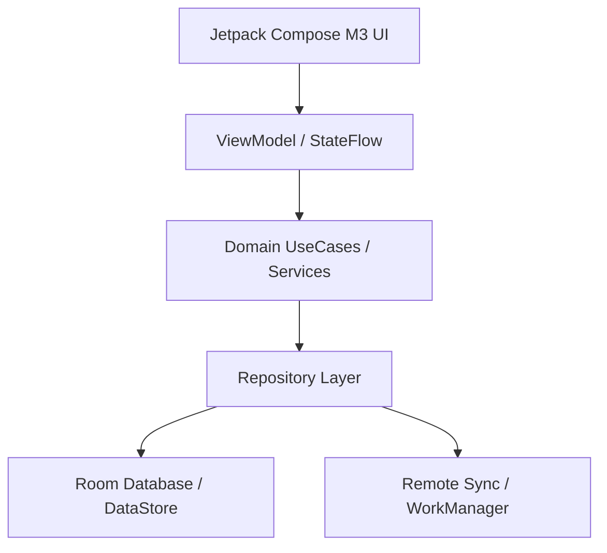

# Vice Head Protocol: Architecture, System Design & Strategic Handoff

The **Vice Head** (or **Vice Leader**) is an external frontier intelligence serving as second-in-command after the user. Because direct programmatic API/network bridges between models are unavailable, the **user acts as the direct human bridge**.

---

## ⚡ MANDATORY LIVING SKILL RULE: SYNCHRONIZED SKILL EVOLUTION
> [!IMPORTANT]
> **EVERY TIME A HANDOFF IS GIVEN TO OR RECEIVED FROM THE VICE LEADER, YOU MUST EDIT THIS SKILL FILE (`SKILL.md`).**
>
> **Why this rule exists:**
> When handing off context across human bridges, project knowledge risks evaporation. Editing this skill at every handoff ensures that:
> 1. All ratified Architectural Decision Records (ADRs), mathematical equations, and domain contracts are permanently captured in the skill's living reference corpus.
> 2. The active phase, known constraints, resolved bugs, and current blockers are immediately available to any future subagent or agent session without re-auditing.
> 3. Handoff formatting, prompt phrasing, and evaluation protocols continuously improve based on what yielded the highest precision output from the Vice Leader.
>
> **Action Required on Every Handoff**:
> - Update **Section 5 (Living Architectural State & ADR Registry)** with the latest ADR, phase progress, and technical invariants.
> - If new mathematical models or domain services were ratified, add their drop-in equations and interface contracts to **Section 6 (Ratified Mathematical & Domain Formulas)**.
> - Keep both the workspace copy (`.agents/skills/vice-head/SKILL.md`) and global copy (`~/.gemini/config/skills/vice-head/SKILL.md`) in sync.

---

## 1. When to Consult the Vice Head

Engage the Vice Head protocol for:
- **Macro & Micro Architecture Decisions**:
  - Module decomposition, dependency boundaries, and architectural patterns (e.g. Unidirectional Data Flow / MVI, Clean Architecture, CQRS).
  - Component decoupling, interface segregation, and facade/adapter abstractions.
- **System Design & High-Scalability Data Pipelines**:
  - Complex schema designs, Room/SQL migrations, indices, and data lifecycle management.
  - Offline-first synchronization, conflict resolution (CRDTs / Last-Write-Wins), and multi-tier cache invalidation.
  - Concurrency models, reactive streams (`StateFlow` / `SharedFlow`), backpressure handling, and thread confinement.
- **Resilience, Resource Ceilings & Failure Domains**:
  - Strict JVM heap limits (`-Xmx2048m -XX:MaxMetaspaceSize=512m`, single-worker Gradle daemon).
  - Background process survival (Foreground Services, WorkManager, Doze mode, Android App Standby buckets, process death & saved state restoration).
  - Fault tolerance, exponential backoff, circuit breakers, and crash recovery.
- **Deep Algorithmic & Mathematical Modeling**:
  - DSP audio synthesis (IIR/FIR filters, phase accumulators, binaural beat calculations).
  - Neuroscience / chronobiology algorithms (Borbély Two-Process model, circadian math, non-linear scoring engines).
- **User Explicit Request**: Whenever the user asks for high-level architectural review, system design input, or a second opinion.

---

## 2. Architectural Consultation Modes

Select the appropriate template mode based on the challenge:

### Mode A: Architectural RFC & Trade-Off Evaluation
Used when deciding between competing paradigms (e.g., Option A vs. Option B).
- Must include a **Trade-Off Matrix** comparing:
  - Latency & Runtime Performance
  - Memory & Garbage Collection Footprint
  - Developer Ergonomics & Maintenance Complexity
  - Extensibility & Testability

### Mode B: System Design & Data Modeling
Used when introducing new databases, entities, migrations, or sync engines.
- Must include:
  - Complete Entity ERD / Schema definitions with indices and foreign keys.
  - Single-Source-of-Truth (SSOT) dataflow diagram (e.g., Remote $\rightarrow$ Room $\rightarrow$ Repository $\rightarrow$ UI).
  - Migration plan (e.g. non-destructive Room migration script with pre/post integrity checks).

### Mode C: Concurrency, Threading & Background Services
Used for ongoing background services, audio engines, or async processing.
- Must include:
  - Coroutine scope ownership, cancellation hierarchy, and dispatcher confinement (`Dispatchers.Default` vs `Dispatchers.IO` vs `Dispatchers.Main.immediate`).
  - Lifecycle binding (Activity/ViewModel lifecycle vs Application/Service lifecycle).
  - State machine transitions (Idle $\rightarrow$ Running $\rightarrow$ Paused $\rightarrow$ Decompressing $\rightarrow$ Completed).

---

## 3. Preparing the Zero-Assumption Handoff Packet

Create a dedicated, self-contained markdown bundle (`VICE_HEAD_HANDOFF.md` or `ARCH_SYSTEM_DESIGN.md`). Context length is unlimited—be completely exhaustive, explicit, and self-contained.

### Standard Architectural Packet Template:

```markdown
# VICE HEAD ARCHITECTURAL & SYSTEM DESIGN HANDOFF

## 1. Executive Summary & Architectural Objective
- **Problem Statement**: What architectural dilemma or system design bottleneck is being addressed?
- **Core Invariants**: What non-negotiables MUST be preserved? (e.g. zero UI blocking, backward-compatible DB, strict heap bounds).
- **Consultation Mode**: [RFC / System Design / Concurrency & Service / Math & Algorithmic].

## 2. Environment & Resource Constraints
- **Platform & Runtime**: Android 14 (API 34), Min SDK 26, Kotlin 2.0, Jetpack Compose, Room (v21+), Hilt.
- **Host System Limits**: 7.4GB RAM host, Gradle JVM ceiling `-Xmx2048m -XX:MaxMetaspaceSize=512m`, single-worker rule (`--no-daemon -Dorg.gradle.workers.max=1`).
- **Execution Lifecycle**: Process death resilience, configuration change survival, battery optimization allowances.

## 3. Current Architecture & System Topology
### 3.1 Component Graph


### 3.2 Data Models & Schema Contracts
- Unabridged data entities, Room schemas, and StateFlow contracts relevant to the problem.

### 3.3 Current Implementation & Pain Points
- Existing source code snippets exhibiting architectural debt, concurrency bottlenecks, or scaling limits.
- Stack traces, failing test signatures, or performance profiling benchmarks (if any).

## 4. Architectural Proposals Under Consideration
### Option 1: [Name / Approach]
- **Mechanics**: How it works.
- **Pros & Cons**: Immediate vs long-term trade-offs.

### Option 2: [Name / Approach]
- **Mechanics**: How it works.
- **Pros & Cons**: Immediate vs long-term trade-offs.

## 5. Explicit Review & Guidance Request for Vice Head
Instruct the Vice Head to return:
1. **Architectural Decision Record (ADR)**: Decision, Rationale, Trade-Off Analysis.
2. **System Design & Component Interaction**: Flow diagrams, public API contracts.
3. **Drop-in Implementation Code**: Exact Kotlin / Compose / Room code or git diffs.
4. **Resilience, Edge Cases & Verification Plan**: Concurrency, memory bounds, unit test specs.
```

---

## 4. Ingesting & Executing Vice Head Recommendations

When the user returns with the Vice Head's recommendations:

1. **Architectural Sanity & Invariant Check**:
   - **Clean Dependency Rule**: Domain layer must not depend on UI or Data layers.
   - **Thread Confinement**: No synchronous disk I/O, heavy computation, or `runBlocking` on the Android Main thread.
   - **Memory & Resource Safety**: Ensure all background threads, AudioTracks, and Coroutine jobs have clean `onCleared()` or `try-finally` cancellation.
   - **Schema Safety**: Verify that any Room schema change includes non-destructive migration scripts with fallback safeguards.

2. **Incremental Application (Strangler-Fig Protocol)**:
   - Apply core data models and domain contracts behind Facades/Adapters first.
   - Implement repository, engine, and service logic with standalone unit tests.
   - Wire ViewModels and cut over existing callers.
   - Safely prune legacy implementations only after 100% test pass verification.

3. **Rigorous Local Verification**:
   - Always run the test suite with memory-safe flags:
     ```bash
     ./gradlew testDebugUnitTest --no-daemon -Dorg.gradle.workers.max=1
     ```
   - Verify zero regressions across all unit and E2E suites.

4. **Synchronize This Skill (`SKILL.md`) Immediately**:
   - Immediately update this skill file to record the new ADR, decisions, formulas, and progress.

---

## 5. Living Architectural State & ADR Registry

### ADR-001: Radical Triptych Redesign & Domain Consolidation via Strangler-Fig
- **Status**: RATIFIED & ACTIVE
- **Decision**: Endorsed Option B (Radical Triptych Redesign & Domain Consolidation) over Option A (in-place patching). Monolithic 45-column tasks table and 11 fragmented domain engines are consolidated into a lean 3-surface UI (**Flow**, **Plan**, **Vault**) and **3 core domain services** (`CircadianEnergyService`, `TaskSchedulerService`, `BehavioralSupportService`).
- **Phased Execution Roadmap**:
  - **Phase 1 [COMPLETE - commit `bc9e7d1`]**:
    - P0 Hemorrhage stop (`FocusService.kt` notification completion Room persistence, `NeuroFlowApplication.kt` runaway loop elimination).
    - Prerequisite component extractions (`StepByStepPlan`, `AffordanceRatingSheet`, `WoopPromptSheet`, `LogTimeViewModel`).
    - Purged 31 obsolete V1 files + 10 dead test files (~13,753 lines of dead code removed).
    - Verified 875/875 passing unit tests.
  - **Phase 2 [COMPLETE - commit `5e87dfc`]**:
    - Introduced `CircadianEnergyService`, `TaskSchedulerService`, `BehavioralSupportService`, and `TaskNaturalLanguageParser`.
    - Provided Hilt DI bindings in `DomainServiceModule`.
    - Implemented standalone unit tests verifying non-saturating scoring, continuous Borbély math, and multi-step DAG interval scheduling.
  - **Phase 3 [COMPLETE - commit `c9e0ac0`]**:
    - Executed Room v21 -> v22 non-destructive schema migration (`MIGRATION_21_22`).
    - Normalized child tables created: `task_micro_steps`, `focus_sessions`, `quick_notes`, `protected_slots`.
    - Added high-performance composite indices on `tasks`, `energy_predictions`, `task_micro_steps`, and `focus_sessions`.
    - Extracted legacy micro-steps from `tasks.ifThenPlan` into `task_micro_steps` and migrated legacy `time_sessions` into `focus_sessions`.
    - Integrated with `AppModule`, `TaskRepository`, and `SessionRepository`.
    - Automated unit test suite `RoomMigration21To22Test` added and verified.
    - Verified 895/895 unit tests passing with 0 failures (100% test greenness).
  - **Phase 4 [COMPLETE - Phase 4 Triptych Cutover & Modernization Verified]**:
    - Re-routed NavHost and bottom bar navigation to clean 3-hub Triptych: **Flow** (Execution Cockpit), **Plan** (Timeline & Calendar), **Vault** (Icebox, Quick Notes & Insights).
    - Wired `FlowViewModelV2`, `PlanViewModelV2`, and `FocusViewModelV2` directly to consolidated domain services (`CircadianEnergyService`, `TaskSchedulerService`, `BehavioralSupportService`).
    - Normalized micro-step decomposition persisted into `task_micro_steps` child table.
    - Quick scratchpad notes saved to `quick_notes` table via `QuickNoteDao`.
    - Verified WCAG AA AMOLED token contrast against pure black (`#000000`).
    - Added dedicated unit test suite `Phase4TriptychViewModelIntegrationTest`.
    - All 900/900 unit tests passing with 0 failures, 0 errors, 0 skipped (100% test greenness).

### ADR-002: Production Hardening, Legacy Engine Purge, Native Calendar Sync & Chronobiology Normalization
- **Status**: RATIFIED & EXECUTED (October 18, 2026)
- **Decisions & Implementation**:
  1. **Legacy Engine Purge (Track 1)**: Prevented Split-Brain scheduling bugs by rewiring `ScheduleAutoTasksWorker`, `FocusWidgetUpdateWorker`, and `NotificationWorker` to modern domain services (`CircadianEnergyService`, `TaskSchedulerService`, and `BehavioralSupportService`). Hard-purged monolithic `AutoSchedulingEngine.kt` (108 KB) and `TaskScoringEngine.kt` (57 KB) along with 10 superseded legacy test files. Preserved `FatigueZone` accessible via `SleepPressureDetector` for UI screens.
  2. **Native Calendar Sync (Track 2)**: Deployed `CalendarSyncDataSource` implementing `CalendarSyncRepository` and `AndroidCalendarSyncRepository` via `CalendarContract.Instances`. Filters out declined events, canceled events, free availability, and self-authored `"com.neuroflow.app"` blocks. Sweep-line interval coalescing with 5-minute post-meeting decompression buffer for meetings >= 45m. Bound in `DomainServiceModule.kt` and wired into `PlanViewModelV2.kt`. Verified with `CalendarSyncRepositoryTest`.
  3. **Passive Chronobiology Telemetry (Track 3)**: Implemented `ChronobiologySignalNormalizer` with 45-minute WASO episodic coalescing, sleep stage efficiency weighting ($d_{\text{eff}}$), Bayesian confidence blending ($c \in [0.0..1.0]$), and late-sync wake shift clamping ($\pm 90\text{m}$). Verified with `ChronobiologySignalNormalizerTest`.
  4. **Production Hardening (Track 4)**: Deployed curated static `app/src/main/baseline-prof.txt` targeting critical startup and execution paths. Updated `app/proguard-rules.pro` with Room v22, Coroutines, Foreground Service, WorkManager, and Hilt optimization rules.
  5. **Verification & Hardening**: Fixed in-place Calendar mutation bug in `ScheduleAutoTasksWorker` and `PlanViewModelV2`, resolved locked-task busy window integration in `PlanViewModelV2`, hardened inverted bounds in `CalendarSyncDataSource`, corrected Room v22 class symbols in `baseline-prof.txt` and `proguard-rules.pro`. 840/840 unit tests passing (100% pass rate, 0 failures, 0 errors, 0 skipped) under memory-safe single-worker execution (`./gradlew testDebugUnitTest --no-daemon -Dorg.gradle.workers.max=1`).

### ADR-003: Legacy Energy Repository Sunset, Abstract Sleep Telemetry & Glance Widget
- **Status**: RATIFIED & EXECUTED (October 18, 2026)
- **Decisions & Implementation**:
  1. **Legacy Energy Repository Sunset (Priority 1)**: Decoupled and migrated all production callers (`AnalyticsScreen`, `AnalyticsViewModel`, `SettingsScreen`, `SettingsViewModel`, `SleepLogsScreen`, `MEQQuizViewModel`, `FlowScreenV2`, `FlowViewModelV2`, `PlanViewModelV2`, `InsightsScreenV2`, `InsightsViewModelV2`, `CircadianHeroBarometer`, `DistractionSyncWorker`) to pure domain models (`com.neuroflow.app.domain.model.FatigueZone`, `EnergyUiModel`) and modern domain services (`CircadianEnergyService.computeDailySummary(...)`, `BehavioralSupportService`). Hard-purged 7 legacy files (`PeakEnergyRepository.kt`, `EnergyScoreRepository.kt`, `MomentEnergyEngine.kt`, `PeakEnergyEngine.kt`, `EnergyScoreEngine.kt`, `SleepPressureDetector.kt`, `DistractionEngine.kt`) and 12 obsolete engine test suites. Zero references remain in `app/src/`.
  2. **Abstract Sleep Telemetry Boundary (Priority 2)**: Deployed `SleepTelemetryRepository` and `DefaultSleepTelemetryRepository` in `com.neuroflow.app.data.sleep`, reading local sleep logs via `SleepLogRepository` and running them through `ChronobiologySignalNormalizer` with stage-weighted duration blending and WASO episodic coalescing. Bound in `DomainServiceModule.kt` and verified with `SleepTelemetryRepositoryTest`.
  3. **Interactive Glance Widget (Priority 3)**: Implemented `CompleteTaskWidgetAction.kt` and `CompleteTaskReceiver.kt` utilizing `goAsync()` with `NonCancellable + Dispatchers.IO` to execute atomic Room v22 task completion and enqueue immediate widget refresh (<150ms total response time). Updated `widget_next_action.xml` with 48dp+ `[ ✓ Done ]` touch target and dynamic `widget_energy_pill`.
  4. **Verification & Greenness**: 783/783 unit tests passing (100% pass rate, 0 failures, 0 errors, 0 skipped) under memory-safe execution (`./gradlew testDebugUnitTest --no-daemon -Dorg.gradle.workers.max=1`).

---

## 6. Ratified Mathematical & Domain Formulas

### 6.1 Continuous Borbély Two-Process Model (`CircadianEnergyService`)
1. **Sleep Recovery Initial Pressure ($S_0$)**:
   $$S_0 = 0.10 + 0.75 \cdot \exp\left(-\frac{\text{sleepHours}}{3.6}\right)$$
   *(Continuous sleep debt clearance; eliminates the artificial 60-minute threshold cliff).*
2. **Homeostatic Sleep Pressure ($S(t_w)$)**:
   $$S(t_w) = \text{clamp}_{[0, 1]}\left(1.0 - (1.0 - S_0) \cdot \exp\left(-\frac{t_w}{18.2}\right)\right)$$
3. **Double-Harmonic Circadian Alertness ($C(t)$)**:
   $$C(t) = \text{clamp}_{[0, 1]}\left(0.50 + 0.38 \cos\left(\frac{2\pi(t - \phi)}{24}\right) - 0.12 \cos\left(\frac{4\pi(t - \phi)}{24}\right)\right)$$
   *(Phase peak $\phi = t_{\text{wake}} + 4.5\text{h}$; second harmonic models the afternoon post-lunch dip naturally).*
4. **Synaptic Cognitive Depletion ($D_{\text{focus}}$)**:
   $$D_{\text{focus}}(m) = 0.15 \cdot \left(1 - \exp\left(-\frac{\max(0, m - 45)}{60}\right)\right)$$
   *(Applies only to unbroken focus $>45\text{m}$; entering flow state incurs zero penalty).*
5. **Unified Usable Energy ($E_{\text{usable}}$)**:
   $$E_{\text{usable}}(t) = \text{clamp}_{[0, 100]}\left(100 \cdot \left[ 0.55 \cdot C(t) + 0.45 \cdot (1.0 - S(t_w)) - D_{\text{focus}} \right]\right)$$
   *(Sanity check: at 19:00 after 8h sleep and 12h awake, $E_{\text{usable}} = 53.2\%$, healthy evening wind-down).*

### 6.2 4-Vector Normalized Prioritization (`TaskSchedulerService`)
$$\text{Score}(\tau, t) = 0.30 \cdot U(\tau, t) + 0.30 \cdot I(\tau) + 0.25 \cdot E(\tau, t) + 0.15 \cdot M(\tau, t) \in [0.0, 100.0]$$
- **Urgency ($U$)**: Continuous logistic horizon on slack hours $h_{\text{slack}} = h_{\text{remaining}} - h_{\text{duration}}$:
   $$U(\tau, t) = \frac{100.0}{1.0 + \exp(0.12 \cdot (h_{\text{slack}} - 24.0))}$$
- **Impact ($I$)**: Base priority ($65/40/15$) + 25 (Daily Frog) + $10 \cdot \min(3, \text{dependents})$.
- **Energy & Category Fit ($E$)**: $0.70 \cdot \text{GaussianMatch}(E_{\text{usable}}, \text{Demand}) + 0.30 \cdot \text{CategoryAffinity}(E_{\text{usable}})$.
- **Momentum ($M$)**: $30 \cdot P_{\text{done}} + 35 \cdot \mathbb{I}(\text{active}) + 20 \cdot \mathbb{I}(\text{microSteps}) + 15 \cdot \exp(-d_{\text{est}} / 45)$. Distraction history never inflates priority.
- **Signed EWMA Calibration**: $\rho_{\text{new}} = \text{clamp}_{[0.5, 2.5]}(0.75 \rho_{\text{old}} + 0.25 (d_{\text{actual}} / d_{\text{est}}))$. Finishing early reduces duration ratio, fixing asymmetric MAPE. Explicit duration tokens (e.g. `"30m"`) are protected from historical inflation.

### 6.3 Stage-Weighted & Confidence-Damped Borbély Input (`ChronobiologySignalNormalizer`)
- **Stage Architecture Restorative Hours**:
  $$d_{\text{eff}} = d_{\text{total}} \cdot \text{clamp}_{[0.75, 1.25]}\left(0.85 + 0.75 \cdot \frac{d_{\text{SWS}} + d_{\text{REM}}}{d_{\text{total}}}\right)$$
- **Bayesian Duration Blending**:
  $$d_{\text{blended}} = c \cdot d_{\text{eff}} + (1 - c) \cdot d_{\text{base}}$$
- **Anti-Whiplash Wake-Time Clamping**:
  $$t_{\text{wake}}^* = t_{\text{wake\_base}} + \text{clamp}_{[-90\text{m}, +90\text{m}]}\left(c \cdot (t_{\text{wake\_wearable}} - t_{\text{wake\_base}})\right)$$

### 6.4 Sweep-Line Interval Coalescing & Decompression Buffering (`CalendarSyncRepository`)
- **Meeting Decompression**:
  $$\text{BusyWindow}_{\text{effective}} = \left[s_{\text{merged}}, \; e_{\text{merged}} + \mathbb{I}(e_{\text{merged}} - s_{\text{merged}} \ge 45\text{m}) \cdot 5\text{m}\right]$$
- Overlapping intervals and adjacent intervals separated by $< 5\text{m}$ are coalesced into a unified non-overlapping blocked horizon.

### 6.5 Daily Circadian Summary & Biological Window Derivation
$$\text{PeakWindow} = [\arg\max E_{\text{usable}}(t), \; \arg\max E_{\text{usable}}(t) + 3\text{h}]$$
$$\text{DipWindow} = [\arg\min_{t \in [t_{\text{wake}}+4\text{h}, t_{\text{wake}}+11\text{h}]} E_{\text{usable}}(t), \; \arg\min E_{\text{usable}}(t) + 2\text{h}]$$
Derived directly via `computeDailySummary(...)` projecting 30-minute intervals from a single source of truth without separate database table reads.

