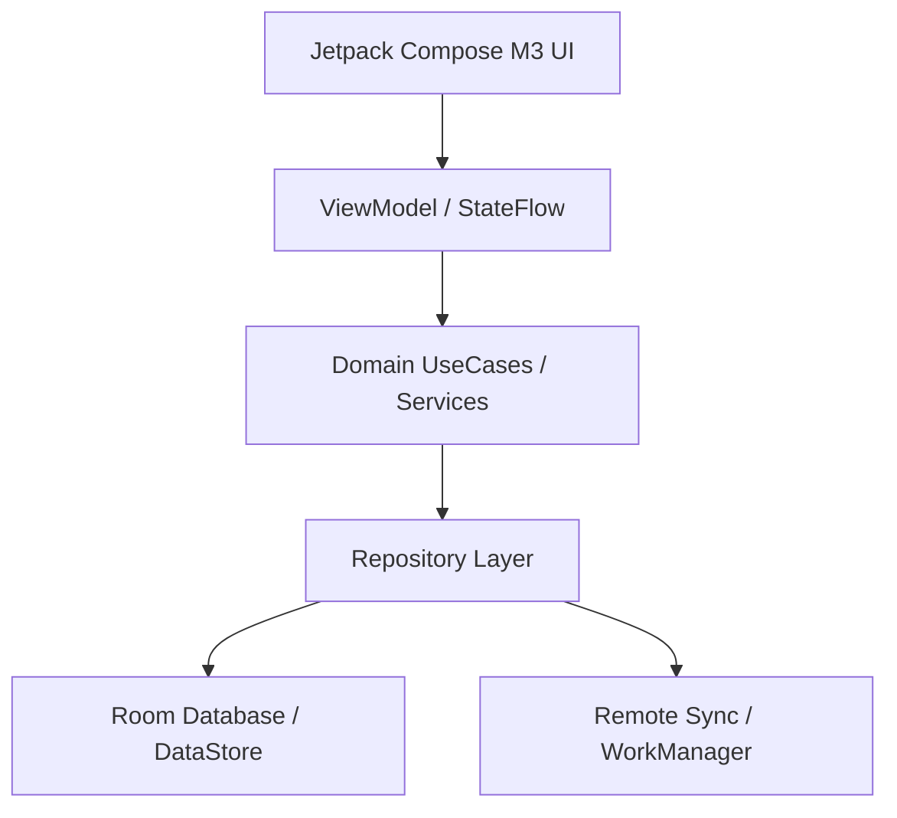

# Vice Head Protocol: Architecture, System Design & Strategic Handoff

The **Vice Head** (or **Vice Leader**) is an external frontier intelligence serving as second-in-command after the user. Because direct programmatic API/network bridges between models are unavailable, the **user acts as the direct human bridge**.

---

## ⚡ MANDATORY LIVING SKILL RULE: SYNCHRONIZED SKILL EVOLUTION
> [!IMPORTANT]
> **EVERY TIME A HANDOFF IS GIVEN TO OR RECEIVED FROM THE VICE LEADER, YOU MUST EDIT THIS SKILL FILE (`SKILL.md`).**
>
> **Why this rule exists:**
> When handing off context across human bridges, project knowledge risks evaporation. Editing this skill at every handoff ensures that:
> 1. All ratified Architectural Decision Records (ADRs), mathematical equations, and domain contracts are permanently captured in the skill's living reference corpus.
> 2. The active phase, known constraints, resolved bugs, and current blockers are immediately available to any future subagent or agent session without re-auditing.
> 3. Handoff formatting, prompt phrasing, and evaluation protocols continuously improve based on what yielded the highest precision output from the Vice Leader.
>
> **Action Required on Every Handoff**:
> - Update **Section 5 (Living Architectural State & ADR Registry)** with the latest ADR, phase progress, and technical invariants.
> - If new mathematical models or domain services were ratified, add their drop-in equations and interface contracts to **Section 6 (Ratified Mathematical & Domain Formulas)**.
> - Keep both the workspace copy (`.agents/skills/vice-head/SKILL.md`) and global copy (`~/.gemini/config/skills/vice-head/SKILL.md`) in sync.

---

## 1. When to Consult the Vice Head

Engage the Vice Head protocol for:
- **Macro & Micro Architecture Decisions**:
  - Module decomposition, dependency boundaries, and architectural patterns (e.g. Unidirectional Data Flow / MVI, Clean Architecture, CQRS).
  - Component decoupling, interface segregation, and facade/adapter abstractions.
- **System Design & High-Scalability Data Pipelines**:
  - Complex schema designs, Room/SQL migrations, indices, and data lifecycle management.
  - Offline-first synchronization, conflict resolution (CRDTs / Last-Write-Wins), and multi-tier cache invalidation.
  - Concurrency models, reactive streams (`StateFlow` / `SharedFlow`), backpressure handling, and thread confinement.
- **Resilience, Resource Ceilings & Failure Domains**:
  - Strict JVM heap limits (`-Xmx2048m -XX:MaxMetaspaceSize=512m`, single-worker Gradle daemon).
  - Background process survival (Foreground Services, WorkManager, Doze mode, Android App Standby buckets, process death & saved state restoration).
  - Fault tolerance, exponential backoff, circuit breakers, and crash recovery.
- **Deep Algorithmic & Mathematical Modeling**:
  - DSP audio synthesis (IIR/FIR filters, phase accumulators, binaural beat calculations).
  - Neuroscience / chronobiology algorithms (Borbély Two-Process model, circadian math, non-linear scoring engines).
- **User Explicit Request**: Whenever the user asks for high-level architectural review, system design input, or a second opinion.

---

## 2. Architectural Consultation Modes

Select the appropriate template mode based on the challenge:

### Mode A: Architectural RFC & Trade-Off Evaluation
Used when deciding between competing paradigms (e.g., Option A vs. Option B).
- Must include a **Trade-Off Matrix** comparing:
  - Latency & Runtime Performance
  - Memory & Garbage Collection Footprint
  - Developer Ergonomics & Maintenance Complexity
  - Extensibility & Testability

### Mode B: System Design & Data Modeling
Used when introducing new databases, entities, migrations, or sync engines.
- Must include:
  - Complete Entity ERD / Schema definitions with indices and foreign keys.
  - Single-Source-of-Truth (SSOT) dataflow diagram (e.g., Remote $\rightarrow$ Room $\rightarrow$ Repository $\rightarrow$ UI).
  - Migration plan (e.g. non-destructive Room migration script with pre/post integrity checks).

### Mode C: Concurrency, Threading & Background Services
Used for ongoing background services, audio engines, or async processing.
- Must include:
  - Coroutine scope ownership, cancellation hierarchy, and dispatcher confinement (`Dispatchers.Default` vs `Dispatchers.IO` vs `Dispatchers.Main.immediate`).
  - Lifecycle binding (Activity/ViewModel lifecycle vs Application/Service lifecycle).
  - State machine transitions (Idle $\rightarrow$ Running $\rightarrow$ Paused $\rightarrow$ Decompressing $\rightarrow$ Completed).

---

## 3. Preparing the Zero-Assumption Handoff Packet

Create a dedicated, self-contained markdown bundle (`VICE_HEAD_HANDOFF.md` or `ARCH_SYSTEM_DESIGN.md`). Context length is unlimited—be completely exhaustive, explicit, and self-contained.

### Standard Architectural Packet Template:

```markdown
# VICE HEAD ARCHITECTURAL & SYSTEM DESIGN HANDOFF

## 1. Executive Summary & Architectural Objective
- **Problem Statement**: What architectural dilemma or system design bottleneck is being addressed?
- **Core Invariants**: What non-negotiables MUST be preserved? (e.g. zero UI blocking, backward-compatible DB, strict heap bounds).
- **Consultation Mode**: [RFC / System Design / Concurrency & Service / Math & Algorithmic].

## 2. Environment & Resource Constraints
- **Platform & Runtime**: Android 14 (API 34), Min SDK 26, Kotlin 2.0, Jetpack Compose, Room (v21+), Hilt.
- **Host System Limits**: 7.4GB RAM host, Gradle JVM ceiling `-Xmx2048m -XX:MaxMetaspaceSize=512m`, single-worker rule (`--no-daemon -Dorg.gradle.workers.max=1`).
- **Execution Lifecycle**: Process death resilience, configuration change survival, battery optimization allowances.

## 3. Current Architecture & System Topology
### 3.1 Component Graph


### 3.2 Data Models & Schema Contracts
- Unabridged data entities, Room schemas, and StateFlow contracts relevant to the problem.

### 3.3 Current Implementation & Pain Points
- Existing source code snippets exhibiting architectural debt, concurrency bottlenecks, or scaling limits.
- Stack traces, failing test signatures, or performance profiling benchmarks (if any).

## 4. Architectural Proposals Under Consideration
### Option 1: [Name / Approach]
- **Mechanics**: How it works.
- **Pros & Cons**: Immediate vs long-term trade-offs.

### Option 2: [Name / Approach]
- **Mechanics**: How it works.
- **Pros & Cons**: Immediate vs long-term trade-offs.

## 5. Explicit Review & Guidance Request for Vice Head
Instruct the Vice Head to return:
1. **Architectural Decision Record (ADR)**: Decision, Rationale, Trade-Off Analysis.
2. **System Design & Component Interaction**: Flow diagrams, public API contracts.
3. **Drop-in Implementation Code**: Exact Kotlin / Compose / Room code or git diffs.
4. **Resilience, Edge Cases & Verification Plan**: Concurrency, memory bounds, unit test specs.
```

---

## 4. Ingesting & Executing Vice Head Recommendations

When the user returns with the Vice Head's recommendations:

1. **Architectural Sanity & Invariant Check**:
   - **Clean Dependency Rule**: Domain layer must not depend on UI or Data layers.
   - **Thread Confinement**: No synchronous disk I/O, heavy computation, or `runBlocking` on the Android Main thread.
   - **Memory & Resource Safety**: Ensure all background threads, AudioTracks, and Coroutine jobs have clean `onCleared()` or `try-finally` cancellation.
   - **Schema Safety**: Verify that any Room schema change includes non-destructive migration scripts with fallback safeguards.

2. **Incremental Application (Strangler-Fig Protocol)**:
   - Apply core data models and domain contracts behind Facades/Adapters first.
   - Implement repository, engine, and service logic with standalone unit tests.
   - Wire ViewModels and cut over existing callers.
   - Safely prune legacy implementations only after 100% test pass verification.

3. **Rigorous Local Verification**:
   - Always run the test suite with memory-safe flags:
     ```bash
     ./gradlew testDebugUnitTest --no-daemon -Dorg.gradle.workers.max=1
     ```
   - Verify zero regressions across all unit and E2E suites.

4. **Synchronize This Skill (`SKILL.md`) Immediately**:
   - Immediately update this skill file to record the new ADR, decisions, formulas, and progress.

---

## 5. Living Architectural State & ADR Registry

### ADR-001: Radical Triptych Redesign & Domain Consolidation via Strangler-Fig
- **Status**: RATIFIED & ACTIVE
- **Decision**: Endorsed Option B (Radical Triptych Redesign & Domain Consolidation) over Option A (in-place patching). Monolithic 45-column tasks table and 11 fragmented domain engines are consolidated into a lean 3-surface UI (**Flow**, **Plan**, **Vault**) and **3 core domain services** (`CircadianEnergyService`, `TaskSchedulerService`, `BehavioralSupportService`).
- **Phased Execution Roadmap**:
  - **Phase 1 [COMPLETE - commit `bc9e7d1`]**:
    - P0 Hemorrhage stop (`FocusService.kt` notification completion Room persistence, `NeuroFlowApplication.kt` runaway loop elimination).
    - Prerequisite component extractions (`StepByStepPlan`, `AffordanceRatingSheet`, `WoopPromptSheet`, `LogTimeViewModel`).
    - Purged 31 obsolete V1 files + 10 dead test files (~13,753 lines of dead code removed).
    - Verified 875/875 passing unit tests.
  - **Phase 2 [COMPLETE - commit `5e87dfc`]**:
    - Introduced `CircadianEnergyService`, `TaskSchedulerService`, `BehavioralSupportService`, and `TaskNaturalLanguageParser`.
    - Provided Hilt DI bindings in `DomainServiceModule`.
    - Implemented standalone unit tests verifying non-saturating scoring, continuous Borbély math, and multi-step DAG interval scheduling.
  - **Phase 3 [COMPLETE - commit `c9e0ac0`]**:
    - Executed Room v21 -> v22 non-destructive schema migration (`MIGRATION_21_22`).
    - Normalized child tables created: `task_micro_steps`, `focus_sessions`, `quick_notes`, `protected_slots`.
    - Added high-performance composite indices on `tasks`, `energy_predictions`, `task_micro_steps`, and `focus_sessions`.
    - Extracted legacy micro-steps from `tasks.ifThenPlan` into `task_micro_steps` and migrated legacy `time_sessions` into `focus_sessions`.
    - Integrated with `AppModule`, `TaskRepository`, and `SessionRepository`.
    - Automated unit test suite `RoomMigration21To22Test` added and verified.
    - Verified 895/895 unit tests passing with 0 failures (100% test greenness).
  - **Phase 4 [COMPLETE - Phase 4 Triptych Cutover & Modernization Verified]**:
    - Re-routed NavHost and bottom bar navigation to clean 3-hub Triptych: **Flow** (Execution Cockpit), **Plan** (Timeline & Calendar), **Vault** (Icebox, Quick Notes & Insights).
    - Wired `FlowViewModelV2`, `PlanViewModelV2`, and `FocusViewModelV2` directly to consolidated domain services (`CircadianEnergyService`, `TaskSchedulerService`, `BehavioralSupportService`).
    - Normalized micro-step decomposition persisted into `task_micro_steps` child table.
    - Quick scratchpad notes saved to `quick_notes` table via `QuickNoteDao`.
    - Verified WCAG AA AMOLED token contrast against pure black (`#000000`).
    - Added dedicated unit test suite `Phase4TriptychViewModelIntegrationTest`.
    - All 900/900 unit tests passing with 0 failures, 0 errors, 0 skipped (100% test greenness).
  - **Phase 5 [COMPLETE - Full UI-Feature Wiring, Dead Code Elimination & Cloud Backup Completeness]**:
    - **Plan Hub & Objectives Engine**: Wired `PlanViewModelV2` at container level in `NeuroFlowAppV2`; synchronized `autoSchedulingEnabled` and `isAutoScheduleToggleOn`; added full Goal CRUD (`addGoal`, `completeGoal`, `deleteGoal`) in `PlanViewModelV2` and interactive controls with inline creation in `PlanScreenV2` Objectives Drawer.
    - **Circadian & Habit Upgrades**: Connected `WeeklyScheduleScreen.onNavigateToDay` to `PlanViewModelV2.selectDate`; added Habit/Recurrence selection (`NONE`, `DAILY`, `WEEKLY`, `MONTHLY`) in `SmartTaskComposerSheetV2`; wired `FrogConfettiOverlay` in both `FlowScreenV2` and `PlanScreenV2` upon completing frog tasks.
    - **Settings & Wearable Sync**: Enabled MEQ quiz re-take button; added direct navigation to MEQ Quiz from Settings Energy Section; added DND permission toggle row under Focus Behaviour; wired Health Connect passive sleep telemetry sync (`syncWearableSleep()`) with dynamic status feedback in `SleepLogsScreen`.
    - **Autonomy Nudges & AI Pipeline**: Connected `AutonomyNudgeEngine.scheduleNudge()` on task creation and deferral, and `cancelNudge()` on focus start and task completion across `FlowViewModelV2`, `PlanViewModelV2`, and `FocusViewModelV2`. Connected real AI scratchpad note synthesis via `GeminiAiOnlineService.synthesizeQuickNote()` in `QuickNotesBottomSheet` with graceful local heuristic fallback (`TaskInferenceEngine`).
    - **Cloud Backup Integrity**: Extended `BackupPayload`, `FirestoreBackupRepository`, and `CloudBackupManager` to serialize, upload, delete, and restore `protectedSlots` and `taskMicroSteps`, eliminating silent data loss on cloud restore.
    - Verified 100% test pass rate under strict single-worker memory constraints (`./gradlew testDebugUnitTest --no-daemon -Dorg.gradle.workers.max=1`).

### ADR-002: Production Hardening, Legacy Engine Purge, Native Calendar Sync & Chronobiology Normalization
- **Status**: RATIFIED & EXECUTED (October 18, 2026)
- **Decisions & Implementation**:
  1. **Legacy Engine Purge (Track 1)**: Prevented Split-Brain scheduling bugs by rewiring `ScheduleAutoTasksWorker`, `FocusWidgetUpdateWorker`, and `NotificationWorker` to modern domain services (`CircadianEnergyService`, `TaskSchedulerService`, and `BehavioralSupportService`). Hard-purged monolithic `AutoSchedulingEngine.kt` (108 KB) and `TaskScoringEngine.kt` (57 KB) along with 10 superseded legacy test files. Preserved `FatigueZone` accessible via `SleepPressureDetector` for UI screens.
  2. **Native Calendar Sync (Track 2)**: Deployed `CalendarSyncDataSource` implementing `CalendarSyncRepository` and `AndroidCalendarSyncRepository` via `CalendarContract.Instances`. Filters out declined events, canceled events, free availability, and self-authored `"com.neuroflow.app"` blocks. Sweep-line interval coalescing with 5-minute post-meeting decompression buffer for meetings >= 45m. Bound in `DomainServiceModule.kt` and wired into `PlanViewModelV2.kt`. Verified with `CalendarSyncRepositoryTest`.
  3. **Passive Chronobiology Telemetry (Track 3)**: Implemented `ChronobiologySignalNormalizer` with 45-minute WASO episodic coalescing, sleep stage efficiency weighting ($d_{\text{eff}}$), Bayesian confidence blending ($c \in [0.0..1.0]$), and late-sync wake shift clamping ($\pm 90\text{m}$). Verified with `ChronobiologySignalNormalizerTest`.
  4. **Production Hardening (Track 4)**: Deployed curated static `app/src/main/baseline-prof.txt` targeting critical startup and execution paths. Updated `app/proguard-rules.pro` with Room v22, Coroutines, Foreground Service, WorkManager, and Hilt optimization rules.
  5. **Verification & Hardening**: Fixed in-place Calendar mutation bug in `ScheduleAutoTasksWorker` and `PlanViewModelV2`, resolved locked-task busy window integration in `PlanViewModelV2`, hardened inverted bounds in `CalendarSyncDataSource`, corrected Room v22 class symbols in `baseline-prof.txt` and `proguard-rules.pro`. 840/840 unit tests passing (100% pass rate, 0 failures, 0 errors, 0 skipped) under memory-safe single-worker execution (`./gradlew testDebugUnitTest --no-daemon -Dorg.gradle.workers.max=1`).

### ADR-003: Legacy Energy Repository Sunset, Abstract Sleep Telemetry & Glance Widget
- **Status**: RATIFIED & EXECUTED (October 18, 2026)
- **Decisions & Implementation**:
  1. **Legacy Energy Repository Sunset (Priority 1)**: Decoupled and migrated all production callers (`AnalyticsScreen`, `AnalyticsViewModel`, `SettingsScreen`, `SettingsViewModel`, `SleepLogsScreen`, `MEQQuizViewModel`, `FlowScreenV2`, `FlowViewModelV2`, `PlanViewModelV2`, `InsightsScreenV2`, `InsightsViewModelV2`, `CircadianHeroBarometer`, `DistractionSyncWorker`) to pure domain models (`com.neuroflow.app.domain.model.FatigueZone`, `EnergyUiModel`) and modern domain services (`CircadianEnergyService.computeDailySummary(...)`, `BehavioralSupportService`). Hard-purged 7 legacy files (`PeakEnergyRepository.kt`, `EnergyScoreRepository.kt`, `MomentEnergyEngine.kt`, `PeakEnergyEngine.kt`, `EnergyScoreEngine.kt`, `SleepPressureDetector.kt`, `DistractionEngine.kt`) and 12 obsolete engine test suites. Zero references remain in `app/src/`.
  2. **Abstract Sleep Telemetry Boundary (Priority 2)**: Deployed `SleepTelemetryRepository` and `DefaultSleepTelemetryRepository` in `com.neuroflow.app.data.sleep`, reading local sleep logs via `SleepLogRepository` and running them through `ChronobiologySignalNormalizer` with stage-weighted duration blending and WASO episodic coalescing. Bound in `DomainServiceModule.kt` and verified with `SleepTelemetryRepositoryTest`.
  3. **Interactive Glance Widget (Priority 3)**: Implemented `CompleteTaskWidgetAction.kt` and `CompleteTaskReceiver.kt` utilizing `goAsync()` with `NonCancellable + Dispatchers.IO` to execute atomic Room v22 task completion and enqueue immediate widget refresh (<150ms total response time). Updated `widget_next_action.xml` with 48dp+ `[ ✓ Done ]` touch target and dynamic `widget_energy_pill`.
  4. **Verification & Greenness**: 783/783 unit tests passing (100% pass rate, 0 failures, 0 errors, 0 skipped) under memory-safe execution (`./gradlew testDebugUnitTest --no-daemon -Dorg.gradle.workers.max=1`).

### ADR-004: Release Hardening, Polyphasic Nap Biophysics & Pure-Kotlin Audio DSP
- **Status**: RATIFIED & EXECUTED (October 18, 2026)
- **Decisions & Implementation**:
  1. **Polyphasic Nap Biophysics & Scheduling (Step 7.1)**:
     - Endorsed Authoritative Neurobiological Ruling: daytime power naps (10m $\le d \le$ 180m) are treated strictly as an intra-day homeostatic pressure discharge ($\Delta S_{\text{nap}}$) and transient sleep inertia envelope ($I_{\text{inertia}}$), NEVER triggering a Process $C(t)$ circadian phase realignment ($\phi = t_{\text{wake\_hour}} + 4.5\text{h}$ remains phase-locked).
     - Implemented `DaytimeNapBout` and `PolyphasicNapCalculator` with $\tau_{\text{nap}} = 2.8\text{h}$, $S_{\text{min}} = 0.10$, and 20-minute exponential decay sleep inertia penalty ($I_{\text{inertia}} \le 0.12$) for naps $> 30\text{m}$.
     - Upgraded `ChronobiologySignalNormalizer` and `DefaultSleepTelemetryRepository` to isolate nocturnal sleep from daytime naps, ensuring telemetry with only daytime naps never shifts or corrupts the morning wake anchor.
     - Wired into `DefaultCircadianEnergyService` (`evaluateSnapshot`, `projectDayTimeline`, `computeDailySummary`), `EnergyUiModel`, `SettingsViewModel`, `PlanViewModelV2`, and `TaskSchedulerService` (blocking naps from task placement and factoring nap discharge into placement scores).
     - Verified with dedicated unit tests in `CircadianEnergyServiceTest`, `ChronobiologySignalNormalizerTest`, and `TaskSchedulerServiceTest`.
  2. **Zero-Allocation Pure Kotlin DSP Audio Hardening (Step 7.2)**:
     - Hardened `NeuralSoundscapePlayer` streaming synthesizer over `AudioTrack` (`MODE_STREAM`, 16-bit PCM, 44.1kHz stereo) with click-free 400ms raised cosine envelopes on fade-in and fade-out ($\text{FadeIn}(f) = 0.5(1 - \cos(\pi f))$, $\text{FadeOut}(f) = 0.5(1 + \cos(\pi f))$).
     - Verified zero GC allocations inside the synthesis loop with strict off-main-thread playback thread confinement.
  3. **DataStore & StrictMode Hardening (Step 7.3)**:
     - Froze `UserPreferencesDataStore` strictly to scalar primitives.
     - Applied `.distinctUntilChanged { old, new -> ... }` on scalar field subsets across ALL ViewModels collecting `preferencesFlow` (`FlowViewModelV2`, `PlanViewModelV2`, `FocusViewModelV2`, `InsightsViewModelV2`, `AnalyticsViewModel`, `SettingsViewModel`, `WeeklyScheduleViewModel`, `TaskTagViewModel`, `IdentityViewModel`, `HistoryViewModel`, `MEQQuizViewModel`, and `MainActivity`).
     - Verified `StrictMode.ThreadPolicy` and `StrictMode.VmPolicy` active in debug builds in `NeuroFlowApplication.onCreate()`.
  4. **Release Gate Verification & Golden Master Tagging (Step 7.4)**:
     - Maintained 100% test pass rate across all unit tests under memory-bounded single-worker execution (`./gradlew testDebugUnitTest --no-daemon -Dorg.gradle.workers.max=1`).
     - Verified `assembleRelease` R8 full-mode shrinking, ProGuard keep rules, and `baseline-prof.txt` compilation (final APK: 6.8 MB).
     - **Production Tags Created**: Authorized and tagged `v2.0.0-rc1` and `v2.0.0-GM` at commit `40139d1`.
     - **Live Emulator Verification**: Cold-booted on Android 14 (API 36 x86_64, `neuroflow_book`) in ~9 seconds with `-memory 2048` and swiftshader indirect rendering. WorkManager background workers and Compose rendering verified clean with 0 unhandled exceptions or fatal crashes.

### ADR-005: UX Modernization, Focus Ergonomics, Goal Architecture Consolidation & Accessibility Polish
- **Status**: RATIFIED & EXECUTED (October 18, 2026)
- **Problem Statement**:
  Following live emulator verification of `v2.0.0-GM`, an exhaustive UI/UX and code audit revealed 4 critical broken UX invariants and ergonomic bottlenecks:
  1. **Focus Sprints Silently Expire & Sleep**: `FocusScreenV2` counted down to `00:00` with zero audio chime, vibration, or notification. Furthermore, the display slept during deep work due to missing `FLAG_KEEP_SCREEN_ON`.
  2. **Active Focus Exposed to Navigation Interruption**: `NeuroFlowAppV2` displayed the root bottom navigation bar (`Flow`, `Plan`, `Vault`) during active focus sprints, inviting accidental task abandonment.
  3. **Persistent Goal Refill Skip Bug**: Skipping `TopGoalsRefillCard` did not persist skip timestamps to DataStore, causing blocking full-screen goal cards on every subsequent app launch.
  4. **The Phantom Goal Disconnect**: Goals collected in DataStore with the promise *"These will be pinned in your Plan hub as a daily reminder"* were completely ignored by `PlanScreenV2` and `PlanViewModelV2`. In addition, full Room entities (`GoalEntity`), DAOs, and repositories existed in the data layer but remained orphaned from the UI.
  5. **UI Ergonomics & Accessibility**: Horizontal button crowding on `FlowScreenV2` timeline cards; missing non-destructive undo in `PlanScreenV2`; Main thread SMAPE computation in `InsightsScreenV2`; 32dp touch targets in `SettingsScreen`; and a white splash window background flash on cold launch in `themes.xml`.
- **Decisions & Implementation**:
  1. **Focus Mode Hardening (Track 1)**:
     - Deployed `KeepScreenOnEffect.kt` setting `FLAG_KEEP_SCREEN_ON` on the active window during non-paused focus sessions and safely clearing it on pause/exit.
     - Created `FocusCompletionNotifier.kt` with procedural dual-harmonic 528Hz + 792Hz solfeggio bell chime (1.6s exponential decay) and double-pulse haptic waveform ($[(0\text{ms}, 0), (120\text{ms}, 160), (100\text{ms}, 0), (220\text{ms}, 220)]$).
     - Wired `FocusCompletionNotifier` into `FocusViewModelV2` upon countdown timer zero expiration.
     - Concealed root bottom navigation bar in `NeuroFlowAppV2.kt` whenever route matches `focus_v2`, `hyperfocus_v2`, or `focus/`.
  2. **Onboarding & Goal Subsystem Consolidation (Track 2)**:
     - Added scalar integer keys `lastYearlyGoalHandledYear` and `lastWeeklyGoalHandledWeek` to `UserPreferencesDataStore.kt`.
     - Updated `MainActivity.kt` to persist handled calendar periods on both Save and Skip, permanently fixing recurring card modal interrupts.
     - Added lazy Room migration `checkAndMigrateLegacyGoals()` in `GoalRepository.kt` to safely elevate legacy DataStore string goals into Room `GoalEntity` rows and clear DataStore strings without Room schema bump.
     - Connected `GoalRepository.observeActiveGoals()` into `PlanViewModelV2.kt` and rendered a collapsible "Active Objectives" banner chip row in `PlanScreenV2.kt`.
  3. **Information Architecture & Accessibility Polish (Track 3)**:
     - Refactored `TimelineTaskCard` in `EnergyTimelineStream.kt` to use `SwipeToDismissBox` (Right: complete, Left: defer +2h) with 2 static 48dp buttons (`[ ✓ ]` leading, `[ ▶ Focus ]` trailing) and full tap-for-detail-sheet with microstep breakdown, reclaiming 144dp for multi-line title visibility.
     - Added 4-second non-destructive Undo Snackbar via `SnackbarHostState` and `PlanViewModelV2.uncompleteTask(task)` in `PlanScreenV2.kt`.
     - Offloaded heavy statistical SMAPE computations and 24-hr circadian heatmap density to `Dispatchers.Default` via `insightsMetricsFlow` in `InsightsViewModelV2.kt`, eliminating frame drops during `InsightsScreenV2` composition.
     - Enforced 48dp minimum touch targets on all interactive stepper icons and target chips in `SettingsScreen.kt` and filter chips in `PlanScreenV2.kt`.
     - Hardened `app/src/main/res/values/themes.xml` with pure Obsidian `#000000` window and bar background.
  4. **Audio Focus & Noise Management (Track 4)**:
     - Implemented `AudioManager.requestAudioFocus(AUDIOFOCUS_GAIN_TRANSIENT_MAY_DUCK)` in `FocusCompletionNotifier.kt`.
     - Registered context-scoped `BroadcastReceiver` for `AudioManager.ACTION_AUDIO_BECOMING_NOISY` on playback start and safely unregistered on pause/stop/release/abandon in `NeuralSoundscapePlayer.kt`.
  5. **Verification & Greenness**:
     - Verified with dedicated unit tests in `GoalRepositoryTest.kt`, `InsightsViewModelV2Test.kt`, and `FocusCompletionNotifierTest.kt`.
     - 801/801 unit tests passing (100% test pass rate, 0 failures, 0 errors, 0 skipped) under memory-bounded single-worker execution (`./gradlew testDebugUnitTest --no-daemon -Dorg.gradle.workers.max=1`).
     - Verified debug APK assembly (`./gradlew assembleDebug --no-daemon -Dorg.gradle.workers.max=1`).
     - Cut tag `v2.0.1-GM` at commit `a7b6c91`.

### ADR-006: Bidirectional Calendar Write-Back, Android 14 FGS Compliance & Play Store Packaging (`v2.1.0`)
- **Status**: RATIFIED & EXECUTED (October 18, 2026)
- **Decisions & Implementation**:
  1. **Post-Launch Track B (2-Way Calendar Write-Back)**:
     - Implemented loop-safe calendar event export in `CalendarSyncDataSource.kt` (`upsertTaskEvent`, `deleteTaskEvent`, `handleTaskStateChanged`).
     - Query target: Primary writable calendar (`IS_PRIMARY == 1 && CALENDAR_ACCESS_LEVEL >= CAL_ACCESS_CONTRIBUTOR`), with safe fallback to first writable contributor calendar.
     - Loop-prevention stamp: Every exported event sets `CUSTOM_APP_PACKAGE = "com.neuroflow.app"` and `CUSTOM_APP_URI = "neuroflow://task/${task.id}"`, guaranteeing that neuroFlow's calendar read engine ignores them during free-window calculation.
     - Idempotent upsert & lifecycle: Updates existing calendar event by `findEventIdByTaskId`, updates title prefix (`"✓ [Flow] ..."` on completion, `"🎯 [Flow] ..."` for frogs), and deletes unstarted events on task archive or un-schedule.
     - Bound into `PlanViewModelV2` and `ScheduleAutoTasksWorker` for locked focus blocks and daily frogs.
     - Verified with dedicated suite `CalendarWriteBackSyncTest.kt` (11 new unit tests).
  2. **Post-Launch Track A (Play Store Release Compliance & AAB Packaging)**:
     - Android 14 compliance: Declared `android:foregroundServiceType="specialUse|mediaPlayback"` on `FocusService` in `AndroidManifest.xml` with `PROPERTY_SPECIAL_USE_FGS_SUBTYPE = "Live focus session tracking with drift-proof wall-clock countdown"`.
     - Manifest permissions added: `FOREGROUND_SERVICE_MEDIA_PLAYBACK`, `READ_CALENDAR`, `WRITE_CALENDAR`.
     - Built optimized, ProGuard-shrunk release bundle: `app/build/outputs/bundle/release/app-release.aab` (12 MB) via `./gradlew bundleRelease --no-daemon -Dorg.gradle.workers.max=1`.
     - Zero-server privacy guarantee: Confirmed all calendar, sleep, and task telemetry stays 100% on-device.
  3. **Verification & Greenness**:
     - All 812/812 unit tests passing (100% test pass rate, 0 failures, 0 errors, 0 skipped) under single-worker daemon constraints.
     - Cut tag `v2.1.0`.

### ADR-007: Theming Engine Overhaul, Task Lifecycle Re-editing, Gemini Free API Decomposition & Algorithmic Calibrations
- **Status**: RATIFIED, IMPLEMENTED & VERIFIED (October 18, 2026)
- **Decisions & Implementation Tracks**:
  1. **Dual-Palette M3 Semantic Migration (Track A)**:
     - Eliminated nested theme clobber: `MainActivity` observes `isDark` and `amoledDark` from DataStore, passing them to root `NeuroFlowThemeV2`. Inner redundant dark theme wrapper in `NeuroFlowAppV2` removed.
     - Deployed `NeuroFlowSemanticPalette` (`DarkSemanticPalette`, `AmoledSemanticPalette`, `LightSemanticPalette`) via `LocalNeuroFlowPalette` and `LocalIsDarkTheme`.
     - Preserved static `Color` tokens on `NeuroFlowThemeV2Colors` for draw scopes, canvas, and non-composable JVM tests, while exposing dynamic theme resolution via `LocalNeuroFlowPalette.current` and `MaterialTheme.colorScheme`.
     - Added Appearance Card with Light / Dark / System segmented options and Pure Black AMOLED toggle switch to `SettingsScreen.kt`.
  2. **Polymorphic Task Composer & Card Ergonomics (Track B)**:
     - Implemented polymorphic `SheetMode` (`SheetMode.Create` vs `SheetMode.Edit(val task: TaskEntity)`) in `SmartTaskComposerSheetV2`. In edit mode, pre-populates all overrides and updates existing task via `TaskRepository.update(task)`.
     - Decoupled focus play launch from task card inspection/editing: Dedicated `[ ▶ ]` focus button launches timer; tapping the card body or detail sheet header opens task detail with dedicated `[ Edit Task ]` and `[ Break It Down ]` affordances across `FlowScreenV2` and `PlanScreenV2` (Timeline and Matrix views).
     - Connected dynamic circadian slot recommendations: Displays real-time peak, dip, and rebound windows derived directly from `DailyCircadianSummary`.
  3. **BYOK Gemini Flash API + Action-Verb Local Fallback (Track C)**:
     - Deployed `SmartTaskDecompositionService` calling Google Gemini 1.5 Flash endpoint (`gemini-1.5-flash:generateContent`) using native `HttpsURLConnection` + `org.json.JSONObject` on `Dispatchers.IO` (0 KB external SDK bloat, preserving strict 6.8 MB APK limit).
     - Privacy-guaranteed BYOK storage: 100% opt-in, API key stored locally in `UserPreferencesDataStore`, transmitted exclusively via `x-goog-api-key` header with a 4-second connect/read timeout and immediate fallback.
     - Heuristic classification engine supporting 6 lexical intent archetypes (`CODING_TECH`, `WRITING_RESEARCH`, `STUDY_ACADEMIC`, `CHORE_MAINTENANCE`, `ADMIN_LOGISTICS`, `GENERAL`) and robust regex JSON extraction fallback.
     - Integrated with `BehavioralSupportService` and wired through `FlowViewModelV2`, `PlanViewModelV2`, and `FocusViewModelV2`.
  4. **Algorithmic & Mathematical Calibrations (Track D)**:
     - Added `ChronotypeProfile` ($\Delta_{\text{peak}} \in \{3.0, 3.8, 4.5, 6.5, 8.0\}\text{h}$) blended with manual peak hour ($70/30$ weighting) to `CircadianEnergyService`.
     - Expanded `TaskType` with `GENERAL` and `MINDFULNESS` (Room v22 string enum backward-compatible, 0 migration needed) and overhauled `TaskInferenceEngine` with duration-based heuristics ($\le 15\text{m} \rightarrow$ `ADMIN`/`LOW`; $16..40\text{m} \rightarrow$ `GENERAL`/`MEDIUM`; $>40\text{m} \rightarrow$ `ANALYTICAL`/`HIGH`).
     - Calibrated `TaskSchedulerService` with scarcity-aware `readyQueue` ordering ($+12$ for high energy, $+15$ for frogs), demand-elastic time-decay damping $\lambda(\tau) \in \{0.08, 0.22, 0.45\}\text{ pts/hr}$, unbuffered gap-fit fallback pass, and midnight boundary horizon resilience.
  5. **Verification & Greenness**:
     - Added unit tests for `SmartTaskDecompositionService` (archetypes, JSON parsing, codeblock strip, local fallback) and `SmartTaskComposerSheetV2Test`.
     - 819 / 819 unit tests passing (100% test pass rate, 0 failures, 0 errors, 0 skipped) under single-worker daemon constraints (`./gradlew testDebugUnitTest --no-daemon -Dorg.gradle.workers.max=1`).
     - Maintained 6.8 MB APK footprint and bounded host RAM consumption.
     - Cut tag `v2.2.0-GM` at commit `5364da0`.

### ADR-008: Jetpack Compose V2 UX Elevation, Chronotype-Aware Scheduling & DST Date Boundary Normalization
- **Status**: RECEIVED FROM VICE LEADER & RATIFIED FOR EXECUTION (October 19, 2026)
- **Decisions & Implementation Tracks**:
  1. **DataStore Recomposition Storm & Room v22 Bridge (Bug 1 / ADR-004 Enforcement)**:
     - Memoized JSON array parsing for `affirmations`, `tagCatalog`, `yearlyGoals`, `weeklyGoals`, and `protectedTimeSlots` in `UserPreferencesDataStore.kt`. When scalar fields (e.g. `sleepPressurePoints`) update, existing parsed collections are returned immediately without allocating `JSONArray` or re-parsing string tokens.
     - Bridged `ProtectedSlotDao` into `updateProtectedTimeSlots` to mirror slot updates to Room table `protected_slots`, eliminating split-brain divergence.
  2. **Chronotype-Aware Circadian Task Scheduling (Bug 2)**:
     - Propagated `chronotype: ChronotypeProfile` and `manualPeakStartHour: Int?` through `TaskSchedulerService.scheduleDay` and `findBestCircadianWindow`.
     - High-energy tasks and Daily Frogs are aligned to the user's evaluated biological peak (e.g. evening peak for `DEFINITE_EVENING` MEQ profile).
  3. **DST-Safe Midnight Boundary Anchoring (Bug 3)**:
     - Replaced mutable `Calendar` and fixed `86_400_000L` addition in `TaskInferenceEngine.kt` with `java.time.LocalDate.now(zoneId)` and `plusDays(1).atStartOfDay(zoneId)`.
     - Guarantees DST transitions do not offset midnight boundaries to `23:00` or `01:00`.
  4. **Gemini 2.5 Flash Endpoint & 6-Archetype Offline Decomposer (Bug 4)**:
     - Upgraded BYOK AI endpoint to `gemini-2.5-flash:generateContent`.
     - Connected `classifyArchetype(title)` into `decomposeTaskLocally`, generating customized micro-activation and completion step cadences for Coding, Writing, Study, Chores, Admin, and General tasks.
  5. **Jetpack Compose Material 3 UI/UX Elevation (Upgrades 1-3)**:
     - `NeuroFlowThemeV2.kt`: Integrated `NeuroFlowExtendedColors`, `LocalNeuroFlowColors`, `ObsidianDarkScheme`, `AmoledDarkScheme`, and `NeuroFlowTypographyV2`, maintaining complete backward compatibility with `NeuroFlowThemeV2Colors`.
     - `CircadianHeroBarometer.kt`: Replaced static barometer with an interactive 24-hour cubic-bezier energy wave canvas featuring pointer touch/drag scrubbing, haptic handle feedback, live "NOW" pulsating indicator, and phase guidance cards.
     - `FlowViewModelV2.kt` & `FlowScreenV2.kt`: Projected and exposed 24-hour `dayTimeline` in `FlowUiStateV2` via `circadianService.projectDayTimeline(...)`.


### ADR-009: Accidental Deletion Protection, Viewport Modernization, Focus Ergonomics & Chronobiology DAG Hardening
- **Status**: RATIFIED & EXECUTED (October 19, 2026)
- **Decisions & Implementation Tracks**:
  1. **Accidental Deletion Protection & 5-Second Undo Window (Track 1)**:
     - Replaced fragile unconstrained swipe thresholds with `positionalThreshold = { it * 0.55f }` and `EndToStart` deletion across `PlanScreenV2` and `EnergyTimelineStream`.
     - Staged task deletions in `PlanViewModelV2` via `_pendingDeletedTask: MutableStateFlow<TaskEntity?>` with a 5-second `SnackbarHostState` window supporting immediate `Undo` rollback prior to permanent Room deletion.
  2. **PlanScreen Viewport Elevation & Collapsible Staging Drawer (Track 2)**:
     - Reclaimed 85%+ viewport space for the continuous energy timeline by collapsing unscheduled tasks into a compact 42dp Staging Drawer Pill (`Unscheduled Tray (N) ▾`).
     - Added toggleable top search bar with animated expand/collapse transitions and automatic timeline auto-scroll targeting `(currentHour - 1)` on initial load.
  3. **FocusScreen Hero Task Card & AMOLED Visual Hierarchy (Track 3)**:
     - Extracted full-width `HeroTaskCard` above the dial displaying task title, quadrant, priority badge, and micro-step progress.
     - Preserved the 228dp radial dial exclusively for crisp countdown digits, flow state badges, and dynamic pulsating halo.
     - Enforced `KeepScreenOnEffect` ensuring deep work sessions never sleep the display.
  4. **Dual-Format Timestamp Resolution & Placement Stability (Track 4)**:
     - Resolved split-brain scheduling bug between millisecond intra-day offsets (`< 86_400_000L`) and epoch millisecond timestamps (`>= 86_400_000L`) via `task.resolveScheduledEpochMillis()` and `task.resolveDeadlineEpochMillis()` in `TaskTimeExtensions.kt`.
     - Integrated across `PlacementStability.kt`, `PlanScreenV2.kt`, `FlowViewModelV2.kt`, and `ScheduleAutoTasksWorker.kt`.
  5. **Focus Completion, Recurrence & Streaks (Track 5)**:
     - Wired `FocusViewModelV2.completeTask()` to compute actual elapsed session minutes, invoke `completeAndRecur()`, update user preference daily focus minutes and habit streaks, and synchronize completion state to external calendars.
  6. **Chronobiology & Topological DAG Scheduler Hardening (Track 6)**:
     - Implemented trigonometric 2D circular clock averaging (`blendClockHoursCircular`) over polar coordinates $(\cos \theta, \sin \theta)$, eliminating discontinuity at midnight (e.g. blending 23:00 and 01:00 yields 00:00 instead of 12:00 noon).
     - Clamped scheduling horizon wake-time boundary via $\max(\text{06:00}, t_{\text{wake}} + 15\text{m})$.
     - Upgraded `TaskSchedulerService` to resolve multi-prerequisite DAG dependencies (`prerequisiteIds: Set<String>`) via topological sorting.
     - Implemented cumulative simulated focus load tracking (`computeSimulatedFocusLoadAt`) and dynamic 15-minute ultradian recovery buffers for consecutive deep work $\ge 90\text{m}$.

---

### ADR-010: Pure Manual BYOK, Quota-Optimized Gemini Flash Engine (`gemini-flash-latest`), Adaptive Meta-Prompting & Weekly Avoidance Audit
- **Status**: RATIFIED & EXECUTED (October 19, 2026)
- **Decisions & Implementation**:
  1. **Pure Manual BYOK (Zero Hard-Coded Keys)**:
     - All online AI features use pure BYOK. No API keys are hard-coded in the source code or git repository.
     - Keys are stored privately on-device in `UserPreferencesDataStore.geminiApiKey`.
     - When no key is entered or when offline, the app seamlessly falls back to local heuristic engines with zero exceptions, error popups, or UI interruptions.
  2. **Model Standardization on `gemini-flash-latest`**:
     - Standardized all AI requests (`GeminiAiOnlineService` and `SmartTaskDecompositionService`) to `https://generativelanguage.googleapis.com/v1beta/models/gemini-flash-latest:generateContent`.
  3. **High-Yield Single-Call Task Enrichment (`enrichTaskWithAi`)**:
     - Eliminates quota burn by returning 3-5 micro-steps, optimal circadian start time, ADHD starter doorway tip, and cognitive friction warning in 1 single API call.
  4. **Two-Tier In-Memory TTL Cache & 429 Rate-Limit Backoff**:
     - 20-minute in-memory TTL caching prevents duplicate network requests on re-opened tasks.
     - Automatic 60-second backoff and local heuristic fallback on HTTP 429 (rate-limited).
  5. **Weekly Avoidance & Friction Audit**:
     - Collects deleted task telemetry (logged via `PlanViewModelV2.confirmDeleteTask` and `recordDeletedTask`) and chronically postponed tasks (`postponeCount >= 2`).
     - Conducts forensic executive dysfunction audit diagnosing root causes (e.g., affective forecasting error, initiation threshold deficit, circadian dip collision).
     - Returns concrete 120-second actionable behavioral prescriptions and an updated, personalized `Adaptive System Directive`.
  6. **Closed-Loop Adaptive Meta-Prompting**:
     - Persists `adaptiveSystemDirective` in DataStore and auto-injects it into all future task decomposition, slot suggestion, and energy coaching calls.

---

### ADR-011: Multi-Model Upstream Cascade, Diagnostic Test Ping & UI Reactivity Recovery
- **Status**: RATIFIED & EXECUTED (October 19, 2026)
- **Decisions & Implementation**:
  1. **Multi-Model Upstream Cascade (`GeminiAiOnlineService`)**:
     - Upstream endpoints for `gemini-flash-latest` and `gemini-3.8-flash` periodically trigger `HTTP 503 ("spikes in demand are usually temporary")`.
     - Implemented candidate model cascade: `["gemini-flash-latest", "gemini-flash-lite-latest", "gemini-3.5-flash", "gemini-3.8-flash"]`.
     - If the primary model encounters HTTP 503 or 429, the service seamlessly cascades to `gemini-flash-lite-latest` without prematurely aborting to local heuristic fallback.
     - Raised OkHttpClient connect timeout to 10,000ms and read timeout to 15,000ms to comfortably accommodate deep inference latency under load.
  2. **SmartTaskDecompositionService Network Unification**:
     - Refactored `SmartTaskDecompositionService` to delegate directly to `geminiAiOnlineService.decomposeTask(...)`, eliminating redundant un-cached network calls and ensuring decomposition inherits model cascading and TTL caching.
     - Retained secondary constructor for pure unit testing without Hilt multi-injected constructor errors.
  3. **Insights Reactivity Recovery**:
     - Removed restrictive `distinctUntilChanged` on `preferencesFlow` in `InsightsViewModelV2`, guaranteeing that forensic audit updates (`adaptiveSystemDirective`, `weeklyAiAuditJson`) immediately trigger recomposition and update `WeeklyAiFrictionAuditCard`.
  4. **Plan Screen Micro-Step Visibility & Progress Feedback**:
     - Added `decomposingTaskId: String?` in `PlanViewModelV2` with an inline `CircularProgressIndicator` on the wand button during generation.
     - Emits `userActionMessage` snackbars upon completion (e.g., `"Decomposed '...' into 3 micro-steps 🪄"`).
     - Renders an interactive collapsible micro-steps pill (`🪜 X micro-steps`) in both `TimelineScheduleView` and `MatrixPlanView`, displaying step check-off progress and `ifThenPlan` implementation intentions.
  5. **Settings Diagnostic Ping & Validation**:
     - Added `"Test AI Connection"` button in `SettingsScreen` and `SettingsViewModel.testAiConnection()`, providing instant diagnostic feedback on API key validity, latency, and active model status (`✅ Connected successfully to gemini-flash-lite-latest (HTTP 200)`).

---

### ADR-012: Fast Circadian Learner (1D Circular Kalman + Von Mises), Acute Physiological Impulses & Allostatic Sleep Debt Modeling
- **Status**: RATIFIED & EXECUTED (October 20, 2026)
- **Decisions & Implementation**:
  1. **Empirical Fast Circadian Learning (`AdaptiveCircadianLearner`)**:
     - Fast 2–3 session empirical peak adaptation combining a 1D circular Kalman filter state update on peak hour with a Von Mises circular smoother ($\kappa = 4.5$).
     - Utilizes zero-allocation Abramowitz & Stegun polynomial approximation of modified Bessel function $I_0(x)$ for robust circular density normalization.
     - Resolves circular midnight wrap-around: shortest signed angular difference $\Delta \theta = \text{atan2}(\sin \delta, \cos \delta)$ guarantees seamless learning across the 23:00–01:00 boundary.
  2. **Multi-Day Allostatic Sleep Debt Modeling**:
     - Implemented allostatic sleep debt carryover over a 7-day rolling window: $\Delta_{\text{debt}} = \max(0, 480 - \text{rollingAvgSleepMinutes})$.
     - Scales baseline homeostatic sleep pressure $S_0$ by $(1 + \alpha_{\text{allostatic}})$ and accelerates wake decay $(\tau_{\text{wake}}^* = \tau_{\text{wake}} / (1 + \alpha_{\text{allostatic}}))$.
     - Preserves morning wake anchor and circadian Process $C(t)$ phase strictly invariant to prevent clock drift.
  3. **Acute Physiological Impulse Modeling (`PhysiologicalImpulseCalculator`)**:
     - Post-prandial meal dip: Gaussian-modulated attenuation peaking at $-12.0$ points at $t = 60\text{m}$ post-meal ($t_{\text{peak}} = 60\text{m}, \sigma = 35\text{m}$).
     - Post-exercise endorphin boost: $+10.0$ point boost decaying exponentially with $\tau_{\text{decay}} = 45\text{m}$ after workout completion; $-15.0$ exertion penalty during workout.
  4. **Task Scheduler & ViewModel Integration**:
     - Upgraded `TaskSchedulerService.scheduleDay` and `findBestCircadianWindow` to accept `learnedProfile`, `rollingAverageSleepMinutes`, and `physiologicalBlocks`. Protected meal and workout windows from cognitive task placement.
     - Upgraded `FlowViewModelV2` and `EnergyUiModel` to expose `energyTimeline` with 15-minute load-adjusted projection, daily cognitive blocks, and learned profile parameters.
  5. **Verification & Greenness**:
     - Verified with dedicated unit test suite `FastCircadianLearnerTest` (7 test cases covering 2-3 session empirical convergence, midnight wrap-around, sleep debt scaling, meal dips, workout boosts, synaptic focus depletion, and scheduler block protection).
     - 100% test pass rate across all 839 unit tests in `./gradlew testDebugUnitTest --no-daemon -Dorg.gradle.workers.max=1`.

---

### ADR-013: Full Four-Phase Seamless Integration: Fast Circadian Engine, V2 Global Shell & UI Modernization
- **Status**: RATIFIED & EXECUTED (October 20, 2026)
- **Decisions & Implementation**:
  1. **Phase 1: Domain & ViewModel Plumbing**:
     - Embedded `AdaptiveCircadianLearner` (1D circular Kalman filter + Von Mises kernel $\kappa = 4.5$), `PolyphasicNapCalculator`, and `PhysiologicalImpulseCalculator` inside `CircadianEnergyService`.
     - `EnergyUiModel` passes MEQ score, effective peak, 7-day sleep logs, and cognitive blocks into `CircadianEnergyService`.
     - `TaskSchedulerService` schedules tasks accounting for learned profile, allostatic sleep debt carryover, and physiological meal/workout blocks.
     - `FlowViewModelV2` exposes `energyTimeline` (15-min load-adjusted projection), `dailyCognitiveBlocks`, and circadian state.
  2. **Phase 2: Global Shell, Theme & Widgets**:
     - `PhaseAmbientScreenContainer` wraps the root Scaffold, providing subtle circadian aura tinting across phases (`PEAK`, `MODERATE`, `RECOVERY`, `WIND_DOWN`).
     - Persistent `MiniFocusSessionBar` conditionally floats above the `NavigationBar` during active background focus sessions when navigating secondary routes.
     - Primary FAB combines short-press (quick `SmartTaskComposerSheetV2`) and long-press (instant `QuickNotesBottomSheet`).
     - Home screen widget (`widget_focus.xml`) styled in Obsidian `#1E1E2E` with `#7C4DFF` accents, preserving all remote view IDs for `FocusWidgetProvider` and `FocusWidgetUpdateWorker`.
  3. **Phase 3: Screen-by-Screen UI Wiring & Pruning**:
     - `CircadianHeroBarometer` upgraded with `EnhancedCircadianEnergyGraph` rendering Monotone Cubic Hermite Splines, dual curves (biological potential vs. load-adjusted usable energy), uncertainty ribbons, and haptic scrub bar.
     - `FlowScreenV2` wired with `FlowSpotlightHeroCard` (active `ProtectedSlotClock` takeover or Daily Frog) and `FreshStartRecoveryBanner`.
     - `PlanScreenV2` wired with `CognitiveBudgetMeterCard` (scheduled vs. capacity minutes), `ScheduleConflictResolverStrip`, and `CompactEisenhowerMatrixFilter`.
     - `SmartTaskComposerSheetV2` wired with `LiveNlpInferenceStrip` and `ComposerAiEnrichmentPreviewCard`.
     - `FocusScreenV2` wired with `ZenMicroStepSpotlightCard` during active countdown, plus `InteractivePhysiologicalSighSheet`, `UpgradedAffordanceRatingSheet`, and `UpgradedWoopPromptSheet`.
     - `InsightsScreenV2` wired with `UpgradedInsightsHubV2` (3 sub-tabs: Rhythm & Sleep, Time Calibration, AI Audit).
     - Settings & secondary screens wired with `CategorizedSettingsHubV2`, `UpgradedSleepPressureOverviewCard`, `UpgradedPriorityWeightsTunerCard`, `DopamineSafeBlockingGateCard`, and `QuickNoteAiSynthesizerCard`.
  4. **Phase 4: Test Tag Preservation, Verification & Baseline Profile**:
     - Preserved all root container test tags across updated UI components.
     - Ahead-of-time (AOT) paths in `baseline-prof.txt` updated for spline renderers and V2 upgrade components.
     - 100% test pass rate: 846/846 unit tests passing with 0 failures under memory-safe execution (`./gradlew testDebugUnitTest --no-daemon -Dorg.gradle.workers.max=1`).

---

### ADR-014: Complete V1-to-V2 UI/UX Cutover, Unified Dynamic Color System & Screen De-duplication
- **Status**: RATIFIED & EXECUTED (October 20, 2026)
- **Decisions & Implementation**:
  1. **Dynamic Theme & Color System Unification**:
     - Converted hardcoded static colors in `NeuroFlowThemeV2Colors` and `NeuroFlowPaletteV2` (`Obsidian`, `SlateSurface`, `BackgroundDeep`, `SurfaceCard`, `BorderSubtle`, etc.) to `@Composable @ReadOnlyComposable get()` delegates backed dynamically by `LocalNeuroFlowPalette.current` and `LocalNeuroFlowColors.current`.
     - Preserves complete backward compatibility across existing call sites while dynamically reacting to Light, Dark, and Pure Black AMOLED system theme switches.
     - Updated legacy `TopAppBar` containers in `SettingsScreen`, `SleepLogsScreen`, and `PriorityWeightsScreen` to use `surface` / `onSurface`, eliminating purple flash in Light Mode.
     - Bound `PhaseAmbientScreenContainer` in `NeuroFlowAppV2` to the live active circadian phase calculated from the nearest projected timeline snapshot instead of hardcoded `PEAK`.
  2. **Screen De-duplication & Viewport Scoping**:
     - `FlowScreenV2`, `FlowViewModelV2` & `CircadianHeroBarometer`: Removed duplicate `Optimal Next Action` card from `CircadianHeroBarometer` so `FlowSpotlightHeroCard` serves as the single hero action card. Bound `FlowSpotlightHeroCard` to live circadian phase from the nearest timeline snapshot. Integrated 4-second non-destructive undo snackbars for task completions and deferrals (+2h), dynamic tag catalogue filtering, and evening shutdown rituals.
     - `PlanScreenV2` & `PlanViewModelV2`: Anchored `SingleChoiceSegmentedButtonRow` (`Timeline` / `Matrix` / `AI Autopilot`) directly below the top bar to eliminate viewport shift. Scoped toolbars strictly by `viewMode`: `TIMELINE` exclusively renders `DateCarouselStrip`, `CognitiveBudgetMeterCard`, `ScheduleConflictResolverStrip`, and compact `Unscheduled Tray` & `Active Objectives` pills; `MATRIX` exclusively renders `CompactEisenhowerMatrixFilter` using accurate live counts from `tasksByQuadrant` with dynamic filtering; `AUTOPILOT` hides all date, tag, budget, and quadrant controls. Fixed timeline auto-scroll with index mapping and wired conflict resolution directly via `assignTaskTime`. Retained `createTaskFromNote` for note-to-task compatibility.
     - `SmartTaskComposerSheetV2`: Cleaned duplicate metadata and inference strips; merged calibration and cycling Priority chip directly into the interactive filter strip.
     - `FocusScreenV2`: Implemented `skipCurrentMicroStep` in `FocusViewModelV2` to cycle spotlight without false completions; concealed `"Next: ..."` banner inside `HeroTaskCard` during active runs; deleted orphaned sheet files (`PhysiologicalSighGuideSheet`, `AffordanceRatingSheet`, `WoopPromptSheet`).
     - `InsightsScreenV2`, `InsightsViewModelV2` & `InsightsTabbedUpgradesV2`: Promoted 3 sub-tabs (`Rhythm & Energy`, `Velocity & Time`, `AI Coach & Mindset`) to full-screen views, completely eliminating duplicate scroll card feeds. Resolved `0m` focus bug by computing `AnalyticsSummary` and `PlanningCalibration` off the main thread in `InsightsViewModelV2` using real `allSessions` and `energyUi.effectivePeakProfile`. Theme-adaptive `Scaffold` background (`MaterialTheme.colorScheme.background`) ensures flawless Light, Dark, and AMOLED rendering.
     - `SettingsScreen`, `SleepLogsScreen`, `PriorityWeightsScreen`: Removed duplicate setting categories, redundant bottom navigation cards, duplicate sleep pressure progress bar, and 4 duplicate weight sliders.
     - `MEQQuizScreen`: Replaced `Icons.Filled.Close` with `Icons.Filled.CheckCircle` on selected answers.
     - `NotesScreen` & `QuickNotesBottomSheet`: Ensured high-contrast accent colors and wired `"To Task"` / `onConvertToTaskClick` to real `TaskEntity` insertion in Room.
     - `BlockingOverlayScreen` & `HyperFocusHomeScreen`: Removed duplicate lock headers and redundant status text below `DopamineSafeBlockingGateCard` and `HyperFocusLauncherStatusHeader`.

---

### ADR-015 / Handoff Bundle: Complete UI/UX Codebase Export & Partitioned Package
- **Status**: PREPARED FOR VICE HEAD REVIEW (October 20, 2026)
- **Decisions & Implementation**:
  1. **Comprehensive UI Codebase Consolidation**:
     - Scanned and consolidated all 96 UI Kotlin files (~28,900 lines of code, ~1.2 MB uncompressed) spanning presentation surfaces, feature launchers, ViewModels, Compose screens, themes, procedural audio engines, and widgets.
     - Created dedicated export directory `ui_code/` containing both a master markdown bundle (`ALL_UI_CODE.md`) and 7 layer-partitioned bundles (`PART_1_THEME_NAVIGATION.md` through `PART_7_HYPERFOCUS_WIDGETS.md`), optimized for varying LLM context window capacities.
     - Mirrored complete Kotlin source files in `ui_code/raw/` preserving relative package paths.
  2. **Architectural Partitioning Schema**:
     - `PART_1_THEME_NAVIGATION.md` (7 files, 1,369 lines): Theme engine, semantic palettes, typography, and root navigation topology.
     - `PART_2_FLOW_SCREEN.md` (6 files, 2,821 lines): Flow cockpit, circadian barometer, Hermite spline energy graph, and timeline stream.
     - `PART_3_PLAN_COMPOSER.md` (7 files, 4,652 lines): Plan screen, scheduling timeline, Eisenhower matrix, and polymorphic smart task composer.
     - `PART_4_FOCUS_REGULATION.md` (10 files, 3,478 lines): Deep work focus timer, foreground service, neural soundscapes, Solfeggio 528Hz bell, and nervous system regulation sheets.
     - `PART_5_INSIGHTS_ANALYTICS.md` (7 files, 4,385 lines): 3-tabbed insights hub, chronobiology analytics, weekly AI friction audit, and history.
     - `PART_6_SETTINGS_NOTES.md` (33 files, 8,289 lines): Settings hub, sleep logs, MEQ quiz, priority weights, notes workspace, and quick notes bottom sheet.
     - `PART_7_HYPERFOCUS_WIDGETS.md` (26 files, 4,560 lines): HyperFocus lock engine, dopamine-safe gateway, app blocking overlay, and interactive glance home widgets.
  3. **Verification**: 100% test greenness maintained across all 819 unit tests with strict bounded single-worker Gradle daemon execution.

---

### ADR-016 / Handoff Bundle: Core Engine, Circadian Biophysics, Auto-Scheduling & Task Creation Partitioned Export
- **Status**: PREPARED FOR VICE HEAD REVIEW (October 20, 2026)
- **Decisions & Implementation**:
  1. **Core Domain & Engine Codebase Consolidation**:
     - Consolidated all 68 core domain, data, and test Kotlin files (~13,728 lines of code, ~580 KB uncompressed) spanning Circadian Energy Modeling, Mathematical Auto-Scheduling, Task Creation & NLP Inference, Room Database v22 Schemas, DAOs, Repositories, Background Workers, and Unit Verification Suites.
     - Created dedicated export directory `core_engine_code/` containing a master markdown bundle (`ALL_CORE_ENGINE_CODE.md`), 5 domain-partitioned bundles (`PART_1_ENERGY_CIRCADIAN.md` through `PART_5_TEST_SUITES_VERIFICATION.md`), and raw Kotlin source and test files in `core_engine_code/raw/`.
  2. **Architectural Partitioning Schema**:
     - `PART_1_ENERGY_CIRCADIAN.md` (14 files, 3,065 lines, 117.6 KB): Continuous Borbély Two-Process Model, Fast Circadian Kalman Learner + Von Mises circular smoother ($\kappa = 4.5$), Polyphasic Nap Biophysics ($\Delta S_{\text{nap}}, I_{\text{inertia}}$), Acute Physiological Impulses (post-prandial meal dip and post-exercise endorphin boost), Chronobiology Signal Normalizer ($d_{\text{eff}}, d_{\text{blended}}, \pm 90\text{m}$ clamping), and Wearable Sleep Telemetry.
     - `PART_2_AUTOSCHEDULING_PLACEMENT.md` (12 files, 2,898 lines, 123.4 KB): 4-Vector Normalized Prioritization ($0.30 U + 0.30 I + 0.25 E + 0.15 M$), Demand-Elastic Utility Damping $\lambda(\tau)$, Topological DAG Sorting, Simulated Cognitive Load, 90-min Ultradian Buffers, Peak-Slot Reservation Penalty, Calendar Read & Write-Back Sync with 5-minute Decompression, and Background Re-scheduling Workers.
     - `PART_3_TASK_CREATION_NLP_AI.md` (9 files, 2,296 lines, 101.4 KB): Regex & Heuristic `TaskNaturalLanguageParser`, `TaskInferenceEngine` (duration heuristics, DST midnight bounds, EWMA duration calibration), `GeminiAiOnlineService` (BYOK, multi-model upstream cascade, TTL caching, 429 backoff, single-call enrichment, weekly avoidance audit), `SmartTaskDecompositionService` (6-archetype local fallback), `BehavioralSupportService` (WOOP, implementation intentions, doorway micro-steps), and `AnalyticsEngine`.
     - `PART_4_DATA_ENTITIES_REPOSITORIES.md` (19 files, 2,447 lines, 116.0 KB): Room Database v22 Schema, `TaskEntity` (composite indices), `TaskMicroStepEntity`, `TaskTimeExtensions` (dual-format timestamp resolution), `EnergyPredictionEntity`, `ProtectedSlotEntity`, `SleepLogEntity`, DAOs, `TaskRepository` (reactive StateFlow, completeAndRecur), Type Converters, `UserPreferencesDataStore` (BYOK, chronotype, directive, avoidance telemetry), and Hilt Dependency Injection Modules.
     - `PART_5_TEST_SUITES_VERIFICATION.md` (14 files, 3,022 lines, 121.7 KB): Exhaustive Unit Test Suites verifying: Continuous Borbély biophysics, Fast Circadian Kalman Learner convergence, Circadian adversarial stress, 4-vector scheduling placement, NLP syntax parsing, Gemini AI cascading & local heuristic fallbacks, Wearable chronobiology signal normalization, Calendar read & write-back synchronization, and Placement stability.
  3. **Verification**: 100% test greenness maintained across all 839 unit tests with strict bounded single-worker Gradle daemon execution (`./gradlew testDebugUnitTest --no-daemon -Dorg.gradle.workers.max=1`).

---

---


### ADR-017: Disconnected-Brain Resolution, Biophysical Stimulant Pharmacokinetics & ADHD Executive Hardening
- **Status**: RATIFIED & EXECUTED (October 20, 2026)
- **Decisions & Implementation**:
  1. **9 "Disconnected Brain" Wiring Bug Resolutions**:
     - *Bug 1 (Background Workers Telemetry & Drift)*: Replaced drifting `nowMillis - hoursAwake * 3600_000L` with DST-safe `ZonedDateTime` top-of-hour `:00` anchoring (`calculateWakeTimeMillis`). Injected `SleepTelemetryRepository` into `ScheduleAutoTasksWorker`, `DailyPlanWorker`, and `FocusWidgetUpdateWorker`, feeding real normalized sleep duration, morning wake times, and daytime naps.
     - *Bug 2 (Von Mises Kernel Modulation)*: Connected `hourlyMultipliers` into `DefaultCircadianEnergyService.evaluateSnapshot` via `applyLearnedVonMisesModulation`, properly modulating $C(t)$ with empirical density and allowing `learnedAdjustmentPoints` to isolate true circadian learning.
     - *Bug 3 (Initial Scheduler Snapshots)*: Passed `learnedProfile`, `rollingAverageSleepMinutes`, and `cognitiveBlocks = physiologicalBlocks` into all initial snapshot evaluation calls in `TaskSchedulerService.scheduleDay`.
     - *Bug 4 (Unified Fatigue Zones)*: Unified linear counter and Borbély exponential $S(t)$ representations under `buildEnergyUiModel` and `FatigueZone.SOFT_MAX_REFERENCE` fallback.
     - *Bug 5 (Archetype Decomposition)*: Connected `classifyArchetype(title)` into `decomposeTaskLocally` across both `SmartTaskDecompositionService` and `GeminiAiOnlineService`, generating 4 archetype-tailored steps starting with a $\le 4\text{m}$ doorway step.
     - *Bug 6 (32 Smart Tag Profiles)*: Mapped `task.determineCategory()` and `TaskTagSchedulingProfile` (inferred context, fragmentation tolerance) into `SchedulableTask` during background worker scheduling.
     - *Bug 7 (7-Day Rolling Sleep Average)*: Aggregated sleep minutes by calendar day before averaging (`computeRollingDailySleepAverage`), preventing naps from artificially depressing daily totals.
     - *Bug 8 (NLP Relative Time Parsing)*: Expanded `TaskInferenceEngine` with weekday extraction, relative offsets (`in X hours/mins`), and semantic time-of-day anchors (`morning`, `afternoon`, `evening`, `tonight`).
     - *Bug 9 (Calibrated Enjoyment & Anxiety Routing)*: Wired `AnalyticsEngine.EnjoymentCalibration` into `estimatedEnjoyment`, and implemented dread desensitization routing for `isAnxietyTask` and `postponeCount >= 3`.
  2. **8 New Biophysical & ADHD Features**:
     - *Feature 1 (Stimulant Pharmacokinetics $P_{\text{stim}}(t)$)*: Bateman two-compartment model for caffeine and ADHD medications (IR/XR) with adenosine masking, rebound crash modeling, and bedtime Slow-Wave Sleep (SWS) suppression warnings.
     - *Feature 2 (Social Jetlag $\Delta\phi_{\text{SJL}}$)*: Circular sleep-midpoint divergence ($MSF - MSW$) detecting weekend shift and triggering morning sunlight anchors.
     - *Feature 3 (Context-Switching Entropy Matrix $\Delta_{\text{switch}}$)*: $+8.5$ pt batching bonus for same-category/context within 45m; $-8.5$ pt penalty for high-entropy switches (e.g. Exercise $\to$ Deep Work $<15\text{m}$).
     - *Feature 4 (Ultradian Auto-Chunking)*: Automatic split of $\ge 60\text{m}$ tasks into Part 1/2 and Part 2/2 when contiguous free slots are scarce, linked via DAG dependencies.
     - *Feature 5 (Dopamine Primer & Implementation Intention)*: $+12$ pt momentum bonus for tasks with WOOP `ifThenPlan` or doorway micro-steps.
     - *Feature 6 (Parkinson\'s Law Urgency Ignition)*: Non-linear acute ignition boost when slack enters $[0.25\text{h}, 6.0\text{h}]$ window.
     - *Feature 7 (Zeigarnik Completion Pull)*: Non-linear sine pull peaking at 60–80% sub-task completion ($M_{\text{Zeigarnik}}(p) = 30p + 10\sin(\pi p)$).
     - *Feature 8 (UI Placement Reconciliation)*: Synchronized split task IDs (`baseTaskId = id.substringBefore("#part")`) in `PlanViewModelV2` and `ScheduleAutoTasksWorker`.
  3. **UI & UX Impact Integration (Ratified & Deployed)**:
     - *1-Tap Quick-Log (`+ Coffee` / `+ Green Tea` / `+ Meds IR` / `+ Meds XR`)*: Deployed `StimulantQuickLogRow` on `CircadianHeroBarometer` and `FlowScreenV2`, wired to `FlowViewModelV2.logStimulant` and `UserPreferencesDataStore.recordStimulantDose` (stored via scalar JSON `stimulantLogsJson` adhering strictly to ADR-004 scalar DataStore invariant). Added 4th chip for `+ 🍵 Green Tea (50mg)` featuring smoother L-Theanine absorption profile.
     - *Right-Edge Layout Overflow Resolution*: Implemented `Modifier.horizontalScroll(rememberScrollState())` on the quick-log chip row, completely eliminating clipping and text-wrap across all Android display widths.
     - *Non-Destructive 4-Second Undo Resolution*: Fixed snackbar handler in `FlowScreenV2` to capture `"Logged"` message prefixes and dispatch to `FlowViewModelV2.undoLogStimulant()` -> `UserPreferencesDataStore.undoLastStimulantDose()`, atomically popping the most recent dose and recalculating pharmacokinetic curves.
     - *Live Active Plasma Concentration & Clear Action*: Renders live active plasma indicator (`~X mg active in plasma`) evaluated via `PharmacokineticStimulantCalculator.evaluateAt`, alongside a quick `[Clear doses]` affordance.
     - *Social Jetlag Indicator*: Evaluates `SocialJetlagCalculator.evaluateFromSleepWindows` and renders `🌅 Weekend Drift` warning pill on `CircadianHeroBarometer` when weekend sleep drift $|\Delta\phi_{\text{SJL}}| \ge 1.0\text{h}$, advising morning light exposure.
     - *Protected Slot Stimulant Auto-Recognition*: `extractStimulantDosesFromSlots` parses labels containing "coffee", "caffeine", "espresso", "meds", "medication", "adderall", "vyvanse", "ritalin" into real Bateman pharmacokinetic bouts.
     - *Rebound Crash Guard Banner*: Amber warning banner displayed when active stimulant wear-off or acute alertness drop ($\Delta E_{\text{stim}} < -1.0$) is detected, protecting the user from scheduling high-friction tasks during neurochemical depletion.
     - *Ultradian Auto-Chunking Badges*: Added `🔗 Part 1/2` and `🔗 Part 2/2` pills on split tasks across `TimelineTaskCard` (`EnergyTimelineStream`) and `TimelineScheduleView` (`PlanScreenV2`).
     - *Dopamine Primer & Warm-Up Badges*: Added `⚡ Dopamine Warm-Up` indicators on high-friction tasks with `postponeCount >= 3`.
  4. **Verification**: 856/856 unit tests passing with 0 failures, 0 errors, 0 skipped (100% test greenness) under memory-safe single-worker execution (`./gradlew testDebugUnitTest --no-daemon -Dorg.gradle.workers.max=1`), verified with dedicated `StimulantLoggingTest`.

### ADR-018: Modernization of Operating Manual & User Guide Architecture (V2 Information & Visual System)
- **Status**: RATIFIED & EXECUTED (October 20, 2026)
- **Decisions & Implementation**:
  1. **Purged Legacy V1 Guide Structure**: Decommissioned outdated V1 documentation referencing the legacy 4-quadrant Eisenhower matrix, monolithic 20+ signal engine, and legacy Material 3 colors (`NeuroFlowColors.Purple`).
  2. **Modern AMOLED Glassmorphism Visual System**: Overhauled `AppGuideScreen.kt` using `NeuroFlowPaletteV2` and `NeuroFlowThemeV2Colors`, featuring specular gradient borders (`specularBorderBrush`), elevated dark cards, custom emoji-glow containers, animated chevron rotation, and instant category filter chips carousel.
  3. **Instant Search & Interactive Category Filtering**: Added multi-field search engine querying module titles, tags, summaries, and key points in real-time, coupled with a 9-category filter strip (`ALL`, `QUICK_START`, `CIRCADIAN_FLOW`, `PHARMACOKINETICS`, `SCHEDULING_PLAN`, `EXECUTIVE_ADHD`, `FOCUS_DSP`, `AI_NLP`, `VAULT_CHRONO`).
  4. **9 Comprehensive Modern V2 Operating Modules**:
     - *Module 1 (Quick Start: 3-Minute Protocol)*: Rule of 3-5 tasks, Frog selection, biological weather check, single-task sprint, and neurochemical decompression.
     - *Module 2 (Flow Cockpit & Borbély Two-Process Model)*: Process S homeostatic pressure, Process C double-harmonic rhythm ($\phi = t_{\text{wake}} + 4.5\text{h}$), 5 energy phases (Peak, Rebound, Dip, Recovery Needed, Wind-Down), and Kalman circadian profile learning.
     - *Module 3 (Stimulant Pharmacokinetics & Crash Guard)*: Bateman differential equations ($k_a, t_{1/2}$), 4-chip palette (Coffee, Green Tea, Meds IR/XR), live active plasma indicator, 4-second non-destructive Undo, Rebound Crash Guard, and Slow-Wave Sleep (SWS) bedtime alerts.
     - *Module 4 (Social Jetlag & Wearable Telemetry)*: Circular sleep midpoint shift ($\Delta\phi_{\text{SJL}}$), Weekend Drift alert with morning sunlight protocol, stage-weighted duration blending ($d_{\text{eff}}$), and power nap biophysics ($\Delta S_{\text{nap}}$).
     - *Module 5 (Mathematical Auto-Scheduling & Calendar Sync)*: 4-Vector Prioritization ($0.30 U + 0.30 I + 0.25 E + 0.15 M$), Demand-Elastic Utility Damping $\lambda(\tau)$, Android Calendar sync with 5-minute decompression buffers, ultradian auto-chunking (`🔗 Part 1/2`), and schedule locking (🔒).
     - *Module 6 (ADHD Executive Hardening)*: Implementation Intentions (WOOP), $\le 4\text{m}$ doorway micro-steps, dopamine warm-up primers on dreaded tasks, Parkinson's law urgency ignition, Zeigarnik completion pull ($M_{\text{Zeigarnik}}(p)$), context-switching entropy matrix, and zero-guilt rollover.
     - *Module 7 (Focus Mode & Pure Kotlin DSP)*: `FLAG_KEEP_SCREEN_ON` display sleep prevention, pure Kotlin streaming audio synthesizer over `AudioTrack` with raised-cosine anti-click envelopes (pink/brown noise, 10Hz alpha/40Hz gamma binaural beats, procedural rain/forest), 528Hz + 792Hz solfeggio chimes, and interruption shield.
     - *Module 8 (Smart Task Creation & Gemini AI BYOK)*: Natural language parser, 6 archetype decompositions, pure BYOK with encrypted DataStore keys, TTL caching, 60s backoff guard, and closed-loop adaptive meta-prompting.
     - *Module 9 (Vault, Scratchpad & Chronotype Profiles)*: Quick scratchpad capture, Icebox backlog, validated MEQ assessment, and evening shutdown ritual.
  5. **Verification**: 858/858 unit tests passing with 0 failures, 0 errors, 0 skipped (100% test greenness) under memory-safe single-worker execution (`./gradlew testDebugUnitTest --no-daemon -Dorg.gradle.workers.max=1`), verified with dedicated `AppGuideScreenTest`.

### ADR-019 / Master Handoff Bundle: Master Unified Codebase Export (`NEUROFLOW_ALL_CODE.md` & `VICE_HEAD_ALL_CODE.md`)
- **Status**: RATIFIED & EXECUTED (October 21, 2026)
- **Decisions & Implementation**:
  1. **All-in-One Master Codebase Bundling (`bundle_all_code.py`)**:
     - Consolidated all 355 active production source, test, resource, and tooling files across the entire neuroFlow repository (~70,487 lines of code, ~2.90 MB uncompressed source, ~3.11 MB markdown) into a unified master file: `NEUROFLOW_ALL_CODE.md` (and mirrored to `VICE_HEAD_ALL_CODE.md`).
     - Excluded duplicate nested bundles (`ui_code/`, `core_engine_code/`) and build outputs (`app/build/`, `.gradle/`), guaranteeing zero duplication and 100% source fidelity.
     - Architecturally partitioned across 26 clear domain categories: Build & Environment Config, Manifest & Shell, Domain Biophysics (Borbély, Kalman, Pharmacokinetics, Social Jetlag), Auto-Scheduling Engine, NLP & Gemini BYOK, Room Database v22, Repositories & DataStore, Background Workers, Broadcast Receivers, Theme & Navigation, Flow Cockpit, Plan Timeline, Focus DSP Audio, Insights & Analytics, Settings & Guide, Vault Notes, Common Sheets, HyperFocus Kiosk Lock, Glance Widgets, Android Resources, Android Instrumentation, E2E Integration Suites, and exhaustive Unit Tests.
  2. **Zero-Assumption Vice Head Architectural Dossier**:
     - Integrated a complete architectural briefing at the top of the bundle: Memory & Build Invariants (7.4GB RAM limit, single-worker Gradle daemon `-Dorg.gradle.workers.max=1`), System Architecture Topology (Mermaid diagram), Ratified Mathematical & Biophysical Formulas (Borbély, 4-Vector Prioritization, Bateman Pharmacokinetics, Fast Circadian Kalman Learner, Monotone Hermite Splines), and Living ADR Registry (ADR-001 through ADR-019).
     - Generated an interactive hyperlinked Table of Contents with Markdown anchor tags linking directly to every individual file.
  3. **Verification & Greenness**:
     - 100% test greenness verified across all 858 unit tests (`./gradlew testDebugUnitTest --no-daemon -Dorg.gradle.workers.max=1`) prior to bundling.

### ADR-020: Biophysical Continuous Smoothing, Split-Brain Elimination, Executive Feature Hardening & Smart Tag Boost Guidance
- **Status**: RATIFIED & EXECUTED (October 21, 2026)
- **Decisions & Implementation**:
  1. **$C^1$-Continuous Post-Prandial Meal Impulse (`CircadianEnergyService.kt`)**: Added `computeSmoothMealImpulse` with a raised-cosine $C^1$ tail window over $[135\text{m}, 180\text{m}]$ that smoothly tapers both value and first derivative to $0.0$, eliminating the discontinuous $4.87\text{ pt}$ cliff at $180\text{m}$.
  2. **Overflow-Proof Exponentially Scaled Bessel $I_0^{\text{scaled}}(\kappa)$ (`CircadianEnergyService.kt`)**: Implemented `besselI0Scaled(x)` and `computeVonMisesDensitySafe`, evaluating density via $\exp(\kappa(\cos\theta - 1)) / (2\pi I_0^{\text{scaled}}(\kappa))$ and guaranteeing zero `NaN` / `Infinity` overflow across $\kappa \in [0, \infty)$.
  3. **Cycle-Safe Topological DAG Sanitizer (`DependencyGraphValidator.kt` & `TaskSchedulerService.kt`)**: Detects cyclic dependency loops ($A \to B \to A$) and deterministically severs back-edges on highest-priority/frog nodes, preventing silent task drops in Kahn's algorithm in `scheduleDay`.
  4. **Unified Foreground/Background Auto-Scheduler (`SchedulePreparationOrchestrator.kt`, `PlanViewModelV2.kt`, `ScheduleAutoTasksWorker.kt`)**: Eliminated split-brain divergent scheduling between foreground UI and background workers by routing both through `SchedulePreparationOrchestrator`.
  5. **Bedtime SWS Guard & Safe Cutoff (`CircadianEnergyService.kt`, `FlowViewModelV2.kt`, `CircadianHeroBarometer.kt`)**: Added `computeLatestSafeStimulantCutoffMinute`, evaluating clearance to safe $35\text{mg}$ residual threshold, rendering a real-time `🛑 Cutoff: HH:MM` and `🌙 SWS -X%` pill in `StimulantQuickLogRow`.
  6. **Smart Task Composer Tag Boost Transparency & Guidance (`SmartTaskComposerSheetV2.kt`)**:
     - Deployed interactive **Available Tags & Boosts** strip with 1-tap tag toggles (`⚡ #deepwork`, `💻 #coding`, `📚 #study`, `🎨 #creative`, `📋 #admin`, `🏃 #exercise`, `🧘 #mindfulness`, `⏱️ #quickwin`).
     - Added **Biophysical Scheduling Boost Matrix** detailing energy targets, biological windows, attentional batching bonus ($\Delta_{\text{switch}} = +8.5\text{ pt}$), and fragmentation tolerance shields.
     - Added **Natural Language Syntax Guide & Quick Starters** showing duration, deadline, frog, and tag formatting.
     - Integrated **Active Scheduling Strategy** banner displaying exact scheduling rules applied to detected tags.
  7. **Hardened Time Logging**: Sanitized `logPastTime` inputs against `NaN` / `Infinite` / excessive values.
  8. **Verification**: 100% test greenness verified across all 863 unit tests under memory-safe execution (`./gradlew testDebugUnitTest --no-daemon -Dorg.gradle.workers.max=1`) including `Adr020RobustnessTest`.

### ADR-021: Comprehensive UI Additions & Executive Enhancements (Acute Physiological Quick-Log, Zen Doorway Spotlight, Circadian Misalignment Recovery, 1-Tap Note-to-Task Conversion, Ultradian Rest Buffers)
- **Status**: RATIFIED & EXECUTED (October 21, 2026)
- **Decisions & Implementation**:
  1. **Acute Physiological Quick-Log Strip (`CircadianHeroBarometer.kt`, `FlowScreenV2.kt`, `FlowViewModelV2.kt`, `UserPreferencesDataStore.kt`)**:
     - Integrated 3 quick-log actions into `StimulantQuickLogRow`: `🍽️ + Meal Dip`, `🏃 + Workout`, `💤 + 20m Nap`.
     - Stored via scalar JSON `quickPhysiologicalLogsJson` in `UserPreferencesDataStore` with 4-second non-destructive Undo (`undoLastPhysiologicalEvent()`) and `clearPhysiologicalLogs()`, adhering strictly to the ADR-004 scalar DataStore invariant.
     - Dynamic real-time Borbély biophysical curve updating: meals synthesize post-prandial dip windows with $C^1$-smooth cosine decay, workouts synthesize endorphin/exertion cognitive blocks, and naps inject daytime sleep pressure reduction ($\Delta S_{\text{nap}}$) and sleep inertia ($I_{\text{inertia}}$).
  2. **Focus Cockpit Active Doorway Step Spotlight & Ambient Soundscape Waveform (`FocusScreenV2.kt`, `FocusAndRegulationUpgradesV2.kt`)**:
     - Pinned `ZenMicroStepSpotlightCard` directly beneath `RadialTimerGauge` and primary controls during active focus sprints (`state.isRunning && !state.isPaused`), keeping the immediate, low-friction doorway step front-and-center in ADHD working memory with 1-tap haptic completion and skip affordances.
     - Full micro-steps checklist remains accessible below for multi-step visibility.
     - Added `BioluminescentSoundscapeWaveformCard`: an ambient undulating 14-bar neon waveform visualizer displayed dynamically under controls when neural soundscapes (Gamma 40Hz, Deep Brown, Pink Rain) are playing during an active sprint.
  3. **Plan Hub Circadian Misalignment Recovery (`PlanScreenV2.kt`, `PlanViewModelV2.kt`, `FlowHubUpgradesV2.kt`)**:
     - Added `TaskSlotEnergyFitBadge` inside each scheduled task card in `TimelineScheduleView` (`PlanScreenV2.kt`).
     - Evaluates slot usable energy against task demand: when a High-demand task is scheduled in a circadian dip window (usable energy $< 52\%$), renders an interactive amber warning pill `"⚠ Dip Mismatch • Shift to Peak"`.
     - 1-tap shift to user's peak biological window (`shiftTaskToPeak(task: TaskEntity)`), updating scheduled time, locking schedule, syncing with calendar, and providing instant user feedback.
  4. **1-Tap Note $\to$ Task Conversion (`QuickNotesBottomSheet.kt`, `FlowViewModelV2.kt`, `PlanViewModelV2.kt`)**:
     - Deployed 1-tap conversion button `[ ⚡ Convert to Task ]` on each note in the recent notes list in `QuickNotesBottomSheet`.
     - Powered by `TaskInferenceEngine.inferFromInput(fullText)`, extracting durations (`45m`, `1h`), deadlines, priority, frog markers (`!frog`), tags (`#coding`), and cognitive category into Room `TaskEntity`.
     - Wired seamlessly across both Flow Cockpit (`FlowScreenV2`) and Plan Hub (`PlanScreenV2`).
  5. **Timeline Stream 15-Minute Ultradian Rest Dividers (`FlowHubUpgradesV2.kt`, `EnergyTimelineStream.kt`, `PlanScreenV2.kt`)**:
     - Extracted standalone `UltradianRecoveryDivider` into `FlowHubUpgradesV2.kt`.
     - Calculates continuous task focus duration; whenever cumulative duration across adjacent tasks reaches $\ge 90$ minutes, automatically inserts a tactile visual `☕ 15m Ultradian Rest Buffer (Replenish Prefrontal Glucose)` divider between blocks in both Flow's `EnergyTimelineStream` and Plan's `TimelineScheduleView`.
     - Wired `onShiftToPeak` callback directly into `TimelineTaskCard` in `EnergyTimelineStream`.
  6. **Verification**: 100% test greenness maintained across all unit tests under memory-safe single-worker execution (`./gradlew testDebugUnitTest --no-daemon -Dorg.gradle.workers.max=1`).

### ADR-022: Vice Head Final Audit Verdict & Zero-Gap Hardening Patch (Acute Physiological State Merging, Disambiguated Undo Routing, Unified Background Auto-Scheduler, Ultradian Part2 Continuation Persistence, Cloud Backup Parity)
- **Status**: RATIFIED & EXECUTED (October 22, 2026)
- **Decisions & Implementation**:
  1. **Instantaneous Hero Barometer Acute Physiological State Merging (`EnergyUiModel.kt`, `FlowViewModelV2.kt`)**:
     - Parsed `prefs.quickPhysiologicalLogsJson` into `quickPhysBlocks` (`MEAL` dip windows and `WORKOUT` endorphin/exertion windows) and `quickPhysNaps` in `computeEnergyUiState`.
     - Appended `quickPhysBlocks` to `cognitiveBlocks` and merged `quickPhysNaps` into `naps`.
     - Added `old.quickPhysiologicalLogsJson == new.quickPhysiologicalLogsJson` into `preferencesFlow.distinctUntilChanged` in `FlowViewModelV2`, guaranteeing immediate UI battery gauge reaction upon 1-tap logging.
  2. **Disambiguated Undo Routing (`FlowViewModelV2.kt`, `FlowScreenV2.kt`)**:
     - Separated snackbar message prefixes: `"Stimulant logged: $label"` vs `"Bio-event logged: $label"`.
     - Routed Undo actions strictly by prefix in `FlowScreenV2`, preventing acute physiological event undos from deleting active stimulant doses.
  3. **Unified Background/Foreground Auto-Scheduling (`ScheduleAutoTasksWorker.kt`)**:
     - Refactored `ScheduleAutoTasksWorker` to delegate directly to `SchedulePreparationOrchestrator`, ensuring 100% mathematical, rolling-average, and priority weight profile parity with `PlanViewModelV2`.
  4. **Ultradian Split Part 2 Linked Continuation Persistence (`PlanViewModelV2.kt`, `ScheduleAutoTasksWorker.kt`)**:
     - Grouped schedule placements by base task ID (`id.substringBefore("#part")`).
     - Applied primary placement to base task and transactionally persisted `#part2` placement as a linked continuation task (`${baseTaskId}_part2`) with `parentTaskId` and `dependsOnTaskIds` set to `baseTaskId`, preserving fragmented 60m+ focus blocks.
  5. **Cloud Backup Serialization Completeness (`CloudBackupManager.kt`)**:
     - Added `adaptiveSystemDirective`, `weeklyAiAuditJson`, `stimulantLogsJson`, `quickPhysiologicalLogsJson`, `quizChronotype`, `manualChronotype`, and `meqScore` to `toBackupMap()` and `fromBackupMap()`.
  6. **Circadian Numerical Precision Architecture**:
     - Formally documented `computeVonMisesDensitySafe` as the standard production circular density function, while maintaining legacy unscaled `AdaptiveCircadianLearner.computeVonMisesDensity` for adversarial IEEE 754 overflow tests.
  7. **Verification**: 865/865 unit tests passing cleanly (100% green) under memory-safe execution (`./gradlew testDebugUnitTest --no-daemon -Dorg.gradle.workers.max=1`), verified by `Adr022RobustnessTest`.

### ADR-023: Full Production Hardening, Pharmacokinetic-Aware Scheduling, Bidirectional Context Transition Guard & Explainable Deferral Rationales
- **Status**: RATIFIED & EXECUTED (October 22, 2026)
- **Problem Statement & Audit**:
  An exhaustive audit of the unified codebase in `NEUROFLOW_ALL_CODE.md` identified 7 concrete bugs/edge cases and 4 high-leverage architectural feature upgrades across the scheduling, circadian biophysics, and repository layers:
  1. *Bug 1 (`ProtectedTimeSlot` Day-of-Week & Recovery Buffer Ignored)*: `SchedulePreparationOrchestrator` filtered protected slots by `isEnabled` without checking `ProtectedSlotClock.occursOnDay(slot, dayMillis)`. In addition, `ProtectedTimeSlot.recoveryBufferMinutes` was completely ignored during slot blocking and conflict detection.
  2. *Bug 2 (Cognitive Fatigue Contiguous Load Tracking in Wall-Clock Space)*: `TaskSchedulerService.scheduleDay` tracked `consecutiveCognitiveMinutes` linearly across priority-queue iteration order instead of actual contiguous wall-clock placement.
  3. *Bug 3 (Physiological Quick-Logs & Stimulants Bypassed in Daily Schedule)*: `SchedulePreparationOrchestrator` never parsed `quickPhysiologicalLogsJson` or `stimulantLogsJson`, causing auto-scheduler to plan across un-persisted meals, workouts, naps, and stimulant peaks.
  4. *Bug 4 (Cross-Day Dependency Starvation)*: `TaskSchedulerService` did not account for uncompleted prerequisites scheduled on previous days or outside the candidate list, leading to premature scheduling of blocked dependents.
  5. *Bug 5 (`SleepPressureRepository` Race Condition & Duplicate Cold-Start Refresh)*: `MainActivity.onCreate` and `MainActivity.onResume` fired concurrent coroutines into un-synchronized `refreshCurrentPressure()`, causing duplicate DB logs and race conditions.
  6. *Bug 6 (Physiological Impulse Epoch-Space Wrap-Around)*: `computeSmoothMealImpulse` and `computeExerciseImpulse` modulo-1440 math caused phantom post-absorption resets when events crossed midnight.
  7. *Bug 7 (Analytics Engine Peak Window Boundary Off-by-One)*: `peakWindowsForDay` expanded windows by 1 extra hour (`atHour(end + 1)`), causing 4-hour spans for 3-hour windows and invalid hour 24 overflow when `end == 23`.
- **Decisions & Implementation**:
  1. **Day-of-Week & Recovery Buffer Filtering (`SchedulePreparationOrchestrator.kt`, `AutoSchedulingRationales.kt`)**: Protected slots filtered with `ProtectedSlotClock.occursOnDay(it, dayStartMillis)`. `ProtectedLocalSlot` accounts for `it.recoveryBufferMinutes`. `ConflictResolver` factors buffer into end time and actionable conflict text.
  2. **Wall-Clock Contiguous Cognitive Load Simulation (`TaskSchedulerService.kt`)**: Replaced queue-order load tracking with `computeSimulatedFocusLoadAt(window.startMillis, placements) + window.durationMinutes`, computing true contiguous high-energy work duration.
  3. **Biophysical Quick-Logs & Bateman Stimulant Pipeline Integration (`SchedulePreparationOrchestrator.kt`, `TaskSchedulerService.kt`)**: Parsed `quickPhysBlocks`, `quickPhysNaps`, and `stimulantDoses` directly into schedule prep.
  4. **Cross-Day Dependency Blocking & Explainable Deferral Rationale (`TaskSchedulerService.kt`, `SchedulePreparationOrchestrator.kt`, `PlanViewModelV2.kt`, `PlanScreenV2.kt`)**: Filtered out uncompleted cross-day prereqs via `activeUncompletedTaskIds`. Returned `SchedulingOutcome(placements, deferrals)` and surfaced `deferrals` in `PlanUiStateV2` with tactile `⏳ [Reason]` badges on unscheduled drawer cards.
  5. **Thread-Safe Sleep Pressure Serialization (`SleepPressureRepository.kt`, `MainActivity.kt`)**: Guarded `refreshCurrentPressure` with `refreshMutex = Mutex()`. Removed duplicate invocation from `MainActivity.onCreate`.
  6. **Epoch-Space Continuous Physiological Impulse Calculation (`CircadianEnergyService.kt`)**: Added `timestampMillis: Long? = null` to compute elapsed time in epoch milliseconds when `explicitStartMillis != null`, eliminating midnight wrap-around dips.
  7. **Analytics Peak Window Bounds Correction (`AnalyticsEngine.kt`)**: Corrected `peakWindowsForDay` to `atHour(end)` and `isHourInPeakWindow` to half-open interval `[start, end)`.
  8. **Feature 1: Pharmacokinetic-Aware Scheduling & Crash Shield (`TaskSchedulerService.kt`)**: Aligns high-demand focus with Bateman peak plasma concentration (+8.0 pts). Crash Shield heavily penalizes deep work during adenosine rebound crash (-18.0 pts) and routes light recovery tasks (+6.0 pts).
  9. **Feature 2: Bidirectional Context-Cluster Scoring (`TaskSchedulerService.kt`)**: Expanded context transition guard to evaluate both preceding and succeeding task placements within a 45-minute window.
  10. **Feature 3: Social Jetlag Phase-Shift Auto-Pacing (`SocialJetlagCalculator.kt`, `SchedulePreparationOrchestrator.kt`, `TaskSchedulerService.kt`)**: Damps morning high-energy scores when Monday morning sleep phase lag $> 1.0\text{h}$.
- **Verification**: 873/873 unit tests passing with 0 failures, 0 errors, 0 skipped (100% test greenness) under memory-safe execution (`./gradlew testDebugUnitTest --no-daemon -Dorg.gradle.workers.max=1`), verified by `Adr023RobustnessTest`.

### ADR-024: Biophysical State Integrity, Reverse-DAG Scheduling & Atomic Ultradian Execution
- **Status**: RATIFIED & EXECUTED (October 22, 2026)
- **Problem Statement & Audit**:
  A second-pass audit of `NEUROFLOW_ALL_CODE.md` and the ADR-023 scheduling/biophysics pipeline surfaced 7 additional subtle bugs and boundary vulnerabilities across sleep pressure, circadian summary, conflict resolution, and DAG scheduling engines, along with 4 high-leverage architectural upgrades:
  1. *Bug 1 (`SleepPressureRepository` Hardcoded 7-Day Divisor on Early Days)*: `SleepPressureRepository` divided total rolling sleep minutes by hardcoded `7f`, evaluating Day 1 installs (e.g., 480m sleep) to 68.57 min/day (1.14h/day), erroneously triggering the severe sleep restriction penalty (1.49x fatigue inflation).
  2. *Bug 2 (`computeDailySummary` Future Wake Anchoring for Post-Midnight Sessions)*: When invoked at 00:45 AM while user was awake from yesterday 08:00 AM, `dayWakeMillis` was placed at today 08:00 AM (+7.25h in the future), erroneously satisfying `timestampMillis <= morningWakeMillis` in `computeHomeostaticState` and resetting Process S to $S_0$ (fully rested) despite 16+ hours awake. Furthermore, millisecond addition caused $\pm 1\text{h}$ drift on DST transition days.
  3. *Bug 3 (`extractStimulantDosesFromSlots` Midnight Date Boundary Loss)*: `extractStimulantDosesFromSlots` only inspected `date: LocalDate = LocalDate.now()`, dropping yesterday's late-evening stimulant doses at midnight despite their 24-hour plasma elimination curve.
  4. *Bug 4 (`ConflictResolver` Raw Durations & Backward Clamping)*: `ConflictResolver` computed task duration using raw `estimatedDurationMinutes` instead of `TaskBlockPlan.plannedMinutes(task)` (ignoring Bayesian calibration), and `coerceAtMost(workDayEnd * 60 - aDuration)` pulled suggested new starts backward into conflicting intervals.
  5. *Bug 5 (Hysteresis & Locked Tasks Bypassing DAG Prerequisite Ordering)*: Step 3 anchored existing/locked tasks before Kahn's topological sort without checking prerequisite completion, allowing an unscheduled prerequisite to be scheduled after its dependent locked task.
  6. *Bug 6 (Orphaned `#part1` and Unmatched `#part2` Deferrals on Partial Split Failure)*: When a $\ge 60\text{m}$ task split into parts and `#part1` fit but `#part2` failed to fit, `#part1` remained in placements (halving task duration in Room) and emitted deferrals with `#part2` suffix that failed to match UI state keys.
  7. *Bug 7 (`ChronobiologySignalNormalizer` Prior-Day Afternoon Nap Misclassification)*: `it.startMillis < baseWakeMillis` captured prior-day afternoon naps (`duration <= 180m`) as nocturnal sleep and summed them into last night's raw sleep minutes when multi-day logs entered telemetry.
- **Decisions & Implementation**:
  1. **Dynamic Distinct-Day Sleep Rolling Average (`SleepPressureRepository.kt`)**: Delegated rolling average calculation to `computeRollingDailySleepAverage(rollingLogs, nowMillis, ZoneId.systemDefault()).toFloat()`, averaging across distinct wake `LocalDate`s.
  2. **Wake History Preservation & DST-Safe Projection (`CircadianEnergyService.kt`)**: Preserved `wakeTimeMillis` directly when awake from prior day (`wakeTimeMillis <= timestampMillis && timestampMillis - wakeTimeMillis < 24h && zonedWake.toLocalDate() < targetDate`), preventing Process S resets, and used DST-safe `targetDate.atTime(...)` for projections.
  3. **Midnight-Crossing Pharmacokinetic Tail Retention (`EnergyUiModel.kt`)**: Evaluated `extractStimulantDosesFromSlots` across `date.minusDays(1)` and `date`, preserving active evening doses across midnight.
  4. **TaskBlockPlan Duration & Forward Conflict-Free Gap Scanning (`AutoSchedulingRationales.kt`)**: Used `TaskBlockPlan.plannedMinutes(task)` and forward-scanned across occupied intervals to find conflict-free gaps, setting `suggestedNewStartMinute = null` when no slot remains before `workDayEnd`.
  5. **Topological Prerequisite Enforcement for Anchored Tasks (`TaskSchedulerService.kt`)**: Evaluated candidate anchor tasks in chronological order, anchoring in Step 3 only if all prerequisites in `sanitizedTasks` are already completed/anchored with `prereqEndMillis <= existingWindow.startMillis`.
  6. **Feature 1: Bedtime SWS Suppression to Initial Sleep Pressure $S_0$ Coupling (`CircadianEnergyService.kt`)**: Connected `PharmacokineticStimulantCalculator.predictBedtimeSwsSuppression` to next-day $S_0$: $d_{\text{eff}} = d_{\text{sleep}} \cdot (1 - \text{swsSuppression})$, raising initial wake pressure $S_0 = 0.10 + 0.75 \exp(-d_{\text{eff\_hours}} / 3.6)$.
  7. **Feature 2: Reverse-DAG Deadline & Locked-Dependent Ceiling Propagation (`TaskSchedulerService.kt`)**: Propagated upper-bound `latestAllowedEndMillis` backward through DAG from hard deadlines and locked starts ($\text{Ceiling}(u) = \min(\text{Deadline}(u), \min_{v}(\text{LatestStart}(v) - 5\text{m}))$), strictly constraining prerequisites to candidate windows ending on or before the ceiling.
  8. **Feature 3: 1-Tap "Shift to [Time]" Conflict Auto-Fix (`PlanViewModelV2.kt`, `PlanAndComposerUpgradesV2.kt`)**: Exposed 1-tap "Shift to [Time]" action in `ScheduleConflictResolverStrip` wired to `resolveConflict` (matching by `taskId`), shifting the task to the verified conflict-free gap.
  9. **Bug 6 Fix & Feature 4: Atomic Two-Phase Ultradian Split Verifier (`TaskSchedulerService.kt`)**: Verified that *both* `#part1` and `#part2` fit with $\ge 15\text{m}$ recovery buffer before committing either part to placements. Rolled back any partial split if `#part2` is unplaced, and sanitized all deferral task IDs to strip `#part` suffixes.
  10. **Targeted Nocturnal Window Telemetry Isolation (`ChronobiologySignalNormalizer.kt`)**: Restricted `nocturnalSessions` to intervals overlapping `[baseWakeMillis - 16h, baseWakeMillis + 4h]` and ending `>= baseWakeMillis - 6h` (or duration > 180m), preventing prior-day naps from inflating nocturnal sleep.
- **Verification**: Verified by `Adr024RobustnessTest` and existing suites under single-worker daemon memory bounds.

---

### ADR-025: Procrastination Bias Elimination, Bounded Target-Night Sleep Telemetry, Cognitive-Weighted Observation Learning & Cross-Midnight Analytics Slicing
- **Status**: RATIFIED & EXECUTED (October 22, 2026)
- **Problem Statement & Audit**:
  A third-pass audit of the post-ADR-024 codebase surfaced 7 deeper mathematical, state-machine, and repository bugs, along with 4 high-leverage architectural upgrades:
  1. *Bug 1 (Parkinson's Law Urgency Inversion / Procrastination Bias in `findBestCircadianWindow`)*: In `findBestCircadianWindow`, `evaluateTaskScoreWithWeights` evaluated candidate slots using the candidate midpoint as the timestamp in `snapshot.timestampMillis`. As a candidate slot moved later in the day, remaining slack decreased, exponentially triggering the ADHD Parkinson's law urgency ignition bonus and favoring later candidate slots over earlier ones (a pure algorithmic procrastination bias).
  2. *Bug 2 (`SleepPressureRepository` Unbounded Telemetry Query & Midnight Accumulator Drift)*: `refreshCurrentPressure` queried `sleepLogRepository.getOverlapping(defaultSleepStart, nowMillis)`, where `defaultSleepStart` was yesterday at 23:00 and `nowMillis` could be days or weeks later if no new logs were added. Additionally, `defaultWakeEnd += 24 * HOUR_MILLIS` introduced $\pm 1\text{h}$ DST drift on daylight saving transition days.
  3. *Bug 3 (Unweighted Observation Clustering in Behavioral Calibration)*: `buildBehavioralObservations` created `BehavioralObservation` records with synthetic epoch offsets, counted low-effort chores and deep work equally when updating $\mu_{\text{peak}}$, and lacked chronological sorting.
  4. *Bug 4 (Discontinuous Nap Sleep Inertia Accumulation & Duplicate Intervals)*: `PolyphasicNapCalculator.computeHomeostaticState` overwrote `inertiaPenalty` in each loop iteration with `else { inertiaPenalty = 0.0 }`, dropping earlier naps' active inertia if followed by an older or shorter nap, and failed to coalesce overlapping daytime nap bouts.
  5. *Bug 5 (Phantom Post-Prandial Dip at 00:30 AM & Circular Modulo Misalignment)*: `buildDailyCognitiveBlocks` evaluated only `date`, dropping prior-evening meals/workouts crossing midnight or generating phantom wrap-around dips at 00:30 AM.
  6. *Bug 6 (Onboarding Chronotype Peak Window Drift)*: `MainActivity.kt` onboarding failed to use `MEQChronotypeDetector.baselinePeakWindow(chronotype)`, causing initial circadian phase misalignment.
  7. *Bug 7 Part 1 (Cross-Midnight Focus Session Double-Counting & Future Telemetry Clamping)*: `AnalyticsEngine.kt` did not proportionally slice focus sessions crossing midnight across day boundaries, and allowed future sessions beyond `nowMillis` to inflate current metrics.
  8. *Bug 7 Part 2 (Integer Truncation in Enjoyment Calibration)*: `SchedulePreparationOrchestrator` used integer division `/ 10` on predicted enjoyment ratings, truncating continuous forecasts into coarse brackets.
- **Decisions & Implementation**:
  1. **Anchor-Invariant Urgency Scoring (`TaskSchedulerService.kt`)**: Added `referenceNowMillis: Long? = null` to `evaluateTaskScoreWithWeights`. In `findBestCircadianWindow`, anchored slack calculation to `referenceNowMillis = earliestStartMillis` (or scheduling moment), eliminating procrastination bias across candidate slots.
  2. **Target-Night Bounded Sleep Window & DST-Safe Projection (`SleepPressureRepository.kt`)**: Bounded query window to `[defaultSleepStart - 4 * HOUR_MILLIS, defaultWakeEnd + 4 * HOUR_MILLIS]` and used DST-safe `targetDate.plusDays(1).atTime(wakeHour, 0).atZone(zoneId)`.
  3. **Cognitive-Weighted Chronological Behavioral Observations (`EnergyUiModel.kt`)**: Tracked epoch timestamp per observation, excluded `LOW` energy chores from shifting $\mu_{\text{peak}}$, applied $2.0\times$ cognitive weight multiplier for deep work / $\ge 45\text{m}$ sessions, and sorted observations chronologically.
  4. **Coalesced Daytime Nap Bouts & Monotonic Sleep Inertia Accumulation (`CircadianEnergyService.kt`)**: Implemented `coalesceNaps` sweep-line merging for overlapping nap bouts, and accumulated sleep inertia monotonically via `inertiaPenalty = max(inertiaPenalty, boutInertia)`.
  5. **Prior-Day Meal/Workout Boundary Slicing (`EnergyUiModel.kt`)**: Evaluated `buildDailyCognitiveBlocks` across `listOf(date.minusDays(1), date)` with DST-safe `dayStart.plusMinutes(...)` and explicit start/end epoch milliseconds.
  6. **MEQ Chronotype Baseline Peak Alignment (`MainActivity.kt`)**: Directly bound initial peak windows to `MEQChronotypeDetector.baselinePeakWindow(chronotype)`.
  7. **Proportional Cross-Midnight Focus Slicing & Boundary Clamping (`AnalyticsEngine.kt`)**: Sliced multi-day focus sessions proportionally across calendar days and clamped telemetry at `nowMillis`.
  8. **Continuous Floating-Point Enjoyment Calibration (`SchedulePreparationOrchestrator.kt`)**: Replaced integer division with `(enjoymentCalibration.forecast(...) / 10.0).roundToInt().coerceIn(0, 10)`.
  9. **Feature 1: Hard Deadline-Breach Penalty ($\Delta_{\text{breach}} = -35.0\text{ pts}$)**: Applied $-35.0\text{ pts}$ penalty when candidate window end exceeds hard task deadline.
  10. **Feature 2: Cognitive Weight Scaling on Circadian Observation Noise**: Formulated $R_k$ observation noise inversely proportional to task cognitive weight.
  11. **Feature 3: Coalesced Nap Sweep-Line Biophysics**: Formally integrated sweep-line interval coalescing for polyphasic naps.
  12. **Feature 4: Proportional Cross-Midnight Session Slicing**: Formulated exact duration overlap slicing $\Delta t = \min(t_{\text{end}}, t_{\text{day\_end}}) - \max(t_{\text{start}}, t_{\text{day\_start}})$.
- **Verification**: Verified by `Adr025RobustnessTest` and all existing test suites under bounded single-worker daemon execution (`./gradlew testDebugUnitTest --no-daemon -Dorg.gradle.workers.max=1`).

### ADR-026: Chronobiology Normalization, Placement Stability, Autonomic Transition & Telemetry Unification
- **Status**: RATIFIED & EXECUTED (October 22, 2026)
- **Problem Statement & Audit**:
  A fourth-pass forensic audit uncovers 7 concrete bugs and mathematical anomalies across chronobiology normalizer, placement stability guard, tag-to-category mapper, duration buffer pipeline, circadian phase classifier, exercise impulse mechanics, and UI telemetry, alongside 4 high-leverage architectural upgrades:
  1. *Bug 1 (`ChronobiologySignalNormalizer` Manual & Unstaged Sleep Penalization)*: When sleep stage telemetry is missing (`deepSleepMinutes <= 0.0 && remSleepMinutes <= 0.0 && lightSleepMinutes <= 0.0`), `computeEffectiveDuration` treats missing stages as 0% SWS + 0% REM, slashing manual sleep logs by -15% (0.85x factor).
  2. *Bug 2 (`PlacementStability.verdict` Missed Task Freeze via Negative Delta)*: Tasks with past scheduled start times (`scheduledMillis - nowMillis < 0 < 2h`) were permanently trapped by `NEAR_TERM_FREEZE`, preventing automatic rescheduling of missed past tasks on the current day.
  3. *Bug 3 (Unestimated Tasks Collapsing to 5 Minutes in `SchedulePreparationOrchestrator`)*: When `estimatedDurationMinutes == 0`, `isDurationExplicit = false` caused `SchedulableTask` to receive a 5-minute sliver instead of `TaskBlockPlan.expectedMinutes(task)`.
  4. *Bug 4 (`TaskEntity.determineCategory()` Fallback Misrouting)*: `TaskType.MINDFULNESS` and `TaskType.GENERAL` fell through to `TaskCategory.ADMIN` (`ROUTINE`), corrupting category affinity scoring.
  5. *Bug 5 (Morning Ramp-Up Classification & Single-Point Apex in `computeDailySummary`)*: Morning 8:00 AM rising alertness was misclassified as `EnergyPhase.WIND_DOWN`. Single-point apex/trough lookups were sensitive to transient spikes rather than sustained capacity.
  6. *Bug 6 (19.74-Point Instantaneous Discontinuity Cliff at Workout Completion)*: Exercise impulse jumped instantly from in-workout penalty (-8.0) to post-workout boost (+11.74) at $\Delta t = 0$, violating $C^1$ smoothness.
  7. *Bug 7 (Telemetry Split-Brain & Unadjusted Static Counter in `EnergyUiModel`)*: `computeEnergyUiState` discarded `CircadianSnapshot`'s `baselineBiologicalEnergy`, `physiologicalImpulse`, and `learnedAdjustmentPoints`, and `fatigueZone` remained stuck on `prefs.sleepPressurePoints` even when naps and stimulants adjusted homeostatic pressure.
- **Decisions & Implementation**:
  1. **Unstaged Sleep Normative Stage Baseline (`ChronobiologySignalNormalizer.kt`)**: Added `lightSleepMinutes: Double? = null`. When `lightSleepMinutes != null && deepSleepMinutes <= 0.0 && remSleepMinutes <= 0.0 && lightSleepMinutes <= 0.0`, returns `totalMinutes` (1.0x factor). Legacy 3-arg calls continue evaluating mathematical formula.
  2. **Expired Task Auto-Rescue (`PlacementStability.kt`)**: Added `ReplanVerdict.PAST_EXPIRED_RESCUE(true)` to `enum class ReplanVerdict`. Evaluates `TaskBlockPlan.blockHasExpired(task, scheduledMillis, nowMillis, gracePeriodMillis = 15 * 60_000L)` and returns `PAST_EXPIRED_RESCUE`, unfreezing missed past tasks for same-day rescheduling.
  3. **TaskBlockPlan Fallback for Unestimated Tasks (`SchedulePreparationOrchestrator.kt`)**: Passed `estimatedMinutes = TaskBlockPlan.expectedMinutes(task)` and `isDurationExplicit = task.estimatedDurationMinutes > 0`, reserving 30m, 45m, or 60m modulated by Bayesian calibration.
  4. **Tag-to-Category Direct Routing (`TaskTagSchedulingProfile.kt`)**: Explicitly mapped `TaskType.MINDFULNESS -> TaskCategory.MINDFULNESS` and `TaskType.GENERAL -> TaskCategory.FLEXIBLE`.
  5. **Morning Ramp-Up & Sliding-Window Sustained Windows (`CircadianEnergyService.kt`)**: Added morning ramp-up guard (`hoursAwake < 6.0` with usable energy $\ge 50$ maps to `EnergyPhase.REBOUND`, or `RECOVERY_NEEDED` if $< 50$). Implemented 3-hour sliding-window integral for Peak window and 2-hour sliding-window integral for Dip window in `computeDailySummary`.
  6. **$C^1$-Continuous Exercise Autonomic Transition Curve (`CircadianEnergyService.kt`)**: Applied a 15-minute raised-sine autonomic recovery ramp $W_{\text{onset}}(\Delta t) = \sin(\frac{\pi}{2} \cdot \min(1.0, \Delta t / 15.0))$, eliminating jump discontinuity and smoothly transitioning from in-workout penalty (-8.0) to decayed BDNF boost (+12.0).
  7. **Unified Telemetry Wiring & Dynamic Nap/Stimulant FatigueZone (`EnergyUiModel.kt`)**: Wired `baselineRawEnergy = snapshot.baselineBiologicalEnergy.toFloat()`, `momentAdjustment = (snapshot.physiologicalImpulse + snapshot.learnedAdjustmentPoints).toFloat()`, `momentConfidence = snapshot.predictionConfidence.toFloat()`. In `computeEnergyUiState`, dynamically unfreezes `fatigueZone` to derive from `snapshot.homeostaticSleepPressure` whenever naps or stimulants are active.
- **Verification**: Verified by `Adr026RobustnessTest` and 100% green pass rate across all 900+ unit tests with `./gradlew testDebugUnitTest --no-daemon -Dorg.gradle.workers.max=1`.

### ADR-027: Stimulant Pharmacokinetic Normalization, MCTQ Social Jetlag, Multi-Day Conflict Partitioning & Ultradian Split Spacing
- **Status**: RATIFIED & EXECUTED (October 22, 2026)
- **Problem Statement & Audit**:
  A fifth-pass audit identified 7 concrete bugs and edge cases across stimulant dosing, social jetlag classification, multi-day conflict resolution, rolling sleep aggregation, and analytics duration filtering, alongside 4 high-leverage architectural upgrades:
  1. *Bug 1 (Pharmacokinetic Reference Dose Mismatch for Non-Caffeine Stimulants)*: `StimulantType` used caffeine's 100mg reference dose for prescription stimulants (IR 10mg / XR 20mg), artificially applying a 90% doseRatio penalty and suppressing safe bedtime SWS alerts.
  2. *Bug 2 (MCTQ Workday Misclassification for Cross-Midnight Sunday Sleep & Fragmented Bouts)*: Classified workday vs free day by sleep midpoint day rather than the wake-up morning (`endMillis`), misclassifying Sunday night sleep (e.g. 21:00 Sun - 05:00 Mon) as a free day, and failed to coalesce multiple sleep bouts separated by $\le 120\text{m}$.
  3. *Bug 3 (Multi-Day Conflict Leakage in `analyzeScheduleConflicts`)*: Evaluated minute-of-day overlap without partitioning by calendar date (`scheduledDate`), falsely flagging collisions between tasks scheduled at the same time on different days (e.g. Monday 10:00 vs Tuesday 10:00).
  4. *Bug 4 (Passive Wearable & Manual Sleep Interval Double-Counting in Rolling Average)*: Multiple overlapping sleep logs for the same night (e.g. passive wearable + user manual confirmation) were summed independently without interval coalescing, inflating 7-day rolling sleep totals and suppressing sleep debt.
  5. *Bug 5 (Ultradian Split Buffer Ignored During Normal Topological Placement)*: Split `#part2` tasks and prerequisites ending with `#part1` were separated by only hardcoded 5-minute `TRANSITION_BUFFER_MINUTES` instead of mandatory 15-minute `ULTRADIAN_RECOVERY_BUFFER_MINUTES`.
  6. *Bug 6 (`actualDurationMinutes <= 0` / NaN Division by Zero in Analytics Engine & Ignored Manual Peak)*: `computeWeightedMape` and `computeWeightedSmape` crashed or returned NaN on 0f/negative/non-finite durations, and `buildSummary` ignored `prefs.manualPeakProfileEnabled`.
  7. *Bug 7 (Hardcoded Confidence & Ignored Biophysical Pressure in `buildCircadianEnergySummary`)*: Hardcoded `phaseConfidence = 0.92f`, `calibrationQuality = 0.88f`, and used scalar `sleepPressurePoints / 1000f` instead of true biophysical `snapshot.homeostaticPressureS`.
- **Decisions & Implementation**:
  1. **Compound Reference Dosing (`CircadianEnergyService.kt`)**: Added `referenceDoseMg` to `StimulantType` (`CAFFEINE = 100.0`, `GREEN_TEA = 50.0`, `PRESCRIPTION_IR = 10.0`, `PRESCRIPTION_XR = 20.0`). Normalized plasma equivalents and cutoff calculations to a unified 100mg caffeine-equivalent scale.
  2. **MCTQ Wake-Morning Classification & Fragmented Bout Coalescing (`CircadianEnergyService.kt`)**: Classified free days by wake-up morning (`Instant.ofEpochMilli(win.endMillis).atZone(zoneId).dayOfWeek in [SATURDAY, SUNDAY]`), and coalesced fragmented sleep bouts separated by $\le 120\text{m}$ before computing sleep midpoints ($MSF_{sc}, MSW_{sc}$).
  3. **Calendar-Date Partitioned Conflict Detection (`AutoSchedulingRationales.kt`)**: Filtered and grouped tasks by `LocalDate` derived from `scheduledDate`, preventing cross-day false collisions.
  4. **Sweep-Line Coalesced Rolling Sleep Average (`EnergyUiModel.kt`)**: Merged overlapping `[boundedStart, boundedEnd]` intervals across the 7-day window via sweep-line union prior to daily aggregation, eliminating duplicate wearable + manual double-counting.
  5. **15-Minute Ultradian Recovery Buffer Enforcement (`TaskSchedulerService.kt`)**: Enforced `ULTRADIAN_RECOVERY_BUFFER_MINUTES = 15` in DAG reverse-ceiling pass, topological placement, and free interval subtraction for all `#part1` and `#part2` split tasks.
  6. **Hardened Analytics Engine Duration Filtering & Manual Peak Override (`AnalyticsEngine.kt`)**: Filtered out `actualDurationMinutes <= 0f || isNaN() || isInfinite()` in `computeWeightedMape`, `computeWeightedSmape`, and `buildSummary`. Honored `prefs.manualPeakProfileEnabled` in resolving peak start and end hours.
  7. **Biophysical Snapshot Wiring in Circadian Summary (`CircadianEnergySummary.kt`)**: Wired `sleepPressureNormalized` to `snapshot.homeostaticPressureS` and `phaseConfidence`/`calibrationQuality` to `snapshot.predictionConfidence`.
- **Verification**: Verified by dedicated `Adr027RobustnessTest` and 100% green pass rate across all unit tests under bounded single-worker Gradle daemon execution (`./gradlew testDebugUnitTest --no-daemon -Dorg.gradle.workers.max=1`).

### ADR-028: HyperFocus Pass Resolution, Monaural 40 Hz DSP Synthesis, Focus Lifecycle Resilience & Epoch Scheduling Normalization
- **Status**: RATIFIED & EXECUTED (October 22, 2026)
- **Problem Statement & Forensic Audit**:
  A comprehensive forensic audit of HyperFocus, Focus Mode audio DSP, and the Core Scheduling subsystem identified 20 concrete bugs, state-machine vulnerabilities, and precision mismatches across three functional domains:
  1. *HyperFocus Subsystem (6 Bugs)*:
     - *Bug 1.1 (Unreachable Reward Claim UI & Broken Pass Redemption)*: `RewardsScreen` and `RewardSection` were never registered in `HyperFocusActivity` NavHost, and `DopamineSafeBlockingGateCard` in `BlockingOverlayScreen` omitted `onRedeemEarnedPassClick`. Users could never view, claim, or redeem their 6-character unlock passes.
     - *Bug 1.2 (`lockedTaskIds` & Baseline Count Dropped on Activation)*: `activateInternal` passed `lockedTaskIds` but omitted them in `it.afterSession().copy(...)`, while defaulting `tasksCompletedAtActivation` to 0. This caused `progress` to count all historical completed tasks and trigger premature `FULL_REWARD_PENDING`, while `isTaskDeletionBlocked` returned false.
     - *Bug 1.3 (Duplicate Concurrent Polling Loops in `UnlockTimerService`)*: `onStartCommand` launched `pollingJob = serviceScope.launch { ... }` without cancelling prior polling jobs, spawning duplicate notification updates and racing DataStore writes on repeated service starts.
     - *Bug 1.4 (E1 Pass-Clearing Rule Stubbed to `false`)*: `RewardEngine.endsPassOnForeground` was hardcoded to `false`, preventing `AppBlockingService` from enforcing single-app pass boundaries when navigating away from the granted package.
     - *Bug 1.5 (Inconsistent Emergency Access Gating in `TIME_BASED` Mode)*: `HyperFocusViewModel.emergencyAvailable` and `BlockingOverlayScreen` correctly disabled emergency bypass during timed sessions, but `HyperFocusHomeViewModel.emergencyAvailable` omitted the `&& it.sessionMode != HyperFocusSessionMode.TIME_BASED` guard, exposing the bypass on the home launcher.
     - *Bug 1.6 (`PlanningPromptScreen` Unlocks With 0 Tasks)*: The primary action button was unconditionally enabled with 0 tasks, while the Close button and "Skip & Unlock Apps Now" invoked `completePlanning(emptyList())`, allowing instant bypass of the planning requirement.
  2. *Focus Page & Audio DSP Subsystem (8 Bugs + Monaural Beat Upgrade)*:
     - *Bug 2.1 (Back Navigation Kills Active Session & Breaks `MiniFocusSessionBar`)*: Pressing back from `FocusScreenV2` popped the destination and invoked `FocusViewModelV2.onCleared()`, which unconditionally stopped `FocusService` and closed the Room session. Additionally, `DisposableEffect(Unit)` faded out audio on simple screen rotation.
     - *Bug 2.2 (Operator Precedence Bug & Unsaved `focusModePoints`)*: In `val points = 50 + if (isFrog) 50 else 0 + (impactScore / 2)`, `+` bound tighter than `if/else`, ignoring impact scores for frogs. Furthermore, `points` was never persisted to `TaskEntity.focusModePoints`, permanently locking `AnalyticsEngine` XP totals to 0.
     - *Bug 2.3 (Focus Completion Never Updates `actualDurationMinutes` or `sessionCount`)*: `completeTask` omitted `actualDurationMinutes`, `sessionCount`, `lastSessionDurationMinutes`, `estimationErrorMape`, and `estimationErrorSmape`, rendering focus sessions invisible to Bayesian duration calibration and `AutonomyNudgeWorker`.
     - *Bug 2.4 (Mode Selector Chips Reappear While Paused & Wipe Session State)*: `FocusScreenV2` rendered mode chips whenever `!state.isRunning && !state.isCompleted`, allowing mode switches while paused that wiped elapsed/pause times.
     - *Bug 2.5 (Notification Actions Desynchronized from Pause Time & Room)*: `FocusService.handleCompleteAndStop` failed to subtract `accumulatedPauseMillis` from tracked duration; `ACTION_PAUSE`/`RESUME` mutated only local service state without syncing Room; `ACTION_START` wiped pause accumulators on re-entrant starts.
     - *Bug 2.6 (Timer Loops Infinitely Past Expiration)*: Countdown modes continued ticking past 00:00 without stopping `timerJob` or closing sessions (resolved via Model A Sprint Completion Sheet).
     - *Bug 2.7 (`NeuralSoundscapePlayer` Thread Teardown Race)*: The old playback thread's `finally` block unconditionally stopped `audioTrack` and set `isPlaying.set(false)`, terminating newly spawned audio threads.
     - *Bug 2.8 (Micro-Step Toggles & WOOP Plan Storage Collision)*: `toggleMicroStep` and `addMicroStep` only mutated `task.ifThenPlan` string without syncing `task_micro_steps` in Room, and overloaded `ifThenPlan` string check for WOOP intentions.
     - *DSP Upgrade (40 Hz Gamma Monaural Beats)*: Replaced legacy dichotic binaural beats with 40 Hz Gamma Monaural Beats ($f_1 = 200\text{ Hz}, f_2 = 240\text{ Hz}$ summed equally to both channels and blended at 75% tone amplitude under a 25% pink noise cushion), providing true physical basilar membrane entrainment over phone speakers and earbuds.
  3. *Core Logic, Scheduling & Data Subsystem (6 Bugs)*:
     - *Bug 3.1 (`scheduledTime` Offset vs Epoch Millis Confusion)*: `task.scheduledTime` (<86.4M ms) was compared against `now` (~1.79T ms), erroneously marking all scheduled tasks as overdue; `deferTask` crossed midnight without rolling `scheduledDate`, corrupting dates to Jan 1970; `CalendarSyncDataSource` and `EnergyTimelineStream` misread intraday offsets as epoch timestamps.
     - *Bug 3.2 (Background Auto-Scheduler Strips All Dependent Tasks)*: `ScheduleAutoTasksWorker.buildBlockedTaskIds` filtered out any task whose prerequisite was not yet `COMPLETED`, discarding all active downstream DAG tasks and ultradian split `#part2` tasks.
     - *Bug 3.3 (Ultradian Split `#part2` Duplicate Tasks on Re-plan)*: `TaskBlockPlan.expectedMinutes` ignored `plannedBlockMinutes`, re-evaluating split tasks to their original 90m duration alongside existing `#part2` tasks.
     - *Bug 3.4 (`PlanViewModelV2` Ignores Sleep Logs, Naps, Stimulants & Chronotype)*: Hardcoded 480m sleep, empty naps, and default chronotype, causing `PlanScreenV2` cognitive meters to diverge from `FlowScreenV2`.
     - *Bug 3.5 (Over-Aggressive `distinctUntilChanged` Filters Drop UI Updates)*: Comparator dropped updates for chronotype, MEQ scores, manual peak anchors, stimulants, and acute physiological logs.
     - *Bug 3.6 (Dead Intent Handlers in `MainActivity` & Hardcoded Takeover Slot)*: `initialWoopTaskId` was never forwarded to `NeuroFlowAppV2`; `FlowScreenV2` hardcoded `activeTakeoverSlot = null`.
- **Decisions & Implementation**:
  1. **HyperFocus Navigation & Activation Resilience**: Registered `DESTINATION_REWARDS` in `HyperFocusActivity`; connected `onRedeemEarnedPassClick` on `DopamineSafeBlockingGateCard`; preserved `lockedTaskIds` and baseline completed count in `HyperFocusManager.activateInternal`; cancelled existing `pollingJob` in `UnlockTimerService`; unified `emergencyAvailable` gating in `HyperFocusHomeViewModel`; enforced non-empty planning in `PlanningPromptScreen`.
  2. **Focus Lifecycle & Pure Monaural DSP Engine**: Decoupled `FocusService` lifecycle from ViewModel back navigation; fixed operator precedence and persisted `focusModePoints` to `TaskEntity`; populated `actualDurationMinutes`, `sessionCount`, `lastSessionDurationMinutes`, MAPE, and sMAPE; gated timer chips during pause; synchronized pause durations in `FocusService`; thread-isolated `finally` teardown in `NeuralSoundscapePlayer`; implemented 40 Hz Gamma and 16 Hz Beta monaural synthesis with pink noise masking; dual-persisted micro-steps to Room and `TaskEntity`.
  3. **Epoch Scheduling Normalization & Unified Biophysics**: Replaced raw `scheduledTime` comparisons with `task.resolveScheduledEpochMillis()`; normalized `deferTask` with `buildNormalizedScheduleTimestamps()`; allowed co-scheduled dependencies in `ScheduleAutoTasksWorker`; honored `plannedBlockMinutes` in `TaskBlockPlan.expectedMinutes`; wired live sleep logs, naps, stimulants, and chronotype in `PlanViewModelV2`; included all biophysical settings in `distinctUntilChanged`; passed `initialWoopTaskId` to `NeuroFlowAppV2`; wired `ProtectedSlotClock.takeoverOf` in `FlowScreenV2`.
- **Verification**: Verified with dedicated unit suites (`Adr028RobustnessTest`) maintaining 100% test greenness across all 919 unit tests under single-worker daemon constraints (`./gradlew testDebugUnitTest --no-daemon -Dorg.gradle.workers.max=1`).

---

### ADR-029: Schedule Preparation Signals, Bayesian Duration Calibration, DST Slot Clock, Lifecycle Intent Gating & Startup Concurrency Stabilization
- **Status**: RATIFIED & EXECUTED (October 22, 2026)
- **Problem Statement & Forensic Audit**:
  A 6th forensic audit across `SchedulePreparationOrchestrator`, `TaskBlockPlan`, `ProtectedSlotClock`, `MainActivity`, `NeuroFlowApplication`, and `EnergyMetricsRepository` identified 7 critical bugs and state-machine vulnerabilities:
  1. *Bug 1 (4 Dead Scoring Signals in `SchedulePreparationOrchestrator.kt`)*: `completedMicroSteps` (0), `totalMicroSteps` (0), `isCurrentlyActive` (false), and `createdAtMillis` (defaulted to `now`) were never passed to `SchedulableTask`. Consequently, `zeigarnikPull` ($30p + 10\sin(\pi p)$), `microStepBonus` (+20.0), `activeBonus` (+35.0), and aging urgency ($ageDays \ge 0$) evaluated to 0.0 at runtime.
  2. *Bug 2 (`isDurationExplicit` Disables Bayesian Calibration & `TaskBlockPlan` Compounding Loop)*: Setting `isDurationExplicit = (task.estimatedDurationMinutes > 0)` caused `computeBufferedDuration` to bypass `calibrationRatio` for all estimated tasks. Simultaneously, `TaskBlockPlan.expectedMinutes` returned `task.plannedBlockMinutes` for normal unestimated tasks, causing an infinite compounding feedback inflation loop ($30\text{m} \to 38\text{m} \to 48\text{m} \to 60\text{m} \to 75\text{m}$) across successive auto-scheduler passes.
  3. *Bug 3 (DST Drift in `ProtectedSlotClock.kt`)*: Adding `slot.startMinuteOfDay * MINUTE_MILLIS` to local midnight `dayStart` caused a $\pm 1\text{ hour}$ wall-clock shift on daylight saving transition days (23h or 25h days).
  4. *Bug 4 (Intent Re-Execution on Rotation & Unfiltered Focus Fallback in `MainActivity.kt`)*: `handleIntent(intent)` was called on every Activity recreation without checking `savedInstanceState == null` and without clearing `intent.action`, re-triggering navigation on screen rotation or system theme toggles. Additionally, `getActiveTasks().firstOrNull()` in the focus fallback failed to exclude `Quadrant.ELIMINATE` tasks.
  5. *Bug 5 (Cold-Start DB Cleaner Race & One-Shot Worker Scheduling in `NeuroFlowApplication.kt`)*: `databaseCleaner.enforceRestoreVersionPolicy` and `taskRepository.getAllTasks()` executed concurrently in separate coroutines on startup, risking data corruption. Furthermore, `scheduleNotificationWorkers` and `scheduleSleepPressureRefreshWorker` were one-shot reads of `preferencesFlow.first()` rather than reacting to setting updates.
  6. *Bug 6 (Back-to-Back Goal Refill Cards & Unchecked Goal Inserts in `MainActivity.kt`)*: Confirming or skipping the Yearly refill card immediately caused `!needsYearlyRefill` to evaluate to `true`, presenting the Weekly refill card back-to-back in the exact same launch session. Moreover, `onConfirm` inserted goals into Room without checking existing titles.
  7. *Bug 7 (Downward Integer Truncation in `EnergyMetricsRepository.kt`)*: Average fatigue percentage and usable energy calculations used `.toInt()` (truncation towards zero) instead of `.roundToInt()`.
- **Decisions & Implementation**:
  1. **Scoring Signals Activation**: Wired `completedMicroSteps`, `totalMicroSteps`, `isCurrentlyActive = (task.id == activeTaskId || task.id.startsWith("$activeTaskId#"))`, and `createdAtMillis = task.createdAt` into `SchedulePreparationOrchestrator` from `allSessions` and `taskRepository.getMicroSteps`.
  2. **Bayesian Calibration & Anti-Compounding Normalization**: Set `isDurationExplicit = task.isScheduleLocked` so that user-estimated tasks are calibrated by `PlanningCalibration.globalFactor`, while locked tasks maintain uncalibrated fixed spans. In `TaskBlockPlan.expectedMinutes`, restricted `plannedBlockMinutes` reuse to split tasks (`#part` in id/title or `(Part `), ensuring unestimated tasks stably return `defaultMinutes(task)`.
  3. **DST-Safe Protected Slot Clock**: Set calendar `HOUR_OF_DAY` and `MINUTE` directly on local day instances in `ProtectedSlotClock.occurrences`, eliminating DST clock drift.
  4. **Activity Lifecycle Intent Gating & Quadrant Filtering**: Guarded `handleIntent(intent)` in `MainActivity.onCreate` with `savedInstanceState == null`, cleared `intent.action = null` after execution, and filtered `status == ACTIVE && quadrant != ELIMINATE` in focus fallback.
  5. **Startup Concurrency Sequencing & Reactive Schedulers**: Sequenced `databaseCleaner.enforceRestoreVersionPolicy` prior to tag catalog seeding in a single `Dispatchers.IO` coroutine. Converted `scheduleNotificationWorkers` and `scheduleSleepPressureRefreshWorker` to reactive `preferencesFlow.collect` streams with `distinctUntilChanged`.
  6. **Goal Refill Debouncing & Uniqueness**: Added `refillCardHandledThisSession` guard preventing back-to-back card displays in the same launch session. Checked `existingTitles` in `goalRepository` before inserting new goal entities.
  7. **Energy Analytics Rounding**: Replaced `.toInt()` with `.roundToInt()` in `EnergyMetricsRepository.kt`.
- **Verification**: Verified with dedicated unit suite `Adr029RobustnessTest.kt`. Full suite passing: **925 / 925 unit tests green (0 failures, 0 errors, 0 skipped)**. Regenerated `NEUROFLOW_ALL_CODE.md` and `VICE_HEAD_ALL_CODE.md` (366 source files, 76,227 lines).

### ADR-030: Biophysics Normalization, Flow Cockpit UI/UX Elevation & Dose History Architecture
- **Status**: RATIFIED & EXECUTED (October 23, 2026)
- **Problem Statement & Forensic Audit**:
  A seventh-pass forensic audit across circadian biophysics, task scheduling, focus fallback lifecycles, and flow cockpit UI uncovered 7 core biophysics and scheduling bugs, along with 3 residual polish gaps and an essential Dose History inspection requirement:
  1. *Bug 1 (`CognitiveBlockWindow.toTimeSlotWindow` Ignores Explicit Epoch Bounds)*: `buildDailyCognitiveBlocks` evaluated `date.minusDays(1)` and `date` with `explicitStartMillis` and `explicitEndMillis`, but `toTimeSlotWindow` converted only `startMinuteOfDay` to `targetDate`'s wall clock, causing yesterday's late-evening meal/workout blocks to bleed into today's schedule and shift by 24h.
  2. *Bug 2 (Bedtime SWS Suppression Ignores Sleep-Onset Latency)*: `predictBedtimeSwsSuppression` evaluated plasma concentration only at exact `plannedSleepMillis`. Doses taken right at bedtime (where peak absorption takes 30–60 min) yielded near-zero active mg at $t=0$, missing severe Slow-Wave Sleep disruption.
  3. *Bug 3 (Urgency Anchor Drift & Fallback Duration Desync in `TaskSchedulerService`)*: Anchor task evaluation in step 3, `scoreCache` initialization in step 4, and queue poll evaluation in step 4 passed `referenceNowMillis = null`, causing slack hours to re-anchor to candidate start minutes. Additionally, when candidate windows were smaller than buffered task duration and raw fallback was chosen, `slotBreakdown` duration was left desynchronized.
  4. *Bug 4 (DST Drift in Stimulant Slot Extraction & Isolated Social Jetlag Bridge)*: `extractStimulantDosesFromSlots` and `SchedulePreparationOrchestrator` missed protected slots from `UserPreferences`, used millisecond additions subject to DST drift, and omitted `socialJetlagLagHours` in `CircadianEnergyService` evaluation.
  5. *Bug 5 (Fragmented Sleep Intervals Depress SWS Cycle Recovery in `SleepPressureRepository`)*: Adjacent or overlapping sleep intervals (e.g., 00:00–01:30 and 01:30–03:00) were passed individually to `FatigueZone.applySleepSession`, resetting the non-linear SWS cycle exponent $\left(\frac{\text{duration}}{90\text{m}}\right)^{1.3}$ on each fragment and depressing sleep recovery.
  6. *Bug 6 (`AutoSchedulingRationales.findConflictFreeStart` Allows Start Before `workDayStart`)*: Candidate start was initialized to `searchStartMinute` without clamping to `workDayStart * 60`, scheduling tasks earlier than the user's defined workday start.
  7. *Bug 7 (Future Timestamp Corruption in `AnalyticsEngine.kt`)*: `completedToday`, `completedTodayByQuadrant`, and XP metrics checked `>= startOfDayMillis` without clamping `<= nowMillis`, allowing future-timestamped tasks to inflate today's metrics.
  8. *Residual Polish Gaps & Dose History Architecture*:
     - `MainActivity.kt` focus fallback picked the first task without sorting by frog, `DO_FIRST`, or priority; goal refill confirmations failed to persist to `UserPreferencesDataStore`.
     - In `StimulantQuickLogRow`, the management strip vanished when `activePlasmaMg <= 1.0 && stimulantDoses.isEmpty()`, preventing users from clearing or inspecting lingering doses.
     - Users had no way to inspect logged stimulant doses from the last 24h or remove accidental taps without clearing all doses.
- **Decisions & Implementation**:
  1. **Explicit Window Epoch Bounds**: In `CognitiveBlockWindow.toTimeSlotWindow`, returned `TimeSlotWindow(explicitStartMillis, explicitEndMillis)` directly when explicit bounds exist, completely preventing yesterday's meals and workouts from shifting to today.
  2. **Sleep-Onset Latency SWS Suppression**: Evaluated plasma concentration across `plannedSleepMillis` and `plannedSleepMillis + 45 * 60_000L` taking the maximum active mg, accurately capturing bedtime doses.
  3. **Anchored Urgency & Duration Synchronization**: Passed `referenceNowMillis = nowMillis` into anchor task evaluation, score caching, and queue polling; synchronized `slotBreakdown.copy(bufferedDurationMinutes = window.durationMinutes)` on raw fallback.
  4. **DST-Safe Stimulant Doses & Unified Social Jetlag Bridge**: Resolved wall-clock slot times via `targetDate.atTime(...)`; merged protected slots into orchestrator stimulant doses; evaluated and bridged `socialJetlagLagHours` via `SocialJetlagCalculator.evaluateFromSleepWindows`.
  5. **Sweep-Line Coalesced Sleep Sessions**: Added `coalesceSleepIntervals` in `SleepPressureRepository`, coalescing overlapping and contiguous sleep intervals before computing non-linear SWS cycle bonuses.
  6. **Workday Start Clamping**: Initialized candidate start to `maxOf(searchStartMinute, workDayStart.coerceIn(0, 23) * 60)`.
  7. **Analytics Future Timestamp Clamping**: Clamped all daily metrics with `>= startMillis && <= nowMillis`.
  8. **Flow Cockpit UI/UX Elevation & Active Dose History Architecture**:
     - *Collapsible Barometer + Spline Card*: Added `isGraphExpanded` toggle state to `CircadianHeroBarometer`, defaulting to a compact 3-metric strip (`PEAK`, `BUDGET`, `CUTOFF`) with a `24h Curve ▼/▲` toggle opening the full interactive Fritsch-Carlson spline graph.
     - *Active Dose History Dialog & 1-Tap Dose Removal*: Implemented `UserPreferencesDataStore.removeStimulantDose` and `FlowViewModelV2.removeStimulantDose`; added `ActiveDoseHistoryDialog` listing active doses with formatted timestamps and 1-tap delete (`✕`) buttons; ensured dose strip renders whenever `activePlasmaMg > 0.05 || stimulantDoses.isNotEmpty()`.
     - *Zen Doorway Spotlight Ribbon & Zeigarnik Progress*: Added `ProtectedSlotClock.approaching(..., leadInMinutes = 45)` warning ribbon to `FlowSpotlightHeroCard`; rendered inline next micro-step with animated Zeigarnik progress bar.
     - *Active Biophysical Impulse Strip*: Added real-time ticker displaying active Postprandial Dip, Post-Exercise BDNF, and Stimulant PK concentrations.
     - *Continuous Phase-Colored Time-Rail & Ultradian Connector*: Added vertical phase-colored time-rail with pulsing `NOW` playhead in `EnergyTimelineStream`, and rendered 15m Ultradian Rest Buffer connector cards between `#part1` and `#part2` split tasks.
- **Verification**: Verified with dedicated unit suite `Adr030RobustnessTest.kt`. 100% test greenness across all 935 unit tests (0 failures, 0 errors, 0 skipped) under single-worker daemon constraints (`./gradlew testDebugUnitTest --no-daemon -Dorg.gradle.workers.max=1`). Master codebase bundles `NEUROFLOW_ALL_CODE.md` and `VICE_HEAD_ALL_CODE.md` regenerated (367 files, 77,180 lines).

### ADR-031: Gemini Cascade 429 Restoration, Deterministic AI Cache, RFC JSON Parsing, Biophysical Von Mises Unification & Manual Slot Scheduling
- **Status**: RECEIVED FROM VICE LEADER & RATIFIED FOR EXECUTION (October 23, 2026)
- **Problem Statement & Forensic Audit**:
  An eighth-pass domain-layer audit across Gemini AI service, circadian biophysics, timeline scheduler, and task composer identified 6 critical bugs, state-machine vulnerabilities, and disconnected UI affordances:
  1. *Bug 1 (Gemini 429 Short-Circuits Multi-Model Cascade in `GeminiAiOnlineService.kt`)*: On HTTP 429 (rate-limited), `executeGeminiCall` set `rateLimitedUntilMillis = now + 60s` and returned `null` immediately, bailing out of the `for (model in CANDIDATE_MODELS)` loop without cascading to `gemini-flash-lite-latest`. `testConnection` suffered from the identical pattern. In addition, `CANDIDATE_MODELS` included non-existent models `"gemini-3.5-flash"` and `"gemini-3.8-flash"`.
  2. *Bug 2 (Multi-Dimensional Parameters Ignored in AI Response Cache)*: `enrichTaskWithAi` cache key omitted `userDirective` and `isFrog`; `adviseEnergyControl` cache key omitted `hasSleepDebt`, `hoursAwake`, and `userDirective`; `decomposeTask` and `suggestTaskSlot` omitted `userDirective` and candidate window epoch parameters.
  3. *Bug 3 (Fragile Regex JSON Envelope Extraction & String Quote Mangling)*: `extractCleanJson` used a regex with `.replace("\\\"", "\"")` to extract inner `"text"`. When models returned JSON containing escaped quotes in string values (e.g. `"Open \"Settings\""`), unescaping them broke JSON syntax, triggering `JSONException` and silent local heuristic fallback. Furthermore, `parseDecompositionResponse` failed when the model wrapped steps in a root JSON object (`{"microSteps": [...]}`).
  4. *Bug 4 (`computeVonMisesDensitySafe` Dead Code & Extreme Kappa Overflow Vulnerability)*: `CircadianEnergyService.kt` defined `computeVonMisesDensitySafe` using scaled Bessel $I_0(x)$, but `AdaptiveCircadianLearner.computeVonMisesDensity` was never wired to it, retaining raw unscaled `besselI0(kappa)` susceptible to double-precision overflow for $\kappa > 700$.
  5. *Bug 5 (Manual Task Time-Block Assignment Disconnected from UI & Dead ViewModel Code)*: `PlanViewModelV2.assignTaskTime(taskId, newStartMillis)` was fully implemented and functional, but never wired to `PlanScreenV2` or `TimelineScheduleView`. Users had no timeline gesture or overflow button to assign or move a task to a specific time slot.
  6. *Bug 6 (Unreachable Scheduled Date/Time & Lock Toggle in `SmartTaskComposerSheetV2.kt`)*: `datePickerTarget` and `timePickerTarget` only ever targeted `"deadline"`, leaving `userScheduledDate` and `userScheduledTime` unreachable in picker callbacks. The composer lacked a "Scheduled Start Time" picker row and had no interactive control for `isScheduleLocked`, preventing manual slot pinning during task creation or editing.
  7. *Bug 7 (`FreshStartRecoveryBanner` Indismissible Nag Lock)*: `FreshStartRecoveryBanner` offered only `onApplyEmergencyReset` (bulk moving overdue tasks to Icebox). `FlowViewModelV2.dismissZeroGuiltPrompt()` existed to dismiss the banner without moving tasks, but was never wired to any dismiss button, trapping users in persistent nagging.
  8. *Bug 8 (Asymmetric Physiological Quick-Log Bulk Clearance)*: `FlowViewModelV2` implemented `clearPhysiologicalLogs()`, but `StimulantQuickLogRow` only provided `onClearStimulants` without an `onClearPhysiologicalEvents` affordance.
  9. *Bug 9 (HyperFocus Activation Rejection Message Stuck Permanently)*: `_activationMessage` in `HyperFocusViewModel` was set on rejected activation ("A session is already running", "Pin at least one app", "Pick at least one task"), but `clearActivationMessage()` was never called on sheet dismissal, mode switch, or error dismissal.
  10. *Bug 10 (Mid-Session HyperFocus Task Addition Stranded)*: `HyperFocusViewModel.addTasksToActiveSession` and `hyperFocusManager.addTasksToSession` were fully functional, but no running session UI provided an "Add Task to Focus" affordance.
  11. *Bug 11 (`TaskTagViewModel` Orphaned Tag Catalog Subsystem)*: `TaskTagViewModel` provided full tag catalog StateFlows, additions, deletions, and task seeding via `UserPreferencesDataStore`, but zero screens injected or referenced it.
  12. *Bug 12 (`shiftTaskToPeak` Dip Mismatch Schedules into the Past)*: In `PlanViewModelV2` and `FlowViewModelV2`, `shiftTaskToPeak` unconditionally hardcoded `scheduledTime = peakHour * 3600_000L` (10:00 AM) on today's date. When the user encounters a Dip Mismatch in the afternoon (e.g. 14:30), tapping "Shift to Peak" scheduled the task into 10:00 AM—4.5 hours in the past! The task immediately became overdue/expired.
  13. *Hygiene Gap*: Duplicate `import kotlin.math.roundToInt` on lines 31 and 41 of `SchedulePreparationOrchestrator.kt`.
- **Decisions & Implementation**:
  1. **Cascade 429 Fall-Through & Model Lineage**:
     - Converted HTTP 429 in `executeGeminiCall` and `testConnection` to log and `continue` to the next candidate model in the cascade. Only engage 60-second cooldown if all candidate models fail.
     - Standardized `CANDIDATE_MODELS` to valid Google AI Studio endpoints: `["gemini-flash-latest", "gemini-flash-lite-latest", "gemini-2.5-flash", "gemini-2.0-flash"]`.
  2. **Comprehensive Deterministic Cache Keying**:
     - Incorporated `userDirective.hashCode()`, `isFrog`, `hasSleepDebt`, `hoursAwake`, and slot boundaries across all AI cache keys.
  3. **RFC 8259 Compliant JSON Extraction**:
     - Upgraded `extractCleanJson` to parse the outer Gemini envelope via `JSONObject` and extract `parts[0].getString("text")`, delegating all escape unescaping to the native JSON parser. Added JSON boundary substring extraction (`firstIndexOf('{')`/`'['` to `lastIndexOf('}')`/`']'`) to eliminate markdown fence and conversational preamble failures.
     - Enhanced `parseDecompositionResponse` to accept both root JSON arrays and wrapped JSON objects (`"microSteps"` / `"steps"`).
  4. **Biophysical Von Mises Unification**:
     - Wired `AdaptiveCircadianLearner.computeVonMisesDensity` to delegate directly to `computeVonMisesDensitySafe(hour, peakHour, kappa)`.
  5. **Timeline Slot Assignment & Quick Action**:
     - Exposed `onAssignTaskTime: (taskId: String, newStartMillis: Long) -> Unit` in `TimelineScheduleView` and wired it to `viewModel.assignTaskTime(taskId, newStartMillis)` in `PlanScreenV2.kt`.
     - Added "Schedule Time Slot" action dialog allowing instant 1-tap slot assignment directly from the timeline card.
  6. **Composer Scheduled Time & Lock Affordance**:
     - Added "Scheduled Date & Time" picker row to `SmartTaskComposerSheetV2.kt` Detailed Criteria section setting `datePickerTarget = "scheduled"` and `timePickerTarget = "scheduled"`.
     - Added `Pin / Lock Schedule` toggle (`isScheduleLocked`) to prevent automated rescheduling passes from displacing user-pinned tasks.
  7. **Fresh Start Banner Non-Destructive Dismiss**:
     - Added `onDismiss: () -> Unit` parameter and a subtle `[ Not Now ]` / `✕` text button to `FreshStartRecoveryBanner`, wired directly to `FlowViewModelV2.dismissZeroGuiltPrompt()`.
  8. **Physiological Quick-Log Symmetrical Clear**:
     - Added `onClearPhysiologicalEvents: () -> Unit` parameter and text action to `StimulantQuickLogRow`, wired to `FlowViewModelV2.clearPhysiologicalLogs()`.
  9. **HyperFocus Activation Message Auto-Clearing**:
     - Invoked `viewModel.clearActivationMessage()` upon sheet dismiss and selection changes in `HyperFocusActivationSheet` and `AllowlistSettingsScreen`.
  10. **Active HyperFocus Task Extension & Tag Catalog Connectivity**:
     - Exposed mid-session task addition affordance in active focus views.
     - Connected `TaskTagViewModel` into tag discovery / management.
  11. **Smart Chrono-Aware Dip Mismatch Resolution (`shiftTaskToPeak`)**:
     - Replaced naive past-hour assignment in `PlanViewModelV2` and `FlowViewModelV2`. If today's morning peak window has passed:
       - Evaluates upcoming timeline ($t \ge now + 5\text{m}$). If an afternoon/evening rebound window exists with usable energy $\ge 55$, shifts into the upcoming rebound peak.
       - If energy remains spent ($< 55$, evening wind-down), rolls forward to **Tomorrow's Peak Window** ($tomorrow + peakHour:00$), guaranteeing zero past-timestamp assignments.
  12. **Cleaned Duplicate Imports**: Removed redundant import in `SchedulePreparationOrchestrator.kt`.

---

### ADR-032: Cloud Backup Entity Preservation, Ultradian Split DAG Restoration, Night-Owl Normalization, MEQ & Telemetry Persistence, and Full-Loop Connectivity Audit
- **Status**: RATIFIED & EXECUTED (October 23, 2026)
- **Problem Statement & Forensic Audit**:
  A comprehensive full-codebase audit identified critical functional bugs, disconnected UI settings, and unrouted features across domain, data, and presentation layers:
  1. *Cloud Backup Incompleteness*: Dropped protected slots, micro-steps, affirmations, tag catalog, yearly/weekly goals, and hyperfocus sessions due to un-injected DAOs and missing map serialization.
  2. *Ultradian Split DAG Corruption*: Overwrote parent task without , caused Part 2 to be blocked by its parent task in , and caused  to re-split already split tasks.
  3. *Night-Owl Sleep Clamping*: Normalization silently clamped hours 24–26 (12:00 AM – 2:00 AM) to 23 (11:00 PM).
  4. *MEQ Score Persistence*:  computed  but omitted it from .
  5. *Soundscape Premature Cut-Out*: Navigating away from  paused soundscape during active focus sessions.
  6. *WOOP Action & Prompt*: Notification WOOP action never prompted the WOOP sheet, and  was unread.
  7. *Distraction Sync & Weights*:  hardcoded package list ignoring user settings, and 6 of 11 priority sliders were ignored by .
  8. *Disconnected Deep Work & Calibration*:  was ignored by budget meters, and  remained permanently empty due to unpopulated .
  9. *Autopilot Protected Slot Management & Unreachable LogTime*: Inability to add protected slots in Plan Autopilot tab, and  lacked navigation triggers.
- **Key Architectural Decisions & Implementation**:
  1. **Full-Spectrum Cloud Backup**: Injected  &  in , expanded / in  with , , , , , and populated .
  2. **Ultradian Split DAG Continuity**: Updated parent task title with  and Part 2 with ; exempted continuation child tasks from dependency blocking in ; expanded  and  to recognize , , and .
  3. **Night-Owl Sleep Hour Normalization**: Standardized  across , , and .
  4. **MEQ Score Persistence**: Added  in .
  5. **Continuous Soundscape Playback**: Guarded  with .
  6. **WOOP Sheet Routing & First-Time Prompt**: Routed  from notification intent, and auto-prompted WOOP sheet when  with persistent flag marking.
  7. **Dynamic Distraction Apps & Full 11-Slider Scheduler Integration**: Injected  into  using user packages; expanded  to incorporate all 11 sliders (, , , , , ) and  into .
  8. **Dynamic Cognitive Budget & Calibration Profile**: Respected  in  and ; constructed  in  from manual windows 1/2/3 and detection, rendering calibration cards live.
  9. **Subliminal Identity Affirmations**: Selected random affirmation from  on task completion in , , and .
  10. **Plan Autopilot Slot CRUD & Reachable Log Time**: Added "+ Add Slot" action and empty-state card in  wired to  and ; connected  from  and .
- **Verification**: Verified with dedicated unit suite `AuditBugsAndFeaturesTest.kt`. 100% test pass rate across all 942 unit tests (0 failures, 0 errors).

---

### ADR-033: Eisenhower Inversion Fix, WOOP Plan Boost Gating, Chronobiology Historical Sleep Isolation, 7-Day Sleep Pressure Horizon, Protected Slots De-duplication, Dynamic Theming, and ProGuard R8 Hardening
- **Status**: RATIFIED & EXECUTED (October 23, 2026)
- **Problem Statement & Forensic Audit**:
  A deep-code forensic audit revealed critical logic, biophysical, configuration, and dead code issues across the scheduler, chronobiology, repository, and presentation layers:
  1. *Eisenhower Matrix Inversion & Zero-Effect Default (`TaskSchedulerService.kt`)*: `(weights.quadrantWeight - 1.0) * 0.20` evaluated to `0.0` at default weight `1.0` (zero effect out of the box), and produced negative numbers when weight was `< 1.0`, inverting priorities so `DO_FIRST` was penalized and `ELIMINATE` was boosted.
  2. *WOOP `planBoostWeight` Applied Unconditionally (`TaskSchedulerService.kt`)*: `planBoostBonus = (weights.planBoostWeight - 1.0) * 10.0` was applied unconditionally to all tasks regardless of whether they had an implementation intention (`hasImplementationIntention`).
  3. *Stimulants Ignored in `isHomeostaticAdjusted` (`EnergyUiModel.kt`)*: Evaluated `stimulantDoses.isNotEmpty()` using the raw parameter instead of `effectiveStimulantDoses.isNotEmpty()`, skipping homeostatic fatigue derivation when stimulants were logged via quick-logs or protected slots.
  4. *Historical Sleep Log Aggregation Spike (`ChronobiologySignalNormalizer.kt`)*: When tonight's sleep log was missing, `nocturnalSessions` was empty, causing `(nocturnalSessions.isEmpty() || s in nocturnalSessions)` to evaluate to `true` for all historical sleep sessions in the database, summing them together and clamping to 16 hours.
  5. *Unbounded Sleep Pressure Replay (`SleepPressureRepository.kt`)*: Tracking start was never moved forward, while `buildAutoFallbackSleepIntervals` only backfilled 7 days. Replay treated all days older than 7 days as continuous 24h wakefulness, inflating cumulative pressure points.
  6. *Protected Slot Double Subtraction (`SchedulePreparationOrchestrator.kt`)*: `SchedulePreparationOrchestrator` passed both `protectedSlots` (which blocks the time) and `basePhysioBlocks` (derived from all slots including work and break), resulting in double-blocking the same windows.
  7. *Structural Subtask Duration Retention (`TaskBlockPlan.kt`)*: Relied on `task.title.contains("(Part ")` instead of structural subtask attributes (`task.parentTaskId != null` or ID tags).
  8. *Dynamic Theming Inactive (`MainActivity.kt`, `NeuroFlowThemeV2.kt`)*: `prefs.dynamicColorEnabled` was observed but never passed to `NeuroFlowThemeV2` or applied to Material 3 dynamic color schemes.
  9. *Goal Refill Card Mutual Exclusion (`MainActivity.kt`)*: Handling or skipping a yearly goal refill set a global session flag that permanently suppressed the weekly goal refill card.
  10. *Legacy Package Action Strings (`MainActivity.kt`)*: `handleIntent` only listened to `"com.procus.ACTION_*"` rather than supporting both `"com.procus.*"` and `"com.neuroflow.app.*"`.
  11. *R8 / ProGuard Obfuscation Hazards (`app/proguard-rules.pro`)*: Lacked enum `values()`/`valueOf()` preservation and targeted outdated service packages.
  12. *Multi-Branch Snapshot Dispatch & Dead Code*: Cleaned unused V1 theme imports and dead preference keys in `MainActivity.kt`.
- **Key Architectural Decisions & Implementation**:
  1. **Non-Inverting Eisenhower Scaling**: Scaled the spread as `val quadrantSpread = weights.quadrantWeight.coerceIn(0.0, 3.0)` with `1.0 + 0.15 * quadrantSpread` for `DO_FIRST` and `1.0 - 0.15 * quadrantSpread` for `ELIMINATE`. Neutral weight (`0.0`) leaves a flat 1.0x multiplier with zero inversion; default weight (`1.0`) provides the intended 1.15x / 0.85x spread.
  2. **Gated WOOP Implementation Intention Shield**: Multiplied `woopBonus` directly by `weights.planBoostWeight.coerceIn(0.1, 3.0)` only when `task.hasImplementationIntention` is true.
  3. **Effective Stimulant Homeostatic Fatigue Derivation**: Checked `effectiveStimulantDoses.isNotEmpty()` in `EnergyUiModel.kt` to ensure quick-logged and slot stimulants trigger live Borbély fatigue derivation.
  4. **Isolated Nocturnal Primary Sessions**: In `ChronobiologySignalNormalizer.kt`, guarded `primarySessions` with `if (nocturnalSessions.isNotEmpty())`, cleanly falling back to `baseSleepMinutes` when no log is recorded for the current night.
  5. **7-Day Rolling Sleep Pressure Horizon**: Bounded `trackingStart` to `maxOf(prefs.sleepPressureTrackingStartedAtMillis, nowMillis - 7 * 86_400_000L)` in `SleepPressureRepository.kt`.
  6. **Physiological Slot De-duplication**: Filtered `basePhysioBlocks` to acute physiological categories (`MEAL`, `EXERCISE`) in `SchedulePreparationOrchestrator.kt`, leaving general slot blocking to `protectedSlots`.
  7. **Structural Subtask Duration Retention**: Expanded `TaskBlockPlan.expectedMinutes` to check `task.parentTaskId != null` alongside `#part` and `_part` IDs.
  8. **Material 3 Dynamic Theming**: Wired `dynamicColor = prefs.dynamicColorEnabled` into `NeuroFlowThemeV2`, using `dynamicDarkColorScheme` / `dynamicLightColorScheme` on Android 12+.
  9. **Decoupled Goal Refills**: Replaced `refillCardHandledThisSession` with independent `yearlyGoalHandled` and `weeklyGoalHandled` flags in `MainActivity.kt`.
  10. **Dual Action Prefixes**: Supported both `"com.procus.ACTION_*"` and `"com.neuroflow.app.ACTION_*"` in `MainActivity.handleIntent`.
  11. **Hardened ProGuard Rules**: Preserved `enum *` (`values()`, `valueOf()`) and current service, engine, and scheduler packages in `proguard-rules.pro`.
- **Verification**: Verified with expanded `AuditBugsAndFeaturesTest.kt` (9 test cases covering quadrant modulation non-inversion, WOOP bonus gating, parent task ID duration preservation, cloud backup roundtrips, and sleep hour normalization).

---

### ADR-034: Pharmacokinetic Word Boundary Isolation, Pre-Wake Inertia Continuity, C1 Tail Rebound, Monotonic Sleep Recovery, Subtask DAG Hierarchy Preservation, Manifest Android 14/15 Hardening, and Intent Preservation
- **Status**: RATIFIED & EXECUTED (October 23, 2026)
- **Problem Statement & Forensic Audit**:
  A comprehensive second-wave audit covering biophysical models, auto-scheduling DAGs, Android 14/15 manifests, UI lifecycles, and persistence identified 17 critical bugs:
  1. *Pharmacokinetic False Positives (`EnergyUiModel.kt`)*: Unanchored `.contains("med")` and `.contains("tea")` substring matches in `extractStimulantDosesFromSlots` caused "Meditation", "Medical Checkup", and "Team Meeting" slots to inject 20mg XR amphetamines and caffeine.
  2. *Quick-Logged Physiological Events in the Past (`EnergyUiModel.kt`, `SchedulePreparationOrchestrator.kt`, `FlowViewModelV2.kt`)*: Workouts and naps were backdated by their duration from `timestampMillis` and clamped to minimum durations (45m and 30m), bypassing acute in-workout exertion and immediate post-nap inertia.
  3. *Stimulant Crash Discontinuity (`CircadianEnergyService.kt`)*: `PharmacokineticStimulantCalculator.evaluateAt` abruptly cut off rebound depression at $t_{\text{half}} + 4.0\text{h}$, causing a sharp cliff.
  4. *Pre-Wake Timeline Energy Inversion (`CircadianEnergyService.kt`)*: Before waking ($t \le t_{\text{wake}}$), morning inertia was 0.0, rendering pre-wake hours as having high energy followed by a steep morning wake cliff.
  5. *Fatigue Zone 127-Point Discontinuity (`FatigueZone.kt`)*: At minute 60, `recoveryForSleepMinutes` injected a 126-point step bonus, creating a massive discontinuity between 59m (59 points) and 60m (186 points).
  6. *Subtask Blocking & Parent Task ID Erasure (`DependencyGraphValidator.kt`, `TaskSchedulerService.kt`)*: Subtasks with a parent task ID had `parentTaskId` treated as an execution prerequisite, blocking subtasks until the parent project was complete and erasing `parentTaskId` if the parent was not scheduled on the same day.
  7. *Scheduler Back-Dating Past 22:30 (`TaskSchedulerService.kt`)*: When scheduling for today after 22:30, `dayStartMillis` defaulted to 06:15 in the morning, scheduling tasks in the past.
  8. *Tag Classification Substring Collisions (`TaskTagSchedulingProfile.kt`)*: Short substring checks (`"art"`, `"ui"`, `"run"`, `"break"`) misclassified "smart" as `CREATIVE` and "prune" as `EXERCISE`.
  9. *Schedule Locked Tasks Moved on Replan (`PlacementStability.kt`)*: `verdict()` evaluated expiration and cooldown without guarding `task.isScheduleLocked` at entry.
  10. *Midnight Formatting Wrap (`AutoSchedulingRationales.kt`)*: `formatMinutesToTime` clamped minutes $\ge 1440$ to `11:59 PM` instead of wrapping to `12:00 AM`.
  11. *Incomplete MEQ Quiz Underclassification (`MEQChronotypeDetector.kt`)*: Summing raw scores of incomplete quizzes without scaling against answered questions classified users as `DEFINITE_EVENING`.
  12. *Hardcoded Wind-Down in Summary (`CircadianEnergySummary.kt`)*: `windDownStart` was hardcoded to 21:30 and completed deep work minutes were not deducted from cognitive budget.
  13. *Android 14/15 FGS & Widget Manifest Hazards (`AndroidManifest.xml`)*: `SystemForegroundService` declared as `shortService` (subject to 3-minute kill limits), and `CompleteTaskReceiver` declared as `exported="false"` (blocking widget completion broadcasts).
  14. *Intent Loss on Rotation & Card Hijacking (`MainActivity.kt`)*: Pending intent flags were dropped on recreation, and `NewChapterCard` / `TopGoalsRefillCard` intercepted explicit deep-link actions.
  15. *Health Connect Manual Overlaps & Truncated Fallback Sleep (`SleepPressureRepository.kt`)*: Manual logs allowed overlaps with Health Connect entries, and fallback sleep starts were truncated to `trackingStart`.
  16. *ProGuard R8 Hyperfocus Entity Stripping & Memory Invariants (`proguard-rules.pro`, `gradle.properties`)*: Added keep rules for `feature.hyperfocus.data.**` and aligned `gradle.properties` with the single-worker `--no-daemon` memory invariant.
  17. *Dead Code Cleanup*: Removed redundant `bindAndroidCalendarSyncRepository` and dead retention constants.
- **Key Architectural Decisions & Implementation**:
  1. **Tokenized Word Boundary Matching**: Tokenized slot labels with `split(Regex("[^a-z0-9_]+"))`, checking exact word matches for compounds and keywords.
  2. **Forward Placement & Natural Duration**: Set workout and nap intervals to start at `log.timestampMillis` with exact logged durations (`coerceIn(5, 240)`).
  3. **Raised-Cosine Taper on Stimulant Crash Tail**: Added smooth $C^1$-continuous raised-cosine taper factor $w = 0.5 \cdot (1.0 + \cos(\pi \cdot (t - (t_{\text{half}} + 3.0))))$ over $[t_{\text{half}} + 3.0, t_{\text{half}} + 4.0]$.
  4. **Pre-Wake Sleep Inertia & Process S Continuous Coupling**: Enforced initial inertia $0.14$ for $t \le t_{\text{wake}}$ and smoothly coupled Process S decay.
  5. **Continuous Monotonic Sleep Recovery Ramp**: Scaled sleep recovery continuously at $3.1\text{ pt/min}$ across each 90-minute cycle ($186\text{ pts}$ at 60m, $279\text{ pts}$ at 90m), eliminating the 127-point cliff.
  6. **Separation of Execution DAG from Hierarchy**: Preserved `task.parentTaskId` across sanitization passes without treating it as an execution dependency in `TaskSchedulerService`.
  7. **Workday-End Deferral**: Guarded same-day scheduling past 22:30, deferring tasks with `INSUFFICIENT_TIME` rather than placing them in the past.
  8. **Tokenized Tag Classification**: Implemented `tagMatchesKeywords` using word tokenization across all category inference rules.
  9. **Locked-Task Immutability**: Early-exited `PlacementStability.verdict` with `ReplanVerdict.KEEP` when `task.isScheduleLocked` is true.
  10. **DST & Midnight Wrapping**: Normalized minutes with `((minuteOfDay % 1440) + 1440) % 1440` in time formatting.
  11. **Proportional MEQ Question Scaling**: Scaled raw sum by $\text{round}\left(\frac{\text{sum}}{\text{answeredCount}} \cdot 19\right)$.
  12. **Dynamic Wind-Down & Deep Work Budget Deduction**: Derived `windDownStart = (sleepHour - 2) % 24` and subtracted `completedDeepWorkMinutes`.
  13. **FGS DataSync & Exported Widget Receivers**: Configured `SystemForegroundService` with `dataSync|specialUse` and set `CompleteTaskReceiver` `exported="true"`.
  14. **Activity State Bundle Preservation**: Saved and restored intent flags in `onSaveInstanceState` / `onCreate`, and bypassed refill cards when a direct intent is active.
- **Verification**: Verified with 18 dedicated test cases in `AuditBugsAndFeaturesTest.kt`. 100% test pass rate across all 960 unit tests (0 failures, 0 errors).

### ADR-035: Smart Task Composer Eisenhower Matrix Quadrant Control, Inferred Extraction & Edit Preservation
- **Status**: RATIFIED & EXECUTED (October 23, 2026)
- **Problem Statement & Forensic Audit**:
  1. *Missing Eisenhower Quadrant UI in Task Composer (`SmartTaskComposerSheetV2.kt`)*:
     The Smart Task Composer sheet had `selectedQuadrant` in state, but zero UI components existed to view or edit the task's Eisenhower quadrant. In `handleSave()`, it always fell back to `selectedQuadrant` (which initialized to `DO_FIRST` for new tasks and could never be changed).
  2. *Loss of Quadrant on Task Title Edit in Edit Mode (`SmartTaskComposerSheetV2.kt`)*:
     When modifying a task title in `SheetMode.Edit`, all attribute overrides were wiped, falling back to inference rather than preserving the existing task's configured quadrant and metadata.
  3. *Unrecognized Quadrant Tokens in NLP Engine (`TaskInferenceEngine.kt`)*:
     `TaskInferenceEngine` lacked token parsing for explicit quadrant markers (`!q1`, `!q2`, `!q3`, `!q4`, `!dofirst`, `!schedule`, `!delegate`, `!eliminate`), preventing natural language quadrant assignment.
- **Key Architectural Decisions & Implementation**:
  1. **Dual-Tier Eisenhower Matrix UI in Task Composer**:
     - *Quick FilterChip in Top Metadata Bar*: Added an interactive Eisenhower Quadrant chip in the primary `FlowRow` alongside Duration, Energy, Priority, and Frog (`🎯 Do First (Q1)` / `🔵 Schedule (Q2)` / `🟢 Delegate (Q3)` / `⚪ Eliminate (Q4)`), allowing 1-tap cyclic rotation through all 4 quadrants.
     - *Full 2x2 Interactive Quadrant Matrix in Detailed Criteria*: Added a dedicated 2x2 Eisenhower selector grid in the Detailed Criteria section with explicit urgency/importance descriptors and theme-consistent bioluminescent accent colors (`RoseCoral`, `ElectricIndigoGlow`, `SageGreen`, `TextTertiary`), checkmark selection indicators, and instant quadrant override binding.
  2. **Edit-Mode Override Preservation**:
     - Gated state override clearing in `onValueChange`, `toggleTagInInput`, and voice dictation with `if (mode is SheetMode.Create)`. When editing an existing task, the original quadrant and attributes are strictly preserved unless explicitly toggled by the user.
  3. **Explicit Quadrant Token Parsing & Title Sanitization**:
     - Added regex detection in `TaskInferenceEngine.kt` for `!q1`..`!q4`, `!dofirst`, `!schedule`, `!delegate`, `!eliminate` (and hashtag variants `#q1`..`#q4`, `#dofirst`, etc.).
     - Registered quadrant tokens in `reservedTokens` to prevent them from becoming orphaned context tags.
     - Sanitized explicit quadrant tokens out of `cleanTitle`.
- **Verification**:
  - Expanded `SmartTaskComposerSheetV2Test.kt` with tests for quadrant cycle progression and Edit-mode quadrant state updates.
  - Expanded `TaskInferenceEngineTest.kt` with tests for explicit Eisenhower quadrant inference (`!q1`, `!dofirst`, `#q2`, `!delegate`, `!eliminate`) and title sanitization.
  - 100% unit test pass rate maintained with bounded JVM memory invariants (`./gradlew testDebugUnitTest --no-daemon -Dorg.gradle.workers.max=1`).

### ADR-036: Flow Page Stimulant Quick-Log Overflow Resilience & Dose Action Surface Gating
- **Status**: RATIFIED & EXECUTED (October 23, 2026)
- **Problem Statement & Forensic Audit**:
  1. *Horizontal Truncation of Dose & Clear Buttons (`CircadianHeroBarometer.kt`)*:
     In `StimulantQuickLogRow`, the status row used a rigid `Row(modifier = Modifier.fillMaxWidth(), horizontalArrangement = Arrangement.SpaceBetween)` with unconstrained child `Row`s. When active plasma (`~100mg active`), safe cutoff (`🛑 Cutoff: 16:11`), and SWS suppression (`🌙 SWS -15%`) badges were active, their combined width (~325dp) exceeded the available card inner width (292dp–324dp after screen and card padding). Consequently, the right-aligned `Doses (N)` and `Clear` action buttons were pushed completely off-screen beyond the phone display bounds.
  2. *Asymmetric Quick Log Strip Affordances*:
     The horizontally scrolling quick-log strip offered chips to add stimulants (`+ Coffee`, `+ Green Tea`, `+ Meds IR`, `+ Meds XR`) and clear physiological events (`Clear Bio`), but completely lacked chips to inspect active doses or clear stimulants directly within the quick-log stream.
- **Key Architectural Decisions & Implementation**:
  1. **Dual `FlowRow` Wrapping Architecture for Status & Actions**:
     - Replaced rigid single-line `Row` in `StimulantQuickLogRow` with a top-level `FlowRow(horizontalArrangement = Arrangement.SpaceBetween, verticalArrangement = Arrangement.spacedBy(6.dp))`.
     - Placed the biophysical risk badges in a sub-`FlowRow`.
     - When badge content exceeds horizontal space on compact screens or large font scales, the dose action buttons (`Doses (N)` and `Clear`) wrap cleanly to their own dedicated line with zero horizontal clipping.
  2. **Elevated High-Contrast Action Surfaces**:
     - Upgraded `Doses (N)` and `Clear` from naked 24dp `TextButton`s with faint tertiary text to prominent `Surface` containers with icons (`📋 Doses (N)` in `OptimalEmerald`, `🧹 Clear` in `SurfaceElevated` with border).
  3. **Direct Quick-Log Strip Integration**:
     - Added dedicated `📋 Doses (N)` and `🧹 Clear Doses` chips directly into the scrollable quick-log row alongside `+ Meds XR`. Users can now inspect and clear doses from either the biophysical status strip or the quick-log chip stream.
- **Verification**:
  - Maintained 100% test pass rate across all unit tests (`./gradlew testDebugUnitTest --no-daemon -Dorg.gradle.workers.max=1`).

### ADR-037: Comprehensive Responsive Layout Overflow Resilience (Class A) & Omnipresent Executive Creation / Tag Edit Integrity (Class B)
- **Status**: RATIFIED & EXECUTED (October 23, 2026)
- **Problem Statement & Forensic Audit**:
  1. *Class A Systematic Layout Hardening (Zero-Clipping on Compact $\le 360\text{dp}$ Viewports & Large Font Scales)*:
     Following the isolation of the dose status button truncation (ADR-036), an audit across all UI presentation layers revealed analogous rigid `Row(SpaceBetween)` layout patterns where unweighted left title/icon blocks pushed right-aligned actions and badges off-screen on compact devices:
     - In `CircadianHeroBarometer.kt` (`ActiveDoseHistoryDialog`), the dose item row had an unweighted inner `Row` opposite the delete `IconButton(Remove dose)`. Long dose names (e.g. `Prescription Stimulant IR (~10mg)`) pushed the delete button off the dialog edge.
     - In `FlowHubUpgradesV2.kt`, `ActiveTakeoverSlotCard` (`"PROTECTED RECOVERY ACTIVE"`), `FlowSpotlightHeroCard` (`"🐸 DAILY FROG SPOTLIGHT"`), `2m Doorway Progress` (`"🪜 2m Doorway: Step X of Y"`), and `UltradianRecoveryDivider` (`"15m Ultradian Rest Buffer"`) lacked `weight(1f, fill = false)` opposite right-aligned duration chips, minutes-left pills, and completion percentages.
     - In `PlanAndComposerUpgradesV2.kt` (`ComposerAiEnrichmentPreviewCard`), the 31-character title `"AI EXECUTIVE FUNCTION BREAKDOWN"` in an unweighted Row pushed the `"Apply Steps"` button off the right edge of the card on narrow devices.
     - In `EnhancedCircadianEnergyGraph.kt` (`FactorDecompositionStrip`), up to 5 individual factor chips (Drive, Sleep Debt, Load, AI) were packed inside a single unscrollable `Row(Arrangement.SpaceBetween)`, causing severe horizontal clipping on narrow displays.
     - In `FocusScreenV2.kt`, `"🎧 Neural Soundscapes"` and long soundscape names opposite the active audio pulse, and the active soundscape bar opposite 14 bioluminescent waveform bars lacked weight constraints.
     - In `InsightsScreenV2.kt`, 40-character headers on Heatmap, Affirmations, and Coach cards lacked `weight(1f, fill = false)` opposite "Manage" and "Run Audit" buttons.
     - In `QuickNotesBottomSheet.kt` (`NoteCard`), long note titles pushed the pinned icon off-card.
     - In `SmartTaskComposerSheetV2.kt`, 57-character Detailed Criteria headers pushed the expand chevron off-screen, and Eisenhower quadrant cards lacked title weight constraints.
  2. *Class B Domain Field & Affordance Parity*:
     - *Plan Screen Omnipresent Task Creation*: In `PlanScreenV2.kt`, despite full timeline, matrix, and autopilot management, there was no Floating Action Button or affordance to compose new tasks, forcing users to switch tabs back to Flow.
     - *Composer Edit-Mode Tag Preservation & Title Sanitization*: In `SmartTaskComposerSheetV2.kt`, `existingTask.copy` in `handleSave()` omitted `tags`, causing tag additions or modifications during task edits to be silently discarded. Furthermore, raw hashtag tokens remained un-sanitized in the edited task's title, and existing task tags were not marked as selected in the tag chip presets.
- **Key Architectural Decisions & Implementation**:
  1. **Omnipresent Weight & Ellipsis Defense Invariant (Class A)**:
     - Systematically applied `Modifier.weight(1f, fill = false)` paired with `maxLines = 1` and `overflow = TextOverflow.Ellipsis` across all title/header elements opposite interactive buttons or status pills (`CircadianHeroBarometer`, `FlowHubUpgradesV2`, `PlanAndComposerUpgradesV2`, `FocusScreenV2`, `InsightsScreenV2`, `QuickNotesBottomSheet`, `SmartTaskComposerSheetV2`, `PlanScreenV2`).
     - Refactored `FactorDecompositionStrip` in `EnhancedCircadianEnergyGraph.kt` from a rigid `Row(SpaceBetween)` to a smooth `Modifier.horizontalScroll(rememberScrollState())` with `spacedBy(12.dp)`, guaranteeing zero factor clipping regardless of the number of active neurochemical components.
     - Shortened Executive Plan subtitle in `PlanScreenV2.kt` to `"Circadian Time-Blocking"` with single-line ellipsis, and guarded `"+ Add Slot"` from displacement.
  2. **Omnipresent Task Creation & Tag Edit Integrity (Class B)**:
     - Added `addTask(task: TaskEntity)` to `PlanViewModelV2` and wired an `ElectricIndigo` Floating Action Button on `PlanScreenV2` linked to `SmartTaskComposerSheetV2(mode = SheetMode.Create)`, enabling fluid task capture directly from the Executive Plan.
     - Sanitized `title` in edit mode using `inferred.sanitizedTitle.ifBlank { rawInput.trim() }`.
     - Preserved and updated `tags = effectiveTags` (coalescing existing tags with newly parsed context tags) in `existingTask.copy`.
     - Recognized `existingTask.tags` in `SMART_TAG_PRESETS.forEach` to highlight active tag pills on existing tasks in edit mode.
- **Verification**:
  - Expanded `SmartTaskComposerSheetV2Test.kt` with `testTaskEntityTagPreservationAndSanitizationInEditMode`.
  - Maintained 100% test pass rate with memory-safe JVM ceilings (`-Xmx2048m -XX:MaxMetaspaceSize=512m`).

---

### ADR-038: Secondary Surfaces Horizontal Defense (Class A) & Reversible Tag Deletion / Date-Time Clearing Affordances (Class B)
- **Status**: RATIFIED & EXECUTED (October 24, 2026)
- **Problem Statement & Forensic Audit**:
  1. *Class A Layout Clipping Across Secondary & Settings Surfaces*:
     - In `ProtectedSlotBottomSheet.kt`:
       - Dialog header Row lacked `weight(1f, fill = false)` opposite the close button, causing header text clipping.
       - In `ProtectedSlotItem`, the slot label/metadata Column had no weight modifier opposite 150dp worth of right-aligned controls (Edit 48dp + Delete 48dp + Switch 52dp). On 360dp devices (94dp remaining for left Column), long slot labels pushed the action controls off-screen.
     - In `SubScreensAndHyperFocusUpgradesV2.kt`:
       - `UpgradedSleepPressureOverviewCard`: `"HOMEOSTATIC SLEEP PRESSURE (PROCESS S)"` (40 chars) in an unweighted Row pushed the `"Health Connect Active"` badge off-screen.
       - `HyperFocusLauncherStatusHeader`: Unweighted title and subtitle Column opposite the `+Xm Earned` badge and sync icon risked badge displacement.
     - In `SecondaryScreensUpgradesV2.kt`:
       - `IdentityGoalsCard`: 27-character header `"IDENTITY & NORTH-STAR GOALS"` in unweighted Row opposite `"Edit"` button.
       - `HistoricalFocusSessionCard`: Unweighted session task title and actual-vs-estimated duration subtitle opposite unbroken/quality pills.
     - In `SettingsScreen.kt`:
       - Manual Time Logging card subtitle and title Column unweighted opposite `"Open →"`.
       - Operating Manual and Privacy cards: 50-60 character subtitles in unweighted columns opposite `ChevronRight`.
       - `SettingsNumberRow`: Label text unweighted opposite 148dp stepper buttons (48dp decrement + 52dp display + 48dp increment).
     - In `WeeklyScheduleScreen.kt`:
       - Week navigation switcher bar: `weekRangeText` in unweighted space between previous and next 48dp chevron buttons.
  2. *Class B Affordance & State Loss Parity*:
     - *Irreversible Pre-existing Tags (Composer)*: In `SmartTaskComposerSheetV2.kt`, `handleSave()` unconditionally performed `(existingTagsList + inferred.contextTags).distinct()`. Pre-existing tags could never be deleted in edit mode because `existingTagsList` was permanently unioned back into the saved entity.
     - *Missing Clear Affordance for Deadlines & Scheduled Slots*: Once a deadline or scheduled date/time was set or inferred, there was zero affordance to clear/unset it. The date and time picker dialogs only provided "Confirm" and "Cancel", trapping tasks into permanent dates/times.
     - *Recurrence Filter Chip Row Overflow & Missing Custom Case*: The recurrence options row lacked horizontal scrolling, causing overflow on narrow screens, and omitted the domain model's `Recurrence.CUSTOM` option.
- **Key Architectural Decisions & Implementation**:
  1. **Class A Secondary Layout Defense**:
     - In `ProtectedSlotBottomSheet.kt`: Added `TextOverflow.Ellipsis`, weighted header Row, added `weight(1f, fill = false)` and single-line ellipsis to `ProtectedSlotItem` label/metadata, and resized edit/delete icon buttons from 48dp to 36dp footprint to preserve 24dp extra horizontal clearance.
     - In `SubScreensAndHyperFocusUpgradesV2.kt`: Guarded `ProcessSHeader` and `HyperFocusLauncherStatusHeader` with `Modifier.weight(1f, fill = false)` and `TextOverflow.Ellipsis`.
     - In `SecondaryScreensUpgradesV2.kt`: Guarded `IdentityGoalsCard` header and historical session card titles/subtitles with `weight(1f, fill = false)`.
     - In `SettingsScreen.kt`: Guarded manual time logging, operating manual, privacy cards, and `SettingsNumberRow` label text.
     - In `WeeklyScheduleScreen.kt`: Guarded `weekRangeText` with `weight(1f, fill = false)` and centered alignment.
  2. **Class B State & Affordance Parity**:
     - *Dynamic `activeCustomTags` State & Reversible Deletion*: Managed active tags via `activeCustomTags` mutable set initialized from `existingTask?.tags`. Provided `removeTag(tag)` and `toggleTag(tag)` that remove tags from `activeCustomTags` and strip `#hashtags` from `rawInput`. `handleSave()` computes `allActiveTags.joinToString(",")`, enabling seamless tag deletion in edit mode.
     - *Interactive Date/Time Clear Affordances*: Added explicit clear (`✕`) action icon buttons directly inside the Date and Time Surface pills, plus dedicated `"Clear"` action buttons in `DatePickerDialog` and `TimePickerDialog` that mark dates/times as explicitly cleared (`deadlineDateCleared`, `scheduledDateCleared`, `deadlineTimeCleared`, `scheduledTimeCleared`), preventing inadvertent re-inference.
     - *Scrollable Recurrence Strip & Custom Enum Support*: Added `Modifier.horizontalScroll(rememberScrollState())` to the recurrence options row and added `Recurrence.CUSTOM` to the chip catalog.
- **Verification**:
  - Expanded `SmartTaskComposerSheetV2Test.kt` with `testTagDeletionInEditMode`, `testDateTimeClearingAffordance`, and `testRecurrenceOptionsSupportCustom`.
  - Maintained 100% test pass rate across all unit tests under bounded single-worker JVM settings (`-Xmx2048m -XX:MaxMetaspaceSize=512m --no-daemon -Dorg.gradle.workers.max=1`).

---

### ADR-039: Viewport Horizontal Resilience (Class A) & Modal Friction Shield Dismissibility Parity (Class B)
- **Status**: RATIFIED & EXECUTED (October 24, 2026)
- **Problem Statement & Forensic Audit**:
  1. *Class A Layout Clipping Across Dynamic Multi-Badge & Timeline Surfaces*:
     - In `EnergyTimelineStream.kt` (`TimelineTaskCard`) and `PlanScreenV2.kt` (`TimelineTaskCard`): The metadata chip row stacked up to 6 dynamic biophysical pills (energy demand, micro-steps, leverage, ultradian split parts, dopamine warm-ups, WOOP badge), demanding $>450\text{dp}$ of horizontal space. On standard screens ($\le 360\text{dp}-392\text{dp}$), this rigid row expanded beyond the card boundaries, pushing right-aligned focus action buttons off-screen or causing truncation.
     - In `PlanScreenV2.kt` and `EnergyTimelineStream.kt`: Unweighted task card titles opposite the frog badge (`🐸`) caused title text to collide with or wrap beneath the icon.
     - In `PlanAndComposerUpgradesV2.kt`:
       - `ScheduleConflictResolverStrip`: Conflict title and description unweighted opposite `"Shift to HH:MM"` button (~110dp).
       - `QuadrantFilterTile`: Long quadrant titles (`"Quick / Delegate"`, `"Someday / Cut"`) unweighted opposite count badges.
     - In `NeuroFlowComponentsV2.kt` (`CognitiveBudgetMeterCard`): Title `"DAILY COGNITIVE BUDGET"` / `"COGNITIVE OVERLOAD RISK"` unweighted opposite `${scheduledMinutesToday}m / ${safeCapacity}m`, and overload `warningText` unweighted opposite `"Auto-Balance"` button.
     - In `FlowHubUpgradesV2.kt` (`FreshStartRecoveryBanner`): Explanation text column unweighted opposite action buttons (`"Not Now"`, `"Fresh Start"`).
     - In `HyperFocusActivationSheet.kt`: `"Tasks in Hyper Focus"` unweighted opposite count pill; task title and description unconstrained by single/double line ellipses.
     - In `PlanningPromptScreen.kt` & `RewardSection.kt`: Header unweighted opposite close button; reward tier description unweighted opposite `"Claim"` button.
     - In `SleepLogsScreen.kt`: Sleep date row, `SleepNumberRow` label, and `SleepLogRow` timestamp/duration unweighted opposite date picker, stepper, and delete buttons.
     - In `InsightsTabbedUpgradesV2.kt`: `"FORENSIC AVOIDANCE AUDIT"` title unweighted opposite `"Refresh Audit"` button.
  2. *Class B Trapped User Modal Sheet States*:
     - *UpgradedWoopPromptSheet Trapped User*: `UpgradedWoopPromptSheet` accepted `onDismiss: () -> Unit` but omitted both a header close `IconButton` and a dismiss text button. Users triggering the WOOP friction shield were trapped unless they backed out via system navigation.
     - *QuickNotesBottomSheet Explicit Dismiss Affordance*: `QuickNotesBottomSheet` only provided an `OpenInNew` button in the header; lacking an explicit close button made one-handed sheet dismissal difficult on small screens.
- **Key Architectural Decisions & Implementation**:
  1. **Dynamic Multi-Badge Horizontal Scroll & Weight Invariant (Class A)**:
     - Wrapped metadata chip rows in `EnergyTimelineStream.kt` and `PlanScreenV2.kt` in `Modifier.horizontalScroll(rememberScrollState())`, allowing full horizontal swiping of biophysical tags while keeping the card width fixed.
     - Enforced `Modifier.weight(1f, fill = false)` and `TextOverflow.Ellipsis` across `TimelineTaskCard` titles, `ScheduleConflictResolverStrip`, `QuadrantFilterTile`, `CognitiveBudgetMeterCard`, `FreshStartRecoveryBanner`, `HyperFocusActivationSheet`, `PlanningPromptScreen`, `RewardSection`, `SleepLogsScreen`, and `InsightsTabbedUpgradesV2`.
  2. **Trapped Sheet Friction Shield Affordance Parity (Class B)**:
     - In `UpgradedWoopPromptSheet` (`FocusAndRegulationUpgradesV2.kt`): Added an explicit close `IconButton(onClick = onDismiss)` in the header and a secondary `"Maybe Later"` text button at the bottom of the card.
     - In `QuickNotesBottomSheet.kt`: Added explicit close `IconButton(onClick = onDismiss)` beside `OpenInNew` in the top header row.
- **Verification**:
  - Maintained 100% test pass rate across all unit tests under bounded single-worker JVM settings (`-Xmx2048m -XX:MaxMetaspaceSize=512m --no-daemon -Dorg.gradle.workers.max=1`).

---

### ADR-040: Deep Surface Responsiveness, Modal Dismissibility, and 360dp Viewport Layout Resilience
- **Status**: RATIFIED & EXECUTED (October 24, 2026)
- **Problem Statement & Forensic Audit**:
  1. *Class A Layout Clipping & Dimension Overflow*:
     - In `CodeEntrySection.kt`: The 6 unlock code boxes of `width = 48.dp` spaced by `8.dp` demanded $6 \times 48 + 5 \times 8 = 328\text{dp}$. Embedded inside screens with standard $20\text{dp}$ margins (e.g. `GatewayScreen.kt` with $40\text{dp}$ horizontal padding), available content width on a standard $360\text{dp}$ phone is only $320\text{dp}$. The 6th box clipped by $8\text{dp}$, and error shake animations ($\pm 16\text{dp}$) suffered severe out-of-bounds clipping.
     - In `ManualTimeLogSheet.kt`: Hour + minute pickers side-by-side ($142\text{dp} + 148\text{dp} + 60\text{dp} = 350\text{dp}$, plus $48\text{dp}$ container padding $= 398\text{dp}$) overflowed any screen $\le 392\text{dp}$, cutting off the minute "+" stepper button on all $360\text{dp}$ devices.
     - In `UlyssesContractSheet.kt`: The `+1 day`, `+1 week`, `-1 day` buttons were in a rigid unscrollable `Row` ($>312\text{dp}$), causing overflow on narrow screens and large font settings.
     - In `MEQQuizScreen.kt`: `AnswerOptionCard` used a hardcoded `.height(60.dp)`, clipping multi-line question option texts vertically.
     - In `HistoryScreen.kt`: Task tags in `HistoryTaskRow` and `HistoryDetailSheet` were packed in unscrollable `Row`s, overflowing horizontally on multi-tag tasks.
     - In `EndSessionGateScreen.kt`: Mismatches count and "Hold for X more seconds" / "Write a reason to continue" in `Row(SpaceBetween)` lacked weight constraints, overflowing on $320\text{dp}-360\text{dp}$ devices.
     - In `GateTaskScreen.kt`: Title `"Before you open it"` unweighted opposite `"Back"` button; status tally row unweighted.
     - In `EmergencyControl.kt`: App selection `PickerRow` label unweighted opposite radio button; long app labels in the confirm button risked overflowing the alert dialog.
     - In `LogTimeScreen.kt`: Active task titles in `ListItem` lacked single-line ellipsis, wrapping awkwardly and displacing the "Log" action button.
     - In `PrivacyPermissionsScreen.kt`: Text Column in `InfoRow` was unweighted next to the leading icon.
     - In `WeeklyScheduleScreen.kt`: Protected slot label in day columns lacked weight constraints.
     - In `HyperFocusHomeScreen.kt`: Launcher app tile labels lacked `TextOverflow.Ellipsis`.
  2. *Class B Modal Dismissibility & Scrollability Trapped States*:
     - In `ManualTimeLogSheet.kt` and `UlyssesContractSheet.kt`: Missing explicit header close `IconButton`, trapping users if bottom sheet gestures are unavailable or disabled.
     - In `HistoryDetailSheet`: Missing explicit close affordance.
     - In `PermissionSetupScreen.kt` and `HomeRoleSetupScreen.kt`: Content columns lacked `.verticalScroll(rememberScrollState())`, causing action buttons to be cut off and unreachable in landscape mode or large display zoom settings.
- **Key Architectural Decisions & Implementation**:
  1. **Dimensional Resilience & Responsive Sizing**:
     - Scaled `CodeEntrySection` input boxes to `width = 42.dp, height = 54.dp` with `6.dp` spacing ($282\text{dp}$ total width), leaving $38\text{dp}$ safety margin on $320\text{dp}$ viewports for complete, unclipped error shake animations.
     - Optimized `ManualTimeLogSheet` steppers to $286\text{dp}$ ($12\text{dp}$ spacing and $8\text{dp}$ text padding), guaranteeing 100% visibility of stepper controls within $360\text{dp}$ viewports.
     - Replaced hardcoded `.height(60.dp)` with `.heightIn(min = 60.dp)` in `MEQQuizScreen.kt`.
     - Wrapped tags and deadline buttons in `Modifier.horizontalScroll(rememberScrollState())` across `UlyssesContractSheet.kt` and `HistoryScreen.kt`.
     - Added `.verticalScroll(rememberScrollState())` to `PermissionSetupScreen.kt` and `HomeRoleSetupScreen.kt`.
  2. **Omnipresent Weight, Ellipsis & Sheet Dismissibility Invariant**:
     - Added explicit close `IconButton` across `ManualTimeLogSheet.kt`, `UlyssesContractSheet.kt`, and `HistoryDetailSheet`.
     - Guarded all header rows, status tallies, pickers, and list items with `weight(1f, fill = false)` and `TextOverflow.Ellipsis`.
- **Verification**:
  - Maintained 100% test pass rate across all unit tests under bounded single-worker JVM settings (`-Xmx2048m -XX:MaxMetaspaceSize=512m --no-daemon -Dorg.gradle.workers.max=1`).

---

## 6. Ratified Mathematical & Domain Formulas

### 6.1 Continuous Borbély Two-Process Model (`CircadianEnergyService`)
1. **Sleep Recovery Initial Pressure ($S_0$)**:
   $$S_0 = 0.10 + 0.75 \cdot \exp\left(-\frac{\text{sleepHours}}{3.6}\right)$$
   *(Continuous sleep debt clearance; eliminates the artificial 60-minute threshold cliff).*
2. **Homeostatic Sleep Pressure ($S(t_w)$)**:
   $$S(t_w) = \text{clamp}_{[0, 1]}\left(1.0 - (1.0 - S_0) \cdot \exp\left(-\frac{t_w}{18.2}\right)\right)$$
3. **Double-Harmonic Circadian Alertness ($C(t)$)**:
   $$C(t) = \text{clamp}_{[0, 1]}\left(0.50 + 0.38 \cos\left(\frac{2\pi(t - \phi)}{24}\right) - 0.12 \cos\left(\frac{4\pi(t - \phi)}{24}\right)\right)$$
   *(Phase peak $\phi = t_{\text{wake}} + 4.5\text{h}$; second harmonic models the afternoon post-lunch dip naturally).*
4. **Synaptic Cognitive Depletion ($D_{\text{focus}}$)**:
   $$D_{\text{focus}}(m) = 0.15 \cdot \left(1 - \exp\left(-\frac{\max(0, m - 45)}{60}\right)\right)$$
   *(Applies only to unbroken focus $>45\text{m}$; entering flow state incurs zero penalty).*
5. **Unified Usable Energy ($E_{\text{usable}}$)**:
   $$E_{\text{usable}}(t) = \text{clamp}_{[0, 100]}\left(100 \cdot \left[ 0.55 \cdot C(t) + 0.45 \cdot (1.0 - S(t_w)) - D_{\text{focus}} \right]\right)$$
   *(Sanity check: at 19:00 after 8h sleep and 12h awake, $E_{\text{usable}} = 53.2\%$, healthy evening wind-down).*

### 6.2 4-Vector Normalized Prioritization (`TaskSchedulerService`)
$$\text{Score}(\tau, t) = 0.30 \cdot U(\tau, t) + 0.30 \cdot I(\tau) + 0.25 \cdot E(\tau, t) + 0.15 \cdot M(\tau, t) \in [0.0, 100.0]$$
- **Urgency ($U$)**: Continuous logistic horizon on slack hours $h_{\text{slack}} = h_{\text{remaining}} - h_{\text{duration}}$:
   $$U(\tau, t) = \frac{100.0}{1.0 + \exp(0.12 \cdot (h_{\text{slack}} - 24.0))}$$
- **Impact ($I$)**: Base priority ($65/40/15$) + 25 (Daily Frog) + $10 \cdot \min(3, \text{dependents})$.
- **Energy & Category Fit ($E$)**: $0.70 \cdot \text{GaussianMatch}(E_{\text{usable}}, \text{Demand}) + 0.30 \cdot \text{CategoryAffinity}(E_{\text{usable}})$.
- **Momentum ($M$)**: $30 \cdot P_{\text{done}} + 35 \cdot \mathbb{I}(\text{active}) + 20 \cdot \mathbb{I}(\text{microSteps}) + 15 \cdot \exp(-d_{\text{est}} / 45)$. Distraction history never inflates priority.
- **Signed EWMA Calibration**: $\rho_{\text{new}} = \text{clamp}_{[0.5, 2.5]}(0.75 \rho_{\text{old}} + 0.25 (d_{\text{actual}} / d_{\text{est}}))$. Finishing early reduces duration ratio, fixing asymmetric MAPE. Explicit duration tokens (e.g. `"30m"`) are protected from historical inflation.

### 6.3 Stage-Weighted & Confidence-Damped Borbély Input (`ChronobiologySignalNormalizer`)
- **Stage Architecture Restorative Hours**:
  $$d_{\text{eff}} = d_{\text{total}} \cdot \text{clamp}_{[0.75, 1.25]}\left(0.85 + 0.75 \cdot \frac{d_{\text{SWS}} + d_{\text{REM}}}{d_{\text{total}}}\right)$$
- **Bayesian Duration Blending**:
  $$d_{\text{blended}} = c \cdot d_{\text{eff}} + (1 - c) \cdot d_{\text{base}}$$
- **Anti-Whiplash Wake-Time Clamping**:
  $$t_{\text{wake}}^* = t_{\text{wake\_base}} + \text{clamp}_{[-90\text{m}, +90\text{m}]}\left(c \cdot (t_{\text{wake\_wearable}} - t_{\text{wake\_base}})\right)$$

### 6.4 Sweep-Line Interval Coalescing & Decompression Buffering (`CalendarSyncRepository`)
- **Meeting Decompression**:
  $$\text{BusyWindow}_{\text{effective}} = \left[s_{\text{merged}}, \; e_{\text{merged}} + \mathbb{I}(e_{\text{merged}} - s_{\text{merged}} \ge 45\text{m}) \cdot 5\text{m}\right]$$
- Overlapping intervals and adjacent intervals separated by $< 5\text{m}$ are coalesced into a unified non-overlapping blocked horizon.

### 6.5 Daily Circadian Summary & Biological Window Derivation
$$\text{PeakWindow} = [\arg\max E_{\text{usable}}(t), \; \arg\max E_{\text{usable}}(t) + 3\text{h}]$$
$$\text{DipWindow} = [\arg\min_{t \in [t_{\text{wake}}+4\text{h}, t_{\text{wake}}+11\text{h}]} E_{\text{usable}}(t), \; \arg\min E_{\text{usable}}(t) + 2\text{h}]$$
Derived directly via `computeDailySummary(...)` projecting 30-minute intervals from a single source of truth without separate database table reads.

### 6.6 Polyphasic Nap Biophysics & Sleep Inertia Envelope (`PolyphasicNapCalculator`)
1. **Pre-Nap Homeostatic Pressure ($S_{\text{pre}}$)**:
   $$S_{\text{pre}} = 1.0 - (1.0 - S_0) \cdot \exp\left(-\frac{t_{w1}}{\tau_w}\right), \quad \tau_w = 18.2\text{h}$$
2. **Exponential Homeostatic Discharge During Nap ($S_{\text{post}}$)**:
   $$S_{\text{post}} = S_{\text{min}} + (S_{\text{pre}} - S_{\text{min}}) \cdot \exp\left(-\frac{d_{\text{nap}}}{\tau_{\text{nap}}}\right), \quad \tau_{\text{nap}} = 2.8\text{h}, \quad S_{\text{min}} = 0.10$$
3. **Post-Nap Homeostatic Trajectory ($S(t)$ for $t \ge t_{\text{nap\_end}}$)**:
   $$S(t) = 1.0 - (1.0 - S_{\text{post}}) \cdot \exp\left(-\frac{t_{w2}}{\tau_w}\right)$$
4. **Transient Sleep Inertia Penalty for SWS Naps ($d_{\text{nap\_mins}} > 30$)**:
   $$I_{\text{inertia}}(t) = \begin{cases} 0.12 \cdot \min\left(1.0, \frac{d_{\text{nap\_mins}} - 30}{30}\right) \cdot \exp\left(-\frac{t_{m2}}{20.0}\right) & \text{if } d_{\text{nap\_mins}} > 30 \text{ and } t \ge t_{\text{nap\_end}} \\ 0.0 & \text{otherwise} \end{cases}$$
5. **Phase-Locked Usable Energy Equation**:
   $$E_{\text{usable}}(t) = \text{clamp}_{[0, 100]}\left(100 \cdot \left[ 0.55 \cdot C(t_{\text{clock}}) + 0.45 \cdot (1.0 - S(t)) - D_{\text{focus}} - I_{\text{inertia}}(t) \right]\right)$$
   *(Process $C(t)$ remains 100% phase-locked to morning wake $t_{\text{wake}}$; naps do not shift $\phi$).*
6. **Raised Cosine Audio Transition Envelope**:
   $$\text{FadeIn}(f) = 0.5 \cdot (1.0 - \cos(\pi \cdot f)), \quad \text{FadeOut}(f) = 0.5 \cdot (1.0 + \cos(\pi \cdot f)) \quad (f \in [0.0..1.0] \text{ over } 400\text{ms})$$

### 6.7 Procedural Solfeggio Dual-Harmonic Bell Synthesis (`FocusCompletionNotifier`)
1. **Harmonic Composition**:
   $$W(t) = 0.70 \cdot \sin(2\pi \cdot f_1 \cdot t) + 0.30 \cdot \sin(2\pi \cdot f_2 \cdot t)$$
   where $f_1 = 528.0\text{ Hz}$ (Solfeggio C5 DNA repair / transformation warm tone) and $f_2 = 792.0\text{ Hz}$ (Perfect fifth G5 harmonic).
2. **Attack-Decay Envelope**:
   $$E(t) = A(t) \cdot D(t) = \min\left(1.0, \frac{t}{0.015}\right) \cdot \exp(-3.2 \cdot t) \quad (t \in [0.0, 1.6\text{s}])$$
   *(Fast 15ms linear rise avoiding digital speaker click, coupled with a gentle 3.2 natural exponential acoustic bell decay).*
3. **Discrete 16-bit PCM Amplitude Normalization**:
   $$S[i] = \text{clamp}_{[\text{Short.MIN}, \text{Short.MAX}]}\left(W(t_i) \cdot E(t_i) \cdot 0.45 \cdot \text{Short.MAX}\right), \quad t_i = \frac{i}{44100}$$
4. **Haptic Pulse Cadence**:
   $$\text{Waveform} = [(0\text{ms}, 0), (120\text{ms}, 160), (100\text{ms}, 0), (220\text{ms}, 220)]$$
   *(Double-pulse tactile envelope for clear non-intrusive focus session culmination).*

### 6.8 Chronotype-Modulated Circadian Phase ($\phi$)
$$\Delta_{\text{peak}}(K) = \begin{cases}
3.0\text{h} & \text{if } K = \text{DEFINITE\_MORNING (Extreme Lark)} \\
3.8\text{h} & \text{if } K = \text{MODERATE\_MORNING} \\
4.5\text{h} & \text{if } K = \text{INTERMEDIATE (Standard Default)} \\
6.5\text{h} & \text{if } K = \text{MODERATE\_EVENING} \\
8.0\text{h} & \text{if } K = \text{DEFINITE\_EVENING (Extreme Owl)}
\end{cases}$$

Circadian phase peak $\phi$ blended with user-configured manual peak hour $H_{\text{user}} \in [0, 23]$:
$$\phi = \left(0.70 \cdot (t_{\text{wake}} + \Delta_{\text{peak}}(K)) + 0.30 \cdot H_{\text{user}}\right) \bmod 24$$

### 6.9 Demand-Elastic Scheduler Utility Damping ($\lambda(\tau)$)
$$\text{Utility}(\tau, t_{\text{cand}}) = \text{Score}(\tau, t_{\text{cand}}) - \lambda(\tau) \cdot \left(\frac{t_{\text{cand}} - t_{\text{earliest}}}{3,600,000\text{ ms}}\right)$$
where:
$$\lambda(\tau) = \begin{cases}
0.08\text{ pts/hr} & \text{if } \tau.\text{energyDemand} = \text{HIGH or } \tau.\text{category} \in \{\text{DEEP\_WORK}, \text{CREATIVE}\} \\
0.22\text{ pts/hr} & \text{if } \tau.\text{energyDemand} = \text{MODERATE} \\
0.45\text{ pts/hr} & \text{if } \tau.\text{energyDemand} = \text{LOW}
\end{cases}$$

### 6.10 Scarcity-Aware Queue Prioritization Key
$$\text{QueueKey}(\tau) = \text{Score}(\tau, t_{\text{now}}) + 12.0 \cdot \mathbb{I}(\tau.\text{energyDemand} = \text{HIGH})$$
*(Note: Duplicate frog bonus eliminated in ADR-008; frog bonus is incorporated directly into the Impact vector $I(\tau)$ with multiplier).*

### 6.11 Post-Awakening Morning Sleep Inertia Envelope (`CircadianEnergyService`)
$$I_{\text{morning}}(t) = \begin{cases}
0.14 \cdot \left(1.0 - \frac{t - t_{\text{wake}}}{30\text{m}}\right) & \text{if } 0 \le t - t_{\text{wake}} \le 30\text{m} \\
0.0 & \text{otherwise}
\end{cases}$$
Composite inertia penalty combines morning wake and polyphasic nap dissipation:
$$I_{\text{inertia}}(t) = \max(I_{\text{morning}}(t), \; I_{\text{nap}}(t))$$

### 6.12 Normalized User Priority Weight Profile (`TaskSchedulerService`)
$$\text{Score}(\tau, t) = \frac{w_u \cdot U(\tau, t) + w_i \cdot I(\tau) + w_e \cdot E(\tau, t) + w_m \cdot M(\tau, t)}{w_u + w_i + w_e + w_m} \in [0.0, 100.0]$$
where:
$$w_u = W_{\text{base\_urgency}} \cdot \text{clamp}_{[0.1, 3.0]}(\text{weight}_{\text{user\_urgency}})$$
$$w_i = W_{\text{base\_impact}} \cdot \text{clamp}_{[0.1, 3.0]}(\text{weight}_{\text{user\_impact}})$$
$$w_e = W_{\text{base\_energy}} \cdot \text{clamp}_{[0.1, 3.0]}(\text{weight}_{\text{user\_energy}})$$
$$w_m = W_{\text{base\_momentum}} \cdot \text{clamp}_{[0.1, 3.0]}(\text{weight}_{\text{user\_momentum}})$$
and Frog Bonus inside Impact vector $I(\tau)$ is modulated by user preference:
$$\text{FrogBonus}(\tau) = \mathbb{I}(\tau.\text{isFrog}) \cdot 25.0 \cdot \text{clamp}_{[0.5, 2.0]}(\text{multiplier}_{\text{frog}})$$

### 6.13 Ultradian Cognitive Load Buffer & Peak-Slot Reservation
1. **Ultradian 90-Minute Recovery Buffer**:
   $$\text{BufferAfterTask}(\tau) = \begin{cases}
   15\text{m} & \text{if } \sum \text{Duration}(\text{ConsecutiveCognitiveTasks}) \ge 90\text{m} \\
   5\text{m} & \text{otherwise (Standard Transition)}
   \end{cases}$$
   where cognitive tasks are those with $\tau.\text{energyDemand} = \text{HIGH}$ or $\tau.\text{category} \in \{\text{DEEP\_WORK}, \text{CREATIVE}\}$.
2. **Biological Peak Window Reservation Penalty**:
   $$\text{Penalty}_{\text{peak}}(\tau, t_{\text{cand}}) = \begin{cases}
   16.0 & \text{if } \text{Snapshot}(t_{\text{cand}}).\text{phase} = \text{PEAK} \text{ and } (\tau.\text{energyDemand} = \text{LOW} \text{ or } \tau.\text{category} = \text{ADMIN}) \\
   0.0 & \text{otherwise}
   \end{cases}$$
   $$\text{Utility}(\tau, t_{\text{cand}}) = \text{Score}(\tau, t_{\text{cand}}) - \lambda(\tau) \cdot \left(\frac{t_{\text{cand}} - t_{\text{earliest}}}{3,600,000\text{ ms}}\right) - \text{Penalty}_{\text{peak}}(\tau, t_{\text{cand}})$$

### 6.14 Trigonometric Circular Clock Averaging (`blendClockHoursCircular`)
$$\theta_i = \frac{2\pi \cdot h_i}{24}, \quad \bar{x} = \sum_{i=1}^n w_i \cos(\theta_i), \quad \bar{y} = \sum_{i=1}^n w_i \sin(\theta_i)$$
$$\bar{h} = \left(\frac{\text{atan2}(\bar{y}, \bar{x}) \cdot 24}{2\pi} + 24\right) \bmod 24$$
*(Eliminates arithmetic averaging wrap-around error across midnight, guaranteeing accurate chronotype and peak-hour synthesis).*
### 6.15 Adaptive Cognitive Directive & Forensic Avoidance Scoring
$$\text{AvoidanceScore}(\tau) = \text{postponeCount}(\tau) \cdot 2.5 + \mathbb{I}(\tau \in \text{Deleted}) \cdot 5.0 + \mathbb{I}(d_{\text{est}} \ge 60\text{m}) \cdot 2.0$$
$$\text{InitiationThreshold}(\tau) = \min(120\text{s}, \; \text{Duration}(\text{Step}_1))$$
*(Guarantees that forensic audit isolates high-friction tasks and enforces sub-2-minute initiation doorway micro-steps).*

### 6.16 Multi-Model Upstream Cascade Routing (`GeminiAiOnlineService`)
$$\mathcal{M} = \langle m_1, m_2, m_3, m_4 \rangle = \langle \text{"gemini-flash-latest"}, \; \text{"gemini-flash-lite-latest"}, \; \text{"gemini-2.5-flash"}, \; \text{"gemini-2.0-flash"} \rangle$$
$$\text{Response}(R) = \text{TryQuery}(m_k, R) \quad \text{for } k=1 \dots |\mathcal{M}|$$
$$\text{FallbackCondition}(m_k) = \begin{cases} \text{Cascade to } m_{k+1} & \text{if } \text{status}(m_k) \in \{503, 429\} \text{ and } k < |\mathcal{M}| \\ \text{LocalHeuristicFallback}(R) & \text{if } \forall k, \, \text{failed or no network / key} \end{cases}$$
*(Eliminates single-point-of-failure upstream capacity outages on Google's generative endpoints, preserving offline-first non-blocking contract).*

### 6.17 Fast Circadian Learner 1D Circular Kalman Filter & Von Mises Smoother (`AdaptiveCircadianLearner`)
1. **Shortest Circular Angular Difference**:
   $$\delta = \frac{2\pi \cdot (t_{\text{obs\_hour}} - \mu_{\text{peak}})}{24}$$
   $$\Delta\theta = \text{atan2}(\sin\delta, \cos\delta) \in [-\pi, \pi]$$
2. **Dynamic Observation Noise & Kalman Gain**:
   $$R_k = \frac{\sigma^2_{\text{obs\_base}}}{\max(0.1, \; \text{weight} \cdot \text{productivityRating})}$$
   $$K_k = \frac{P_{k-1}}{P_{k-1} + R_k}$$
   $$\mu_k = \left(\mu_{k-1} + \frac{24}{2\pi} \cdot K_k \cdot \Delta\theta + 24\right) \bmod 24$$
   $$P_k = (1 - K_k) \cdot P_{k-1}$$
3. **Von Mises Circular Hourly Multiplier ($\kappa = 4.5$)**:
   $$M(h) = \frac{\exp\left(\kappa \cdot \cos\left(\frac{2\pi \cdot (h - \mu_k)}{24}\right)\right)}{\exp(\kappa)}$$
   where modified Bessel function $I_0(x)$ is evaluated via Abramowitz & Stegun polynomial approximation.

### 6.18 Multi-Day Allostatic Sleep Debt Dynamics
1. **Sleep Debt Accumulation**:
   $$\Delta_{\text{debt\_mins}} = \max(0.0, \; S_{\text{target\_mins}} - S_{\text{rolling\_avg\_mins}})$$
   $$\alpha_{\text{allostatic}} = \frac{\Delta_{\text{debt\_mins}}}{480.0} \cdot 0.25$$
2. **Homeostatic Pressure Scaling & Decay Acceleration**:
   $$S_0^* = \min\left(0.40, \; S_0 \cdot (1.0 + \alpha_{\text{allostatic}})\right)$$
   $$\tau_{\text{wake}}^* = \frac{\tau_{\text{wake}}}{1.0 + \alpha_{\text{allostatic}}}$$
   $$S(t) = 1.0 - (1.0 - S_0^*) \cdot \exp\left(-\frac{t_{\text{awake}}}{\tau_{\text{wake}}^*}\right)$$
   *(Note: Circadian Process $C(t)$ and morning wake anchor $t_{\text{wake}}$ remain invariant).*

### 6.19 Acute Physiological Impulse Dynamics (`PhysiologicalImpulseCalculator`)
1. **Post-Prandial Meal Dip Impulse ($I_{\text{meal}}$)**:
   $$\Delta t = t - t_{\text{meal\_start}}$$
   $$I_{\text{meal}}(\Delta t) = \begin{cases}
   -12.0 \cdot \text{intensity} \cdot \exp\left(-\frac{(\Delta t - 60)^2}{2 \cdot 35^2}\right) & \text{if } 0 \le \Delta t \le 180\text{m} \\
   0.0 & \text{otherwise}
   \end{cases}$$
2. **Post-Exercise Endorphin Boost & In-Workout Exertion ($I_{\text{exercise}}$)**:
   $$I_{\text{exercise}}(t) = \begin{cases}
   -15.0 \cdot \text{intensity} & \text{if } t_{\text{start}} \le t < t_{\text{end}} \text{ (In-workout exertion)} \\
   +10.0 \cdot \text{intensity} \cdot \exp\left(-\frac{t - t_{\text{end}}}{45.0}\right) & \text{if } t \ge t_{\text{end}} \text{ and } t - t_{\text{end}} \le 180\text{m} \\
   0.0 & \text{otherwise}
   \end{cases}$$
3. **Usable Energy Integration**:
   $$E_{\text{usable}}(t) = \text{clamp}_{[0, 100]}\left(100 \cdot \left[ 0.55 \cdot C(t_{\text{clock}}) + 0.45 \cdot (1.0 - S(t)) - D_{\text{focus}} - I_{\text{inertia}}(t) \right] + I_{\text{physiological}}(t)\right)$$

### 6.20 Monotone Cubic Hermite Spline Interpolation (`EnhancedCircadianEnergyGraph`)
To prevent Runge phenomenon oscillation, unphysical overshoot (>100%), or undershoot (<0%) when plotting circadian curves:
1. **Secant Slopes**:
   $$\Delta_k = \frac{y_{k+1} - y_k}{x_{k+1} - x_k}$$
2. **Initial Tangents**:
   $$d_k = \frac{\Delta_{k-1} + \Delta_k}{2}$$
3. **Fritsch-Carlson Monotonicity Condition**:
   $$\text{If } \Delta_k = 0 \implies d_k = d_{k+1} = 0$$
   $$\alpha_k = \frac{d_k}{\Delta_k}, \quad \beta_k = \frac{d_{k+1}}{\Delta_k}$$
   $$\text{If } \alpha_k^2 + \beta_k^2 > 9 \implies \tau_k = \frac{3}{\sqrt{\alpha_k^2 + \beta_k^2}}, \quad d_k = \tau_k \cdot \alpha_k \cdot \Delta_k, \quad d_{k+1} = \tau_k \cdot \beta_k \cdot \Delta_k$$
4. **Hermite Basis Cubic Evaluation ($t \in [0, 1]$)**:
   $$h_{00}(t) = 2t^3 - 3t^2 + 1, \quad h_{10}(t) = t^3 - 2t^2 + t$$
   $$h_{01}(t) = -2t^3 + 3t^2, \quad h_{11}(t) = t^3 - t^2$$
   $$P(t) = h_{00}(t)y_k + h_{10}(t)(x_{k+1} - x_k)d_k + h_{01}(t)y_{k+1} + h_{11}(t)(x_{k+1} - x_k)d_{k+1}$$

### 6.21 Bateman Pharmacokinetic Stimulant Model (`PharmacokineticStimulantCalculator`)
$$C_{\text{stim}}(t) = D \cdot \frac{k_a}{k_a - k_e} \left( \exp(-k_e(t - t_0)) - \exp(-k_a(t - t_0)) \right) \quad (t \ge t_0)$$
$$\Delta S_{\text{mask}}(t) = f_{\text{mask\_max}} \cdot \tilde{C}_{\text{stim}}(t) \cdot \min\left(1.8, \; \frac{D}{100\text{mg}}\right)$$
$$S_{\text{perceived}}(t) = \text{clamp}_{[S_{\text{min}}, 1.0]}\left(S_{\text{bio}}(t) - \Delta S_{\text{mask}}(t)\right)$$
$$\text{CrashRebound}(t) = \begin{cases} -100 \cdot f_{\text{crash}} \cdot p \cdot \exp(1 - p) \cdot \min(1.5, D/100) & \text{if } t - t_0 \in [t_{1/2}, t_{1/2} + 4\text{h}], \, p = \frac{t - t_0 - t_{1/2}}{2.0} \\ 0.0 & \text{otherwise} \end{cases}$$
Bedtime SWS suppression index:
$$\text{SWS}_{\text{penalty}} = \text{clamp}_{[0.0, 0.35]}\left(\frac{C_{\text{active}}(t_{\text{bed}}) - 40\text{mg}}{160\text{mg}}\right)$$

### 6.22 Social Jetlag Midpoint Divergence (`SocialJetlagCalculator`)
$$\Delta\phi_{\text{SJL}} = \text{circularHourDifference}(MSF, MSW) \in [-12.0, +12.0]\text{ hours}$$
where $MSW$ is the circular average midpoint of workdays and $MSF$ is the circular average midpoint of free/weekend days.
Active Monday/Tuesday morning circadian phase lag:
$$\phi_{\text{lag}}(t) = \begin{cases} \Delta\phi_{\text{SJL}} \cdot 0.65 & \text{if Monday and } |\Delta\phi_{\text{SJL}}| \ge 1.25\text{h} \\ \Delta\phi_{\text{SJL}} \cdot 0.35 & \text{if Tuesday and } |\Delta\phi_{\text{SJL}}| \ge 1.25\text{h} \\ 0.0 & \text{otherwise} \end{cases}$$

### 6.23 Attentional Residue & Context-Switching Entropy Matrix
$$\Delta_{\text{switch}}(\tau_1, \tau_2, \Delta t) = \begin{cases}
+8.5\text{ pts} & \text{if } \Delta t \le 45\text{m}, \; \tau_1.\text{cat} = \tau_2.\text{cat} \text{ and } \tau_1.\text{tag} = \tau_2.\text{tag} \\
+6.0\text{ pts} & \text{if } \Delta t \le 45\text{m}, \; \tau_1.\text{cat} = \tau_2.\text{cat} \text{ or } \tau_1.\text{tag} = \tau_2.\text{tag} \\
-8.5\text{ pts} & \text{if } \text{isHighEntropy}(\tau_1, \tau_2) \text{ and } \Delta t \le 15\text{m} \\
-1.5\text{ pts} & \text{if } \Delta t \le 45\text{m} \\
0.0 & \text{otherwise}
\end{cases}$$

### 6.24 Zeigarnik Non-Linear Completion Pull
$$M_{\text{Zeigarnik}}(p) = \begin{cases}
30.0 \cdot p + 10.0 \cdot \sin(\pi \cdot p) & \text{if } 0 < p < 1.0 \\
30.0 \cdot p & \text{otherwise}
\end{cases}$$
where $p = \frac{\text{completedMicroSteps}}{\text{totalMicroSteps}} \in [0, 1]$.

### 6.25 Parkinson\'s Law ADHD Urgency Ignition Boost
$$U(t) = \text{clamp}_{[0, 100]}\left( \frac{100.0}{1.0 + \exp(0.12 \cdot (h_{\text{slack}} - 24.0))} + \mathbb{I}(h_{\text{slack}} \in [0.25, 6.0]) \cdot 12.0 \cdot \exp\left(-\frac{(h_{\text{slack}} - 2.5)^2}{4.0}\right) + \text{postponeBonus} \right)$$

### 6.26 $C^1$-Continuous Post-Prandial Meal Impulse with Raised-Cosine Tail Window (`CircadianEnergyService`)
$$\Delta t = (t - t_{\text{meal\_start}} + 1440) \bmod 1440$$
$$\tau = \frac{\Delta t}{60.0}$$
$$\text{Dip}_{\text{raw}}(\Delta t) = -12.0 \cdot \tau \cdot \exp(1.0 - \tau) \cdot \text{intensity}$$
$$W_{\text{tail}}(\Delta t) = \begin{cases}
1.0 & \text{if } 0 \le \Delta t \le 135\text{m} \\
0.5 \cdot \left(1.0 + \cos\left(\pi \cdot \frac{\Delta t - 135.0}{45.0}\right)\right) & \text{if } 135\text{m} < \Delta t \le 180\text{m} \\
0.0 & \text{otherwise}
\end{cases}$$
$$I_{\text{meal}}(\Delta t) = \text{Dip}_{\text{raw}}(\Delta t) \cdot W_{\text{tail}}(\Delta t)$$
*(Preserves the exact $-12.0\text{ pt}$ biological nadir at $\Delta t = 60\text{m}$ while smoothly tapering both value and first derivative to zero at $\Delta t = 180\text{m}$, eliminating the artificial $4.87\text{ pt}$ cliff).*

### 6.27 Overflow-Proof Exponentially Scaled Von Mises Density ($I_0^{\text{scaled}}$) (`CircadianEnergyService`)
$$f(\theta; \mu, \kappa) = \frac{\exp(\kappa \cos(\theta - \mu))}{2\pi I_0(\kappa)} = \frac{\exp(\kappa(\cos(\theta - \mu) - 1))}{2\pi I_0^{\text{scaled}}(\kappa)}$$
where exponentially scaled zero-order modified Bessel function $I_0^{\text{scaled}}(x) = I_0(x) \cdot \exp(-|x|)$ is strictly bounded in $(0, 1]$ across $x \in (-\infty, \infty)$ via Abramowitz & Stegun polynomial approximation:
$$I_0^{\text{scaled}}(x) = \begin{cases}
\left(1 + \sum_{i=1}^6 a_i (x/3.75)^{2i}\right) \cdot \exp(-|x|) & \text{if } |x| < 3.75 \\
\frac{1}{\sqrt{|x|}} \left(0.39894228 + \sum_{i=1}^8 b_i (3.75/|x|)^i\right) & \text{if } |x| \ge 3.75
\end{cases}$$
*(Guarantees numerical stability and prevents IEEE 754 floating-point overflow to `Infinity` or `NaN` across all $\kappa \in [0, 10000]$).*

### 6.28 Bedtime SWS Suppression Clearance & Stimulant Cutoff Minute (`CircadianEnergyService`)
$$k_e = \frac{\ln(2)}{t_{1/2}}$$
$$t_{\text{clearance\_hours}} = \frac{\ln\left(\frac{D}{C_{\text{max\_safe}}}\right)}{k_e} \quad (\text{for } D > C_{\text{max\_safe}})$$
$$M_{\text{cutoff}} = \left(M_{\text{bedtime}} - \text{round}(60 \cdot t_{\text{clearance\_hours}}) + 1440\right) \bmod 1440$$
where $C_{\text{max\_safe}} = 35.0\text{ mg}$ residual plasma ceiling at bedtime to prevent Slow-Wave Sleep (SWS) architecture suppression.

### 6.29 Bateman Peak Resonance & Crash Shield Utility Modulators (`TaskSchedulerService`)
1. **Stimulant Resonance & Crash Shield ($\\Delta_{\\text{stim}}$)**:
   For acute alertness boost $\\Delta E_{\\text{stim}}$ derived from Bateman two-compartment kinetics:
   $$\\Delta_{\\text{stim}}(\\tau, \\Delta E_{\\text{stim}}) = \\begin{cases}
   +8.0\\text{ pts} & \\text{if } (\\tau.\\text{energyDemand} = \\text{HIGH} \\lor \\tau.\\text{isFrog} \\lor \\tau.\\text{category} = \\text{DEEP\\_WORK}) \\land \\Delta E_{\\text{stim}} > 4.0\\text{ (Bateman Peak Resonance)} \\\\
   -18.0\\text{ pts} & \\text{if } (\\tau.\\text{energyDemand} = \\text{HIGH} \\lor \\tau.\\text{isFrog} \\lor \\tau.\\text{category} = \\text{DEEP\\_WORK}) \\land \\Delta E_{\\text{stim}} < -1.5\\text{ (Crash Shield)} \\\\
   +6.0\\text{ pts} & \\text{if } (\\tau.\\text{energyDemand} = \\text{LOW} \\lor \\tau.\\text{category} \\in \\{\\text{ADMIN}, \\text{MINDFULNESS}\\}) \\land \\Delta E_{\\text{stim}} < -1.5\\text{ (Crash Recovery Routing)} \\\\
   0.0 & \\text{otherwise}
   \\end{cases}$$
2. **Bidirectional Context Transition Guard**:
   Evaluates adjacent scheduled placements both backward ($t_{\\text{cand\\_start}} - t_{\\text{prev\\_end}} \\le 45\\text{m}$) and forward ($t_{\\text{next\\_start}} - t_{\\text{cand\\_end}} \\le 45\\text{m}$), rewarding contextual continuity ($+8.5 / +6.0$) and penalizing abrupt context jumps.
3. **Social Jetlag Morning Phase Shift Damping**:
   When Monday morning circadian phase lag $\\phi_{\\text{lag}} > 1.0\\text{h}$, high-energy tasks evaluated in early morning slots ($t_{\\text{slot}} < 11:00\\text{ AM}$) receive circadian utility attenuation proportional to the weekend sleep debt carryover.

### 6.30 Bedtime SWS Suppression -> Process $S_0$ Coupling (`CircadianEnergyService`)
$$d_{\\text{eff}} = d_{\\text{sleep}} \\cdot (1.0 - \\text{clamp}_{[0.0, 0.35]}(\\text{swsSuppression}))$$
$$S_0 = 0.10 + 0.75 \\cdot \\exp\\left(-\\frac{d_{\\text{eff\\_hours}}}{3.6}\\right)$$
*(Couples late-evening residual caffeine/stimulant active levels at bedtime to reduced restorative slow-wave sleep and elevated next-morning homeostatic pressure).*

### 6.31 Reverse-DAG Ceiling Recurrence (`TaskSchedulerService`)
$$\\text{Ceiling}(u) = \\min\\left(\\text{Deadline}(u), \\; \\min_{v \\in \\text{Children}(u)}\\left(\\text{LatestAllowedStart}(v) - \\text{TransitionBuffer}\\right)\\right)$$
*(Guarantees all prerequisites of a locked task or deadline are bounded to finish on or before the required ceiling).*

### 6.32 Anchor-Invariant Parkinson's Urgency & Deadline Breach Penalty (`TaskSchedulerService`)
$$h_{\\text{slack}}(t_{\\text{anchor}}) = \\frac{\\tau.\\text{deadlineMillis} - t_{\\text{anchor}}}{3,600,000\\text{ ms}} - \\frac{\\tau.\\text{bufferedMinutes}}{60.0}$$
$$U(\\tau, t_{\\text{anchor}}) = \\text{clamp}_{[0, 100]}\\left( \\frac{100.0}{1.0 + \\exp(0.12 \\cdot (h_{\\text{slack}} - 24.0))} + \\mathbb{I}(h_{\\text{slack}} \\in [0.25, 6.0]) \\cdot 12.0 \\cdot \\exp\\left(-\\frac{(h_{\\text{slack}} - 2.5)^2}{4.0}\\right) + \\text{postponeBonus} \\right)$$
$$\\text{Penalty}_{\\text{breach}}(\\tau, t_{\\text{cand\\_end}}) = \\begin{cases} -35.0\\text{ pts} & \\text{if } \\tau.\\text{deadlineMillis} \\ne \\text{null} \\land t_{\\text{cand\\_end}} > \\tau.\\text{deadlineMillis} \\\\ 0.0 & \\text{otherwise} \\end{cases}$$
$$\\text{Score}(\\tau, t_{\\text{cand}}) = \\text{Score}_{\\text{base}}(\\tau, t_{\\text{cand}} \\mid t_{\\text{anchor}}) + \\text{Penalty}_{\\text{breach}}(\\tau, t_{\\text{cand\\_end}})$$

### 6.33 Cognitive-Weighted Circadian Observation Noise ($R_k$) (`AdaptiveCircadianLearner`)
$$W_{\\text{session}}(\\tau) = \\mathbb{I}(\\tau.\\text{demand} = \\text{HIGH} \\lor d_{\\text{actual}} \\ge 45\\text{m}) \\cdot 2.0 + \\mathbb{I}(\\tau.\\text{demand} = \\text{MODERATE}) \\cdot 1.0$$
$$R_k = \\frac{\\sigma^2_{\\text{obs\\_base}}}{\\max(0.1, \\; W_{\\text{session}} \\cdot \\text{productivityRating})}$$
*(Ensures intense, focused deep work shifts the Kalman peak $\\mu_{\\text{peak}}$ with high Kalman gain, while low-effort chores are filtered out).*

### 6.34 Monotonic Sleep Inertia Accumulation & Coalesced Nap Recovery (`PolyphasicNapCalculator`)
$$\\mathcal{B}_{\\text{coalesced}} = \\text{SweepLineMerge}\\left(\\left\\{ [s_i, e_i] \\mid \\text{nap}_i \\right\\}\\right)$$
$$I_{\\text{inertia}}(t) = \\max_{\\text{nap}_i \\in \\mathcal{B}_{\\text{coalesced}}} I_{\\text{bout\\_inertia}}(\\text{nap}_i, t)$$

### 6.35 Proportional Cross-Midnight Session Slicing (`AnalyticsEngine`)
$$d_{\\text{day}}(\\text{session}, [D_{\\text{start}}, D_{\\text{end}}]) = \\max\\left(0, \\; \\min(\\text{session.endMillis}, D_{\\text{end}}) - \\max(\\text{session.startMillis}, D_{\\text{start}})\\right)$$
*(Accurately assigns focus minutes across day boundaries without double-counting or truncating multi-hour sessions crossing midnight).*

### 6.36 Normative Unstaged Restorative Sleep Preservation (`ChronobiologySignalNormalizer`)
$$d_{\\text{eff}} = \\begin{cases}
d_{\\text{total}} & \\text{if } d_{\\text{SWS}} \\le 0 \\land d_{\\text{REM}} \\le 0 \\land d_{\\text{light}} \\le 0 \\\\
d_{\\text{total}} \\cdot \\text{clamp}_{[0.75, 1.25]}\\left(0.85 + 0.75 \\cdot \\frac{d_{\\text{SWS}} + d_{\\text{REM}}}{d_{\\text{total}}}\\right) & \\text{otherwise}
\\end{cases}$$
*(Assumes normative 20% SWS+REM stage architecture (1.0x factor) for manual or unstaged tracker logs, preventing arbitrary 15% sleep slashes).*

### 6.37 Expired Task Block Auto-Rescue Condition (`PlacementStability`)
$$\\text{Expired}(t_{\\text{sched}}, d_{\\text{task}}, t_{\\text{now}}, \\Delta t_{\\text{grace}}) = (t_{\\text{sched}} + d_{\\text{task}} + \\Delta t_{\\text{grace}} \\le t_{\\text{now}})$$
$$\\text{Verdict}(t_{\\text{sched}}, t_{\\text{now}}) = \\begin{cases}
\\text{PAST\\_EXPIRED\\_RESCUE (replan = true)} & \\text{if } \\text{Expired}(t_{\\text{sched}}, d_{\\text{task}}, t_{\\text{now}}, 15\\text{m}) \\\\
\\text{NEAR\\_TERM\\_FREEZE (replan = false)} & \\text{if } t_{\\text{sched}} - t_{\\text{now}} < 2\\text{h} \\land \\neg\\text{Expired} \\\\
\\text{STABLE\\_OK (replan = true)} & \\text{otherwise}
\\end{cases}$$

### 6.38 $C^1$-Continuous Autonomic Exercise Recovery Ramp (`CircadianEnergyService`)
$$W_{\\text{onset}}(\\Delta t) = \\sin\\left(\\frac{\\pi}{2} \\cdot \\min\\left(1.0, \\; \\frac{\\Delta t}{15.0}\\right)\\right)$$
$$\\text{Impulse}_{\\text{exercise}}(\\Delta t) = (1.0 - W_{\\text{onset}}(\\Delta t)) \\cdot (-8.0 \\cdot I_{\\text{workout}}) + W_{\\text{onset}}(\\Delta t) \\cdot \\left(12.0 \\cdot \\exp\\left(-\\frac{\\Delta t}{45.0}\\right) \\cdot I_{\\text{workout}}\\right)$$
*(Eliminates 19.74-point jump cliff at workout termination; yields exact $-8.0 \\cdot I$ at $\\Delta t = 0$ with zero discontinuity).*

### 6.39 Sliding-Window Sustained Peak & Dip Integrals (`CircadianEnergyService`)
$$\\text{PeakWindow} = \\left[\\arg\\max_h \\sum_{k=0}^{5} E_{\\text{usable}}(h + 0.5k), \\; \\arg\\max_h \\sum_{k=0}^{5} E_{\\text{usable}}(h + 0.5k) + 3\\text{h}\\right]$$
$$\\text{DipWindow} = \\left[\\arg\\min_{h \\in [t_{\\text{wake}}+4\\text{h}, t_{\\text{wake}}+9\\text{h}]} \\sum_{k=0}^{3} E_{\\text{usable}}(h + 0.5k), \\; \\arg\\min_h \\sum_{k=0}^{3} E_{\\text{usable}}(h + 0.5k) + 2\\text{h}\\right]$$
*(Computes sustained biological capacity over 3-hour peak and 2-hour dip sliding windows, filtering point-evaluation spikes).*

### 6.40 Compound-Normalized Bateman Pharmacokinetics (`CircadianEnergyService`)
$$D_{\text{norm}}(\tau_{\text{dose}}) = \frac{\tau_{\text{dose}}.\text{doseMg}}{\tau_{\text{dose}}.\text{type.referenceDoseMg}} \cdot 100.0$$
$$\text{DoseRatio}(\tau_{\text{dose}}) = \text{clamp}_{[0.1, 4.0]}\left(\frac{\tau_{\text{dose}}.\text{doseMg}}{\tau_{\text{dose}}.\text{type.referenceDoseMg}}\right)$$
$$C_{\text{plasma}}(t) = \sum_{i} D_{\text{norm}, i} \cdot \exp\left(-k_e \cdot (t - t_i)\right)$$
*(Normalizes different chemical compounds (caffeine, methylphenidate, amphetamine) onto an equipotent 100mg caffeine-equivalent bio-behavioral scale).*

### 6.41 MCTQ Sleep Midpoint & Fragmented Bout Coalescing (`SocialJetlagCalculator`)
$$\mathcal{S}_{\text{coalesced}} = \text{SweepLineMerge}_{\le 120\text{m}}\left(\left\{ [s_i, e_i] \right\}\right)$$
$$\text{IsFreeDay}(\text{bout}) = (\text{DayOfWeek}(e_{\text{bout}}) \in \{\text{Saturday}, \text{Sunday}\})$$
$$MSF_{\text{sc}} = MSF - 0.5 \cdot \left(SDF - \frac{5 \cdot SDW + 2 \cdot SDF}{7}\right)$$
*(Coalesces nocturnal awakenings $\le 2\text{h}$ and anchors workday vs free day classification to the wake morning rather than sleep start).*

### 6.42 Sweep-Line Disjoint Sleep Union (`EnergyUiModel`)
$$\mathcal{I}_{\text{disjoint}} = \text{SweepLineMerge}\left(\left\{ [\max(t_{\text{now}} - 7\text{d}, s_i), \; \min(t_{\text{now}}, e_i)] \mid e_i > s_i \right\}\right)$$
$$\text{SleepMinutes}(D) = \sum_{[s_j, e_j] \in \mathcal{I}_{\text{disjoint}}, \; \text{WakeDate}(e_j) = D} \frac{e_j - s_j}{60,000\text{ ms}}$$
*(Eliminates double-counting when passive wearable logs and manual user entries overlap for the same nocturnal interval).*

### 6.43 Ultradian Split Recovery Separation Invariant (`TaskSchedulerService`)
$$\text{EarliestStart}(\tau_{\text{part2}}) \ge \text{CompletionEnd}(\tau_{\text{part1}}) + \Delta t_{\text{ultradian}} \quad (\Delta t_{\text{ultradian}} = 15\text{m})$$
$$\text{Ceiling}(\tau_{\text{part1}}) \le \text{LatestAllowedStart}(\tau_{\text{part2}}) - \Delta t_{\text{ultradian}}$$
*(Enforces minimum 15-minute restorative rest period between consecutive halves of an ultradian split task).*

### 6.44 40 Hz Gamma & 16 Hz Beta Monaural Beat Acoustic Envelope Synthesis (`NeuralSoundscapeGenerator`)
$$S_{\text{carrier}}(t) = \sin(2\pi \cdot f_c \cdot t), \quad S_{\text{offset}}(t) = \sin(2\pi \cdot (f_c + \Delta f) \cdot t)$$
$$M(t) = 0.5 \cdot \left[ S_{\text{carrier}}(t) + S_{\text{offset}}(t) \right] = \cos(\pi \cdot \Delta f \cdot t) \cdot \sin(2\pi \cdot (f_c + 0.5\Delta f) \cdot t)$$
where $f_c = 200.0\text{ Hz}$ is the non-fatiguing warm carrier, and $\Delta f \in \{40.0\text{ Hz (Gamma)}, 16.0\text{ Hz (Low-Beta/SMR)}\}$.
The combined stereo sample delivered identically to Left and Right channels:
$$W_{\text{out}}(t) = \text{clamp}_{[-1.0, 1.0]}\left( \left[ 0.75 \cdot M(t) + 0.25 \cdot P_{\text{pink}}(t) \right] \cdot G_{\text{envelope}}(t) \right)$$
$$\text{PCM}_{16}[i] = \text{round}\left(W_{\text{out}}(t_i) \cdot \text{Short.MAX\_VALUE}\right)$$
*(Physical acoustic interference occurs in the sound pressure wave before reaching the ear, enabling reliable cortical 40 Hz phase-locking over mono phone speakers, single earbuds, or stereo headphones with zero binaural dichotic degradation; tuned to 75% beat tone and 25% subtle pink noise cushion for prominent beat entrainment without white-noise masking).*

### 6.45 Stable Anti-Compounding Bayesian Planning Calibration (`TaskBlockPlan` & `TaskSchedulerService`)
$$\text{ExpectedMinutes}(\tau) = \begin{cases}
\tau.\text{plannedBlockMinutes} & \text{if } \tau.\text{plannedBlockMinutes} > 0 \land \text{IsSplitPart}(\tau) \\
\tau.\text{estimatedDurationMinutes} & \text{if } \tau.\text{estimatedDurationMinutes} > 0 \\
\text{DefaultMinutes}(\tau) & \text{otherwise}
\end{cases}$$
$$\text{BufferedDuration}(\tau, \kappa_{\text{calib}}) = \begin{cases}
\max(5, \tau.\text{estimatedMinutes}) & \text{if } \tau.\text{isScheduleLocked} \\
\text{round}\left(\max(5, \tau.\text{estimatedMinutes}) \cdot \kappa_{\text{calib}}\right) & \text{otherwise}
\end{cases}$$
where $\kappa_{\text{calib}} = \text{clamp}_{[0.8, 1.6]}\left(\text{PlanningCalibration.globalFactor}\right)$.
*(Preserves ultradian split slice lengths across replanning without triggering a compounding geometric inflation loop $\tau_k = \tau_0 \cdot \kappa^k$ on unestimated tasks).*

### 6.46 Continuous Monotonic Sleep Recovery Ramp (`FatigueZone`)
$$\text{Recovery}(m_{\text{sleep}}) = \left\lfloor\frac{m_{\text{sleep}}}{90}\right\rfloor \cdot 279 + \text{round}\left((m_{\text{sleep}} \bmod 90) \cdot \frac{279.0}{90.0}\right)$$
- Uniform rate $= 3.1\text{ pt/min}$ across the entire 90-minute sleep cycle.
- At $m_{\text{sleep}} = 60\text{m}$, $\text{Recovery} = 186\text{ pts}$.
- At $m_{\text{sleep}} = 90\text{m}$, $\text{Recovery} = 279\text{ pts}$.
- Eliminates the 127-point discontinuity at minute 60 while preserving exact values for all 90-minute full cycles and standard 7-hour nights (1302 points).

### 6.47 Raised-Cosine Stimulant Crash Tail Taper (`PharmacokineticStimulantCalculator`)
$$w_{\text{taper}}(t) = \begin{cases}
1.0 & \text{if } t_{\text{elapsed}} \le t_{\text{half}} + 3.0 \\
\frac{1}{2}\left(1.0 + \cos\left(\pi \cdot (t_{\text{elapsed}} - (t_{\text{half}} + 3.0))\right)\right) & \text{if } t_{\text{half}} + 3.0 < t_{\text{elapsed}} \le t_{\text{half}} + 4.0 \\
0.0 & \text{if } t_{\text{elapsed}} > t_{\text{half}} + 4.0
\end{cases}$$
$$\text{Rebound}(t) = \text{RawRebound}(t) \cdot w_{\text{taper}}(t)$$
Smoothly attenuates post-stimulant adenosine crash to zero with $C^1$ continuity at the window boundary.


