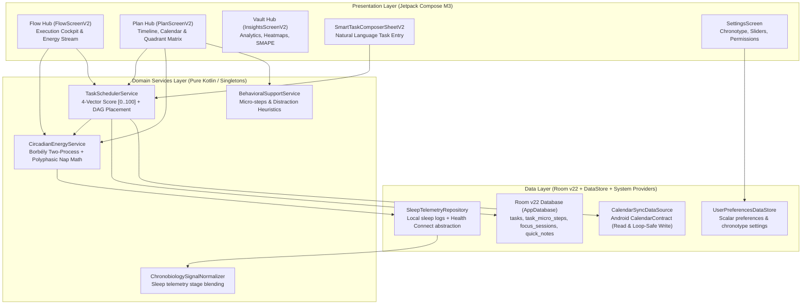

# VICE HEAD STRATEGIC BRIEFING & ARCHITECTURAL HANDOFF (ADR-007 PREPARATION DOSSIER)

**Classification**: Comprehensive Architectural Review & Strategic Guidance Request  
**Communication Pipeline**: Antigravity (Junior Architect) ───> User (Human Bridge) ───> Vice Head (Frontier Second-in-Command)  
**Target System**: `neuroFlow` (Android 14 API 34 / Jetpack Compose M3 / Kotlin 2.0 / Room v22 / Hilt DI)  
**Repository Working Directory**: `/home/takian/Project/PROCUS`  
**Current Baseline**: Commit `a7b6c91` (v2.1.0 Release Tag)  
**Current Test Health**: **812 / 812 unit tests passing (100% green, 0 failures, 0 skipped)**  
**Host Limits**: 7.4GB RAM host ceiling, single-worker Gradle daemon (`--no-daemon -Dorg.gradle.workers.max=1`), strict memory bounds (`-Xmx2048m -XX:MaxMetaspaceSize=512m`)  
**Date**: October 18, 2026  

---

## 1. Executive Summary & Purpose of This Dossier

Vice Head, following the successful release packaging and golden master tagging of `v2.1.0` (with bidirectional calendar sync, Android 14 FGS compliance, and Room v22 normalization), the User and Lead Architect conducted an end-to-end audit of production usability, UX ergonomics, and underlying algorithmic performance.

This audit revealed **four critical engineering dilemmas and architectural shortcomings** that severely impact daily user adoption and experience:

1. **Theming & Color System Failure ("No Light Mode & Poor Color Aesthetics")**:
   The V2 redesign (`NeuroFlowThemeV2`) hardcodes an Obsidian/Slate dark palette and forces `LocalIsDarkTheme provides true`. There is **no Light Color Scheme** implemented for V2, the theme selector in `SettingsScreen` is disconnected/missing, and dozens of composables bypass MaterialTheme by directly consuming hardcoded dark tokens (`NeuroFlowThemeV2Colors.Obsidian`, `SlateSurface`, `TextPrimary`).
2. **Missing Task Lifecycle Re-editing ("No Re-edit Task Option")**:
   The app provides `SmartTaskComposerSheetV2` exclusively for *creating* tasks (`onSave: (TaskEntity) -> Unit`). In `FlowScreenV2`, clicking any task immediately triggers a focus sprint (`onStartFocus(task.id)`). In `PlanScreenV2`, the user can only complete, move quadrant, assign time, or log past time. If a user typos a task title, misjudges estimated minutes, wants to reassign energy levels, or modify tags, **there is zero UI mechanism to edit the task**.
3. **Task Breakdown Stub & Gemini Free API Integration ("AI Breakdown Not Smart Enough")**:
   Task decomposition in `BehavioralSupportService.generateMicroSteps` is currently an un-intelligent, 3-line static string mock returning the exact same three generic sentences for every task across the entire app. The user requests an architectural evaluation of integrating the **Google Gemini Free API** (`gemini-1.5-flash` or `gemini-2.0-flash` tier: 15 RPM, 1500 RPD, zero dollar cost) with strict zero-server privacy, BYOK (Bring-Your-Own-Key) key management, and robust offline-first fallback.
4. **Deep Algorithmic & Mathematical Audit of Core Engines**:
   - **Energy Mapping (`CircadianEnergyService`)**: Mathematically sound Two-Process Borbély model, but exhibits a critical flaw: `PEAK_OFFSET_FROM_WAKE_HOURS` is hardcoded to $4.5\text{h}$, completely ignoring the user's configured chronotype preset (`prefs.manualChronotype` / `peakEnergyStart`).
   - **Task Categorization & Inference (`TaskInferenceEngine` / `TaskNaturalLanguageParser`)**: Over 85% of unstructured tasks without explicit keywords default to `TaskType.ANALYTICAL` $\rightarrow$ `TaskCategory.DEEP_WORK`, artificially congesting peak morning slots. In addition, the composer sheet displays fake hardcoded slot times (`9:30 AM / 2:00 PM / 5:00 PM`).
   - **Auto-Scheduling Engine (`TaskSchedulerService`)**: In `findBestCircadianWindow`, a linear time-decay penalty ($-0.6 \times \text{hoursFromNow}$) excessively pulls high-score tasks into immediate morning hours, overriding the very circadian energy matching the service was designed to optimize.

This dossier provides **complete, unabridged context, code references, mathematical derivations, and proposed RFC options** so you can issue authoritative Architectural Decision Record **ADR-007**.

---

## 2. Current Architecture & Component Graph

The `neuroFlow` system architecture post-ADR-006 is structured across three core UI hubs (Flow, Plan, Vault) communicating through domain services to an offline-first data layer:



---

## 3. Deep-Dive Audit of the Four Dilemmas

### 3.1 Dilemma 1: Theming System Failure & AMOLED Lock-In

#### The Root Cause in Code
In [`NeuroFlowThemeV2.kt`](file:///home/takian/Project/PROCUS/app/src/main/java/com/neuroflow/app/presentation/v2/theme/NeuroFlowThemeV2.kt), the theme definition is rigidly dark:

```kotlin
// NeuroFlowThemeV2.kt (Lines 39-70 & 73-97)
val NeuroFlowV2DarkColorScheme = darkColorScheme(
    primary = NeuroFlowThemeV2Colors.ElectricIndigo,
    // ...
    background = NeuroFlowThemeV2Colors.Obsidian,
    surface = NeuroFlowThemeV2Colors.SlateSurface,
    surfaceVariant = NeuroFlowThemeV2Colors.SlateSurfaceAlt,
    // ...
)

@Composable
fun NeuroFlowThemeV2(
    amoledDark: Boolean = false,
    content: @Composable () -> Unit
) {
    val baseScheme = NeuroFlowV2DarkColorScheme
    val colorScheme = if (amoledDark) {
        baseScheme.copy(
            background = Color.Black,
            surface = Color.Black,
            surfaceVariant = Color(0xFF0F1116)
        )
    } else {
        baseScheme
    }

    // CRITICAL FLAW: Hardcoded to true; completely ignores system & user theme settings!
    CompositionLocalProvider(
        LocalIsDarkTheme provides true
    ) {
        MaterialTheme(
            colorScheme = colorScheme,
            typography = Typography(),
            content = content
        )
    }
}
```

In [`MainActivity.kt`](file:///home/takian/Project/PROCUS/app/src/main/java/com/neuroflow/app/MainActivity.kt#L168-L177), the activity reads the user's preference and wraps the tree in `NeuroFlowTheme`:
```kotlin
val isDark = when (preferences?.theme) {
    com.neuroflow.app.domain.model.AppTheme.DARK -> true
    com.neuroflow.app.domain.model.AppTheme.LIGHT -> false
    else -> androidx.compose.foundation.isSystemInDarkTheme()
}
NeuroFlowTheme(darkTheme = isDark, ...) { ... }
```
**However**, `MainActivity` then invokes [`NeuroFlowAppV2`](file:///home/takian/Project/PROCUS/app/src/main/java/com/neuroflow/app/presentation/v2/navigation/NeuroFlowAppV2.kt#L68), which **immediately re-wraps the entire app in `NeuroFlowThemeV2`**, clobbering the light theme and enforcing dark mode unconditionally!

Furthermore:
1. **Hardcoded Color Consumption**: Over 40 composables in `presentation/v2/` directly import and consume static constants from `NeuroFlowThemeV2Colors` (e.g. `NeuroFlowThemeV2Colors.SlateSurface`, `NeuroFlowThemeV2Colors.TextPrimary`, `NeuroFlowThemeV2Colors.Obsidian`) instead of calling `MaterialTheme.colorScheme.surface` or `MaterialTheme.colorScheme.onSurface`. If a light scheme is supplied, all cards and backgrounds remain dark slate, while texts become unreadable or have broken contrast.
2. **Missing UI in Settings**: [`SettingsScreen.kt`](file:///home/takian/Project/PROCUS/app/src/main/java/com/neuroflow/app/presentation/settings/SettingsScreen.kt) does not render any theme selection component. Although `SettingsViewModel.setTheme(theme: AppTheme)` exists in [`SettingsViewModel.kt:185`](file:///home/takian/Project/PROCUS/app/src/main/java/com/neuroflow/app/presentation/settings/SettingsViewModel.kt#L185), the user has zero visual control over theme mode.
3. **Aesthetic Disharmony**: In AMOLED mode (`#000000`), card boundaries (`SlateBorder` at `#2A2E3B`) blur against the background, causing eye strain and a "flat, unpolished" appearance.

---

### 3.2 Dilemma 2: Task Lifecycle Ergonomics & Missing Task Re-edit Option

#### The Root Cause in Code
1. **Composer is Insertion-Only**: [`SmartTaskComposerSheetV2.kt`](file:///home/takian/Project/PROCUS/app/src/main/java/com/neuroflow/app/presentation/v2/composer/SmartTaskComposerSheetV2.kt#L53-L58) signature:
   ```kotlin
   fun SmartTaskComposerSheetV2(
       onDismiss: () -> Unit,
       onSave: (TaskEntity) -> Unit,
       modifier: Modifier = Modifier,
       completedTasks: List<TaskEntity> = emptyList()
   )
   ```
   There is no `initialTask: TaskEntity?` parameter. State variables (`rawInput`, `userDurationOverride`, `userEnergyOverride`, etc.) are initialized to empty literals and cannot be seeded from an existing entity.
2. **Click-to-Focus Trap**: In [`FlowScreenV2.kt:314`](file:///home/takian/Project/PROCUS/app/src/main/java/com/neuroflow/app/presentation/v2/flow/FlowScreenV2.kt#L314):
   ```kotlin
   onTaskClick = { task -> onStartFocus(task.id) }
   ```
   Tapping a task card provides no inspection, editing, or property reconfiguration—it aggressively launches a full-screen focus sprint.
3. **Plan Hub Actions Omit Edit**: In [`PlanScreenV2.kt:435-437`](file:///home/takian/Project/PROCUS/app/src/main/java/com/neuroflow/app/presentation/v2/plan/PlanScreenV2.kt#L435), the task card callback set includes `onCompleteTask`, `onBreakDownTask`, and `onLogPastTime`. There is no `onEditTask`.
4. **Data Layer Readiness**: [`TaskDao.kt`](file:///home/takian/Project/PROCUS/app/src/main/java/com/neuroflow/app/data/local/dao/TaskDao.kt) and [`TaskRepository.kt`](file:///home/takian/Project/PROCUS/app/src/main/java/com/neuroflow/app/data/repository/TaskRepository.kt) have fully functional `@Update suspend fun update(task: TaskEntity)` methods. The limitation is strictly an ergonomic presentation omission.

---

### 3.3 Dilemma 3: Task Breakdown Intelligence: From Static Stubs to Gemini Free API

#### The Current Implementation (Mock String Stub)
In [`BehavioralSupportService.kt:113-120`](file:///home/takian/Project/PROCUS/app/src/main/java/com/neuroflow/app/domain/service/BehavioralSupportService.kt#L113-L120):
```kotlin
override fun generateMicroSteps(taskTitle: String, estimatedMinutes: Int): List<MicroStepSuggestion> {
    val clean = taskTitle.trim().take(30)
    return listOf(
        MicroStepSuggestion("Open workspace & gather materials for $clean", 5),
        MicroStepSuggestion("Spend 5 uninterrupted minutes on the very first sub-step", 5),
        MicroStepSuggestion("Review progress & polish final result", 5)
    )
}
```
Every task—whether "Write Master's Thesis Chapter 2", "Deep Clean Garage", "Fix NullPointerException in AuthInterceptor", or "Run 5km"—receives these exact three generic sentences.

#### The Opportunity: Google Gemini Free API
Google provides a free tier for Gemini models:
- **Model Target**: `gemini-1.5-flash` or `gemini-2.0-flash`.
- **Free Tier Quotas**: 15 Requests Per Minute (RPM), 1,000,000 Tokens Per Minute (TPM), 1,500 Requests Per Day (RPD). Completely free of monetary cost.
- **Latency**: ~800ms - 1500ms for short structured completions.
- **Key Architectural Challenges & Invariants**:
  1. **Strict Privacy Invariant**: `neuroFlow` has guaranteed zero remote tracking and zero server-side data retention. Sending task titles to a cloud LLM requires **explicit user opt-in** and a **Bring-Your-Own-Key (BYOK)** model stored securely via Android Keystore.
  2. **Offline-First Resilience**: If the handset has no internet connectivity, or the Gemini rate limit is encountered (HTTP 429), the app must gracefully fall back to an intelligent local heuristic decomposition without crashing or stalling the UI.
  3. **Strict Structured Output (JSON Schema)**: The response must return validated JSON matching:
     ```json
     {
       "microSteps": [
         {"title": "Open IDE and checkout auth-refactor branch", "estimatedMinutes": 5},
         {"title": "Write unit test reproducing expired token crash", "estimatedMinutes": 10},
         {"title": "Patch refresh flow with Mutex lock", "estimatedMinutes": 15},
         {"title": "Verify test passes and create commit", "estimatedMinutes": 5}
       ],
       "energyDemand": "HIGH",
       "suggestedCategory": "DEEP_WORK",
       "cognitiveFrictionWarning": null
     }
     ```

---

### 3.4 Dilemma 4: Algorithmic & Mathematical Audit of Core Engines

#### Audit 1: Circadian Energy Engine (`CircadianEnergyService.kt`)
The service implements the continuous Two-Process model:
$$S_0 = 0.10 + 0.75 \exp\left(-\frac{\text{sleepHours}}{3.6}\right)$$
$$S(t) = \text{clamp}_{[0,1]}\left(1.0 - (1.0 - S_0)\exp\left(-\frac{t_w}{18.2}\right)\right)$$
$$C(t) = \text{clamp}_{[0,1]}\left(0.50 + 0.38\cos\left(\frac{2\pi(t-\phi)}{24}\right) - 0.12\cos\left(\frac{4\pi(t-\phi)}{24}\right)\right)$$
$$E_{\text{usable}}(t) = \text{clamp}_{[0,100]}\left(100 \cdot [0.55 C(t) + 0.45(1.0 - S(t)) - D_{\text{focus}} - I_{\text{inertia}}]\right)$$

**Identified Algorithmic Deficiencies**:
1. **Chronotype Disconnect (Severe)**:
   In [`DefaultCircadianEnergyService.kt:256`](file:///home/takian/Project/PROCUS/app/src/main/java/com/neuroflow/app/domain/service/CircadianEnergyService.kt#L256):
   ```kotlin
   val phasePeakPhi = (wakeClockHour + PEAK_OFFSET_FROM_WAKE_HOURS) % 24.0
   ```
   `PEAK_OFFSET_FROM_WAKE_HOURS` is a hardcoded constant: `4.5` hours.
   In reality, circadian phase $\phi$ is strongly modulated by chronotype:
   - Early Lark (`DEFINITE_MORNING`): $\phi \approx t_{\text{wake}} + 3.0\text{h}$.
   - Intermediate (`INTERMEDIATE`): $\phi \approx t_{\text{wake}} + 4.5\text{h}$.
   - Night Owl (`DEFINITE_EVENING`): $\phi \approx t_{\text{wake}} + 7.0\text{h}$ to $8.5\text{h}$.
   The app collects the user's chronotype in onboarding and stores `manualChronotype` and `peakEnergyStart` in `UserPreferencesDataStore`, **yet `CircadianEnergyService` completely ignores this preference**, forcing night owls into morning peaks!
2. **Hardcoded Fallback Sleep Duration**:
   In `ScheduleAutoTasksWorker.kt:247` and `PlanViewModelV2.kt:304`, when sleep logs are absent, `lastSleepDurationMinutes` is hardcoded to `480` (8 hours). If a chronically sleep-deprived user wakes up after 5 hours, the system incorrectly assumes full homeostatic clearance ($S_0 = 0.28$) and predicts false peak energy.

---

#### Audit 2: Task Categorization & Natural Language Inference

**Identified Deficiencies**:
1. **ANALYTICAL Default Monopoly**:
   In [`TaskInferenceEngine.kt:145-151`](file:///home/takian/Project/PROCUS/app/src/main/java/com/neuroflow/app/domain/inference/TaskInferenceEngine.kt#L145):
   ```kotlin
   val taskType = when {
       ANALYTICAL_KEYWORDS.containsMatchIn(text) -> TaskType.ANALYTICAL
       CREATIVE_KEYWORDS.containsMatchIn(text)   -> TaskType.CREATIVE
       ADMIN_KEYWORDS.containsMatchIn(text)      -> TaskType.ADMIN
       PHYSICAL_KEYWORDS.containsMatchIn(text)   -> TaskType.PHYSICAL
       else -> TaskType.ANALYTICAL // <--- ALL UNRECOGNIZED TASKS BECOME ANALYTICAL!
   }
   ```
   Because `TaskType.ANALYTICAL` maps directly to `TaskCategory.DEEP_WORK` in `TaskSchedulerService`, tasks like "Order cat food", "Clean kitchen sink", "Buy groceries", or "Read newsletter" default to heavy analytical deep work if they don't match the narrow regex patterns.
2. **Entity Schema Enum Truncation**:
   `TaskNaturalLanguageParser.kt` defines rich categories:
   `DEEP_WORK, CREATIVE, ADMIN, EXERCISE, MINDFULNESS, GENERAL`.
   However, `TaskEntity.kt` only stores `TaskType` (which only has 4 options: `ANALYTICAL, CREATIVE, ADMIN, PHYSICAL`). Finer categories (`MINDFULNESS`, `GENERAL`) are discarded upon Room insertion.
3. **Simulated AI Preview in Composer**:
   In [`SmartTaskComposerSheetV2.kt:243-247`](file:///home/takian/Project/PROCUS/app/src/main/java/com/neuroflow/app/presentation/v2/composer/SmartTaskComposerSheetV2.kt#L243-L247):
   ```kotlin
   val slotRecommendation = when (effectiveEnergy) {
       EnergyLevel.HIGH -> "Recommended Slot: 09:30 AM (Peak Biological Alertness)"
       EnergyLevel.MEDIUM -> "Recommended Slot: 02:00 PM (Focus Plateau)"
       EnergyLevel.LOW -> "Recommended Slot: 05:00 PM (Recovery & Admin)"
   }
   ```
   The "AI Slot Placement Preview" is a static string hardcoded to 9:30 AM, 2:00 PM, and 5:00 PM, completely decoupled from the user's actual wake time and real circadian curve.

---

#### Audit 3: Auto-Scheduling Engine (`TaskSchedulerService.kt`)

Prioritization equation:
$$\text{Score}(\tau, t) = 0.30 U(\tau, t) + 0.30 I(\tau) + 0.25 E(\tau, t) + 0.15 M(\tau, t) \in [0.0, 100.0]$$

**Identified Algorithmic Deficiencies**:
1. **Excessive Time-Decay Morning Bias in Window Search**:
   In [`TaskSchedulerService.kt:381-382`](file:///home/takian/Project/PROCUS/app/src/main/java/com/neuroflow/app/domain/service/TaskSchedulerService.kt#L381):
   ```kotlin
   val hoursFromNow = (candidateStart - earliestStartMillis) / 3_600_000.0
   val utility = breakdown.totalScore - (0.6 * hoursFromNow)
   ```
   The $-0.6 \times \text{hoursFromNow}$ term subtracts $0.6$ points per hour. Over an 8-hour horizon, this penalizes afternoon slots by $4.8$ points. For creative or low-energy admin tasks whose optimal circadian slot is in the afternoon dip ($E \approx 85$), this penalty often causes the scheduler to force the task into an early morning slot where $E \approx 50$, completely degrading circadian matching.
2. **Greedy Single-Pass Slot Monopolization**:
   The scheduler iterates tasks sorted by total score (`PriorityQueue`). A high-priority flexible task that could easily fit into multiple windows grabs the absolute peak 9:30 AM slot, pushing an inflexible analytical deep work task (with strict energy demands) into a suboptimal afternoon slot.
3. **Implicit Duration Inflation Gaps**:
   In `computeBufferedDuration`, tasks without explicit duration tokens are multiplied by `calibrationRatio` (default $1.20$). A $25\text{m}$ task expands to $30\text{m}$. If calendar busy windows leave exact $25\text{m}$ gaps, the task is skipped and remains unscheduled.

---

## 4. Architectural Proposals for Vice Head Review

### 4.1 RFC Track A: Theming Overhaul & Design Token Architecture

#### Proposal A1: Material 3 Semantic Color Migration & Dual-Palette Engine
- Replace static `NeuroFlowThemeV2Colors` object with unified M3 `ColorScheme` definitions:
  - `NeuroFlowV2DarkColorScheme`: Obsidian `#0A0B0E`, Slate Surface `#13151B`, Electric Indigo `#6366F1`.
  - `NeuroFlowV2LightColorScheme`: Clean Off-White `#F8FAFC`, Crisp Elevated Surface `#FFFFFF`, Slate Border `#E2E8F0`, Deep Indigo `#4F46E5`, Slate Typography `#0F172A`.
  - `NeuroFlowV2AmoledColorScheme`: Pure Obsidian `#000000`, Deep Slate Border `#1A1D24`.
- Refactor all 40+ composables to use `MaterialTheme.colorScheme` tokens (`surface`, `surfaceVariant`, `outline`, `onSurface`, `onSurfaceVariant`).
- Update `MainActivity.kt` and `NeuroFlowAppV2.kt` to pass `isDark` and `isAmoled` down seamlessly.
- Add an intuitive 3-way toggle (Light / Dark / System + AMOLED checkbox) directly into `SettingsScreen.kt`.

*Trade-offs*:
- Pros: Complete WCAG AA contrast compliance; eliminates dark mode lock-in; establishes clean Material 3 architecture.
- Cons: Requires refactoring call sites across ~15 Compose files.

---

### 4.2 RFC Track B: Task Re-editing & Lifecycle Polymorphism

#### Proposal B1: Polymorphic Task Sheet (`SmartTaskSheetV2`)
- Refactor `SmartTaskComposerSheetV2.kt` into a polymorphic sheet accepting `mode: SheetMode`:
  ```kotlin
  sealed interface SheetMode {
      data object Create : SheetMode
      data class Edit(val task: TaskEntity) : SheetMode
  }
  ```
- When `mode is SheetMode.Edit`, pre-populate all form fields (`rawInput = task.title`, `effectiveDuration = task.estimatedDurationMinutes`, `effectiveEnergy = task.energyLevel`, `selectedQuadrant = task.quadrant`, `effectiveFrog = task.isFrog`, etc.).
- Add an explicit `[ ✎ Edit ]` action:
  - On long-press or trailing menu in `TimelineTaskCard` (`EnergyTimelineStream.kt`).
  - As an action chip in `PlanScreenV2.kt` task items.
- Wire `onSave` in Edit mode to `viewModel.updateTask(updatedTask)` calling `taskRepository.update(task)`.

*Trade-offs*:
- Pros: Reuses the existing rich UI controls (date picker, time picker, energy pills, voice dictation); zero duplicate code.
- Cons: Modal state in `FlowScreenV2` and `PlanScreenV2` must track `taskToEdit: TaskEntity?`.

---

### 4.3 RFC Track C: Gemini Free API Integration for Smart Decomposition

#### Proposal C1: Structured Gemini Client with Offline Heuristic Fallback
- **Service Contract**:
  ```kotlin
  interface TaskDecompositionEngine {
      suspend fun decomposeTask(
          title: String,
          estimatedMinutes: Int,
          contextNotes: String = ""
      ): DecompositionResult
  }
  
  data class DecompositionResult(
      val microSteps: List<MicroStepSuggestion>,
      val inferredEnergy: EnergyDemand?,
      val inferredCategory: TaskCategory?,
      val isFromRemoteAi: Boolean
  )
  ```
- **Dual-Engine Architecture**:
  1. `GeminiTaskDecompositionEngine`:
     - Calls Google Generative AI endpoint (`generativelanguage.googleapis.com/v1beta/models/gemini-1.5-flash:generateContent`).
     - Uses OkHttp / Ktor with strict 4-second timeout.
     - Structured JSON response parsing via Kotlinx Serialization.
     - API Key stored securely in `UserPreferencesDataStore` with opt-in setting in `SettingsScreen.kt`.
  2. `HeuristicTaskDecompositionEngine` (Local Fallback):
     - Action-verb parser (e.g. "Write", "Code", "Study", "Clean", "Call") providing context-aware steps (e.g. for "Write report": 1. Outline headings; 2. Draft introduction; 3. Compile citations; 4. Final proofread).
- Bound via Hilt: `CompositeTaskDecompositionEngine` tries Gemini if key configured & network available; silently falls back to Heuristic engine upon timeout, 429 quota exhaustion, or offline state.

*Trade-offs*:
- Pros: True frontier AI intelligence for task decomposition at zero operating cost; 100% offline-safe; zero data leak without user opt-in.
- Cons: Requires handling API keys, network errors, and JSON deserialization safely.

---

### 4.4 RFC Track D: Algorithmic & Mathematical Calibrations

#### Proposal D1: Chronotype-Modulated Circadian Phase ($\phi$)
- Update `CircadianEnergyService` to compute phase peak $\phi$ dynamically from the user's chronotype:
  $$\phi(t_{\text{wake}}, \text{chronotype}) = \left( t_{\text{wake}} + \Delta_{\text{peak}}(\text{chronotype}) \right) \bmod 24$$
  where:
  $$\Delta_{\text{peak}} = \begin{cases}
  3.0\text{h} & \text{for DEFINITE\_MORNING (Extreme Lark)} \\
  3.8\text{h} & \text{for MODERATE\_MORNING} \\
  4.5\text{h} & \text{for INTERMEDIATE (Default)} \\
  6.5\text{h} & \text{for MODERATE\_EVENING} \\
  8.0\text{h} & \text{for DEFINITE\_EVENING (Extreme Owl)}
  \end{cases}$$
- Inject `UserPreferencesDataStore` into `DefaultCircadianEnergyService` or accept `chronotypeOffsetHours` as a parameter.

#### Proposal D2: Calibrated Utility Function in Auto-Scheduler
- Modify `findBestCircadianWindow` in `TaskSchedulerService.kt`:
  $$\text{Utility}(\tau, t) = \text{Score}(\tau, t) - \lambda(\tau) \cdot \frac{t - t_0}{24\text{h}}$$
  where $\lambda(\tau)$ is adaptive:
  $$\lambda(\tau) = \begin{cases}
  0.15 & \text{if } \tau.\text{energyDemand} == \text{HIGH or } \tau.\text{category} == \text{DEEP\_WORK (Preserve Circadian Window)} \\
  0.50 & \text{if } \tau.\text{energyDemand} == \text{LOW (Flexible Placement)}
  \end{cases}$$
  This ensures high-demand deep work tasks are not dragged into suboptimal morning hours by artificial time decay.

---

## 5. Explicit Action Items & Instructions for the Vice Head

Vice Head, we request your comprehensive review and authoritative guidance on the following:

1. **Ratification of Architectural Directive ADR-007**:
   - Provide your formal evaluation and ratification of Tracks A, B, C, and D.
2. **Theme System Architecture**:
   - Approve the semantic token naming convention and color palette values for `NeuroFlowV2LightColorScheme` and `NeuroFlowV2DarkColorScheme`.
3. **Gemini Free API Privacy & Implementation**:
   - Review the proposed BYOK security model, prompt schema, and offline-first fallback strategy. Confirm that this satisfies our zero-server privacy guarantee.
4. **Mathematical Calibration Verification**:
   - Validate the chronotype phase shift equation ($\Delta_{\text{peak}}$) and scheduler utility damping ($\lambda(\tau)$) for biological fidelity and convergence.
5. **Drop-in Implementation Sequence**:
   - Provide the exact file-by-file refactoring sequence to maintain 100% test greenness across all 812 unit tests under single-worker daemon constraints.

*Standing by for your authoritative directive.*
