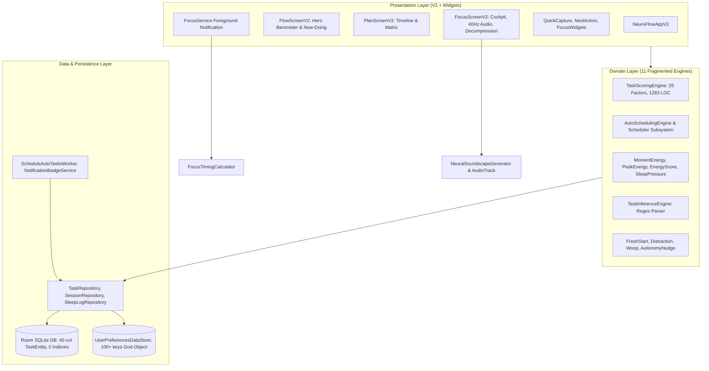

# VICE HEAD STRATEGIC BRIEFING & SYSTEM DESIGN HANDOFF

**Classification**: High-Priority Strategic Architecture & System Design Dossier  
**Channels**: Antigravity (Junior Architect) ───> User (Human Bridge) ───> Vice Head (Frontier Second-in-Command)  
**Target System**: `neuroFlow` (Android, Jetpack Compose, Kotlin 2.0, Room DB, Pure Kotlin DSP)  
**Repository Working Directory**: `/home/takian/Project/PROCUS`  
**Current Branch**: `main`  
**Date**: October 17, 2026  

---

## 1. Executive Summary & Objective

The mission is to architect and build the definitive neuroscience-backed executive function and productivity system for **both ADHD users and general productivity users**.

The project currently has:
1. A **legacy V1 UI layer** (30+ screens, drawer navigation, Eisenhower matrix, verbose questionnaires).
2. A **V2 UI layer** (default, 3-hub bottom bar: Flow, Plan, Insights, OLED obsidian theme, pure Kotlin DSP soundscapes, drift-proof timing, decompression zone, and voice capture).
3. A suite of **927 passing tests (100% pass rate, 0 failures)** verifying core functionality.

We have just completed a **comprehensive, 4-agent architectural, algorithmic, feature, and UI/UX audit** across the entire codebase. The audit uncovered **13 critical mathematical and algorithmic flaws** in the domain engines, **critical data integrity and battery loss risks (P0)**, **over 525 KB of dead legacy code**, and **severe cognitive friction in the information architecture**.

### The Strategic Crossroads
The project owner has explicitly mandated:
> *"i dont mind a completely new architec ui ux .as long as the app serve purposes better... not just adhd but for general use also"*

We are at a defining architectural crossroads:
* **Option A (Conservative In-Place Patching)**: Fix the 13 bugs in place, add missing indexes to Room, delete the 31 dead V1 files, patch the notification data-loss bug, and retain the existing 11 engines and 45-column `TaskEntity`.
* **Option B (Radical Triptych Redesign & Domain Consolidation)**: 
  - Collapse the 11 fragmented engines into **3 core domain services** (`CircadianEnergyService`, `TaskSchedulerService`, `BehavioralSupportService`) + 1 non-destructive token parser.
  - Slay the 45-column `TaskEntity` into a **lean, normalized Room v13 schema** (`tasks`, `task_micro_steps`, `focus_sessions`, `quick_notes`).
  - Adopt the **Triptych Surface Architecture** (**Flow** Cockpit, **Plan** 2-Way Calendar & Interactive Timeline, **Vault** Zero-Guilt Icebox & Notes).
  - Deploy **sub-60s frictionless onboarding** and **dynamic 20% time-blindness buffering**.

We request your authoritative evaluation, Architectural Decision Record (ADR), mathematical models, and implementation guidance.

---

## 2. Environment & Resource Constraints

* **Platform & Runtime**: Android 14 (API 34), Min SDK 26 (Android 8.0 Oreo), Kotlin 2.0.21, Jetpack Compose (BOM 2024.09.00), Material 3.
* **Architecture Style**: MVI / Unidirectional Data Flow (`StateFlow`), Clean Architecture, Hilt 2.51.1 DI.
* **Host Hardware Limitations**:
  - Host RAM: ~7.4 GB available memory.
  - Strict Gradle JVM ceiling: `JAVA_OPTS="-Xmx2048m -XX:MaxMetaspaceSize=512m -XX:+UseParallelGC"`.
  - Gradle Execution: Strict single-worker rule: `./gradlew testDebugUnitTest --no-daemon -Dorg.gradle.workers.max=1`.
* **Execution Invariants**:
  - Android Main Thread is 100% protected from synchronous disk I/O, regex loops, and audio synthesis.
  - Timing is strictly monotonic wall-clock delta (`SystemClock.elapsedRealtime()` / `System.currentTimeMillis()`), never coroutine tick accumulation.
  - Database migrations must preserve all existing user tasks and history without data corruption.

---

## 3. Macro Component Topology

---

## 4. Comprehensive Audit Findings: Critical Bugs & Algorithmic Flaws

### 4.1 System & Persistence Risks (P0–P1)

1. **[P0] Data Loss in `FocusService.kt:91`**:
   Tapping "Complete" on the ongoing lock-screen notification invokes `ACTION_COMPLETE`. The service executes `stopForegroundAndSelf()` and dies. Because it lacks dependencies on `TaskRepository` and `SessionRepository`, **it never marks the task completed in Room DB and leaves `TimeSessionEntity` (`endedAt = null`) permanently unclosed**.
2. **[P0] Battery & Storage Churn in `NeuroFlowApplication.kt:179`**:
   An unbounded `while(true)` loop on `applicationScope` (process lifetime) wakes every 2–5 minutes and re-enqueues `ScheduleAutoTasksWorker` to WorkManager indefinitely. This keeps background services active, waking the CPU and churning SQLite transactions in WorkManager's database.
3. **[P1] Missing Indexes on Room Tables**:
   The 45-column `tasks` table and the 43,000+ row/month `energy_predictions` table have **zero indices** on `status`, `scheduledDate`, `quadrant`, `predictedAtMillis`, and `createdAtMillis`, forcing expensive full-table scans.
4. **[P1] In-Memory Full Table Materialization (`SessionRepository.kt:35`)**:
   `getInterruptionSummary()` calls `timeSessionDao.getAll().filter { it.startedAt >= fromMillis }`. It loads **all sessions in application history** into memory before filtering, causing GC pressure.
5. **[P1] DataStore God-Object (`UserPreferencesDataStore.kt`)**:
   Contains 100+ properties mixing simple flags with complex JSON lists (`protectedTimeSlots`, `affirmations`, `tagCatalog`, `yearlyGoals`). Every scalar write serializes all JSON strings and re-emits `preferencesFlow` to the entire application.

---

### 4.2 The 13 Domain Logic & Algorithmic Flaws

| # | Flaw | Location | Biological / Mathematical Defect |
| :-: | :--- | :--- | :--- |
| **1** | **Focus Trend Inversion (Deep Work Penalized)** | `MomentEnergyEngine.kt:28-82` | `diffs = focusTrajectory.zipWithNext { a, b -> b - a }` where `a` is the newest 5m window and `b` is older. Entering 100% deep focus evaluates as negative, applying a **15% energy penalty**. Slacking off after 3 hours generates a positive boost! |
| **2** | **Score vs. Breakdown Contradiction** | `TaskScoringEngine.kt:637, 1102` | In `score()`, `effectiveLiveEnergy != null && usableEnergy >= 40` for `ADMIN` evaluates to `+10f`. In `scoreBreakdown()`, the branch drops to `isPeakHour -> -15f`. The breakdown card displays `-15f` while actual rank was awarded `+10f`. |
| **3** | **126-Point Sleep Recovery Cliff** | `SleepPressureDetector.kt:289-296` | 59m of sleep = 59 recovery pts. 60m of sleep = 186 pts (instantaneous **+315% jump**). Biological recovery follows continuous SWS/REM decay, not a discrete step function. Jitter in sleep tracking causes wild score volatility. |
| **4** | **DST 1-Hour Schedule Shift** | `ProtectedSlotClock.kt:116` | Slot start is computed as `dayStart + startMinuteOfDay * 60_000L`. On DST change days (23h or 25h days), physical millisecond addition shifts gym/focus blocks by 1 hour relative to wall-clock time. |
| **5** | **Sequential Dependency Deadlock** | `AutoSchedulingEngine.kt:176, 2313` | Dependent tasks are marked `DEPENDENCY_BLOCKED` and excluded from scheduling unless precedent tasks are marked `COMPLETED` in the database. The scheduler cannot plan multi-step workflows (Spec -> Code -> QA) across a single day. |
| **6** | **Asymmetric MAPE Error Inflation** | `AutoSchedulingEngine.kt:932-936` | Duration adjustment uses non-negative symmetric absolute error (MAPE). Finishing a 60m task in 30m yields 100% error, **doubling** the next estimate to 120m instead of decreasing it. |
| **7** | **Score Saturation at 999** | `TaskScoringEngine.kt:67, 807` | `THEORETICAL_MAX` is capped at 1200f, but composite task bonuses easily exceed 2,000 raw points. All top tasks clamp at display score `999`, destroying prioritization differentiation. |
| **8** | **Double-Counting Wake Fatigue** | `EnergyScoreEngine.kt:52`, `PeakEnergyEngine.kt:158` | `reservoirFactor` decays across wake hours, and `fatiguePenalty` subtracts sleep pressure across the same hours. Double-counting fatigue crushes calculated energy to <40% by 7:00 PM for healthy users with 8h sleep. |
| **9** | **Slot Capacity Leaks Across Hour Bins** | `AutoSchedulingEngine.kt:1034-1064` | `slotSpanForDuration` integer arithmetic allocates all 30m of a task from 10:45–11:15 into slot 10:00 AM. Slot 11:00 AM receives 0 assigned minutes, causing overlapping placements. |
| **10**| **Live Energy Disables Category Matching**| `TaskScoringEngine.kt:693-695` | When `effectiveLiveEnergy != null`, `categorySuitabilityScore` is completely skipped, disabling circadian matching for `MINDFULNESS`, `EXERCISE`, and `CREATIVE` tasks. |
| **11**| **Destructive Regex Title Stripping** | `TaskInferenceEngine.kt:196-212` | Blind string replacement strips words without POS awareness: `"Read Today and Tomorrow by Ford"` becomes `"Read and by Ford"`. Explicit durations ("45m") are silently inflated by historical calibration factors. |
| **12**| **Schedule Whiplash via 6h Re-bucketing** | `PlacementStability.kt:83-87` | Tasks are force-replanned every 6 hours based on `hashCode() % 5`, causing calendar blocks to jump 2–3 times a day and disorienting ADHD users who rely on spatial consistency. |
| **13**| **Toxic Distraction Priority Boost** | `DistractionEngine.kt:479` | Tasks with heavy distraction receive a **+80 pt priority boost**, pulling anxiety-inducing avoidance tasks to the top of an ADHD user's queue. |

---

### 4.3 UI/UX Quality & Information Architecture Failures

1. **Weekly Schedule Day Tap Bug (`NeuroFlowAppV2.kt:167`)**:
   `onNavigateToDay = { navController.popBackStack() }`. Tapping any day in the weekly calendar pops the screen instead of showing that day's schedule!
2. **The Lost Unscheduled Backlog**:
   `PlanViewModelV2` extracts unscheduled tasks, but `PlanScreenV2` **never renders them anywhere**—an ADHD object-impermanence black hole.
3. **Touch-Target Crowding**:
   `TimelineTaskCard` packs 4 icon buttons on the right (192dp) + 48dp checkmark, leaving only ~40dp for task titles on standard screens, causing severe truncation and accidental clicks.
4. **AMOLED Contrast Failure**:
   In `amoledDark` mode, cards and background are both `#000000`. Cards blend completely into the background, and `TextTertiary` (`#64748B`) fails WCAG AA minimum contrast standards (3.8:1).
5. **Insights Wall of Charts**:
   `InsightsScreenV2` stacks 11 continuous cards over 842 lines of code, creating cognitive fatigue.

---

## 5. The Concrete Deletion Manifest (31 Files / ~525 KB)

Because V2 is the default interface (`useV2Ui = true`), the entire legacy V1 presentation package is dead code:

### Prerequisite Moves:
1. Move `StepByStepPlanCodec.kt` to `domain/model/StepByStepPlan.kt`.
2. Move `AffordanceRatingSheet.kt` and `WoopPromptSheet.kt` to `presentation/v2/focus/components/`.
3. Create a clean 15-line `LogTimeViewModel` injecting `TaskRepository` to decouple `LogTimeScreen.kt` from `MatrixViewModel`.
4. Remove `useV2Ui` branch from `MainActivity.kt` and `SettingsScreen.kt`.

### Complete Deletion Table:
* **`presentation/today/`**: `TodayScreen.kt`, `TodayViewModel.kt`, `DailyFocusSummary.kt`
* **`presentation/plan/`**: `PlanScreen.kt`
* **`presentation/focus/`**: `FocusScreen.kt`, `FocusViewModel.kt`, `FocusCompletionManager.kt`, `FocusInterventionManager.kt`, `FocusReminderScheduler.kt`, `FocusSessionManager.kt`, `FocusWoopManager.kt`, `MiniWoopReflectionScreen.kt`
* **`presentation/matrix/`**: `MatrixScreen.kt`, `OnHoldPlanningScreen.kt`, `QuadrantDetailScreen.kt`, `MatrixViewModel.kt`
* **`presentation/schedule/`**: `ScheduleScreen.kt`, `ScheduleViewModel.kt`
* **`presentation/progress/`**: `ProgressScreen.kt`, `ProgressViewModel.kt`
* **`presentation/common/`**: `NeuroFlowApp.kt`, `DrawerViewModel.kt`, `MoreMenuSheet.kt`, `NewTaskSheet.kt`, `NewTaskFlowViewModel.kt`, `QuickTaskModalBottomSheet.kt`, `ProtectedSlotTakeoverCard.kt`, `TaskRow.kt`, `DueProtectedSlotFlow.kt`, `DueSlotCopy.kt`, `NavHubs.kt`
* **9 Obsolete Test Files**: `DailyFocusSummaryTest.kt`, `TodayViewModelProtectedSlotTest.kt`, `ProgressViewModelTest.kt`, `NewTaskFlowViewModelTest.kt`, etc.

---

## 6. The Strategic Crossroads: Options Under Consideration

### Option A: Conservative In-Place Patching
* Fix the P0 `FocusService` notification bug.
* Fix the 13 algorithmic bugs directly in `MomentEnergyEngine.kt`, `TaskScoringEngine.kt`, `AutoSchedulingEngine.kt`, etc.
* Add composite indices to `TaskEntity` and `EnergyPredictionEntity`.
* Execute the 31-file deletion manifest to remove legacy V1 code.
* **Trade-Offs**: Low immediate risk, 100% backward compatible with existing tests, but leaves the monolithic 45-column `TaskEntity`, 11 fragmented engines, and cognitive screen clutter intact.

### Option B: The Radical Triptych Redesign & Domain Consolidation
* **The Triptych Navigation Core**: Collapses the app into 3 high-impact surfaces:
  1. **FLOW (Execution Cockpit)**: Circadian Barometer, Now Doing (Daily Frog), Up Next queue (max 2 items), and Quick Scratchpad.
  2. **PLAN (Visual Timeline & Calendar)**: Bidirectional 2-way sync with Google/Outlook calendar + interactive drag-and-drop timeline auto-fitting into biological energy peaks.
  3. **VAULT (Knowledge & Long-term Storage)**: The Zero-Guilt Icebox (stale task archive), Projects, Notes, and Long-Term Circadian Insights.
* **Domain Engine Consolidation**: Collapses 11 engines into **3 core services**:
  1. `CircadianEnergyService`: Pure continuous Borbély Two-Process (exponential Process S + sinusoidal Process C). Zero discrete cliff steps.
  2. `TaskSchedulerService`: 4-vector normalized scoring ($\text{Score} = w_u \cdot U + w_i \cdot I + w_e \cdot E + w_m \cdot M$) + interval tree reservation with dependency DAG scheduling.
  3. `BehavioralSupportService`: 1-tap emergency schedule reset, WOOP implementation intentions, reflective distraction tracking (zero distraction priority boosts).
  4. `TaskNaturalLanguageParser`: Non-destructive token parser.
* **Lean Normalized Room Schema (v13)**:
  - `tasks`: 14 columns (id, title, notes, status, estimated_minutes, actual_minutes, energy_demand, is_frog, scheduled_start, deadline, completed_at, is_locked, parent_task_id, timestamps).
  - `task_micro_steps`: 1-to-many child table for "Break It Down" micro-steps.
  - `focus_sessions`: Dedicated historical session logs with foreign key cascades.
  - `quick_notes`: Lean scratchpad notes.
* **High-Impact Differentiators**:
  - Sub-60s 3-chip onboarding.
  - Dynamic 20% time-blindness auto-buffering.
  - "Break It Down" Magic Wand micro-step generator.
  - Zero-guilt Icebox sweep (no red overdue badges).
* **Trade-Offs**: Major refactoring effort, requires careful Room schema migration, but elevates neuroFlow into an elite, market-leading product for both ADHD and general users.

---

## 7. Explicit Strategic Guidance Request for Vice Head

Vice Head, as second-in-command frontier intelligence, please provide your authoritative guidance on the following:

### 1. Architectural Decision Record (ADR)
* Do you endorse **Option A (Conservative Patch)** or **Option B (Radical Triptych Redesign & Domain Consolidation)**?
* If Option B, what is your recommended phased migration path to ensure continuous test suite greenness?

### 2. Algorithmic Formulations
* **Borbély Two-Process Model**: Provide the exact mathematical equations for continuous exponential sleep pressure ($S(t)$) and sinusoidal circadian alertness ($C(t)$) that parameterize cleanly from a user's wake time without discrete cliff steps.
* **4-Vector Task Prioritization**: Formulate the normalized scoring equation:
  $$\text{Score} = w_u \cdot U(\text{Urgency}) + w_i \cdot I(\text{Impact}) + w_e \cdot E(\text{EnergyFit}) + w_m \cdot M(\text{Momentum})$$
  Specify how each sub-score is normalized to $[0..100]$ to prevent score saturation.
* **Dependency DAG Scheduling**: How should the `TaskSchedulerService` construct the topological sort and interval tree constraints so multi-step workflows schedule sequentially across available calendar gaps?

### 3. Database Schema & Migration Strategy
* Review the proposed **Room v13 schema** (`tasks`, `task_micro_steps`, `focus_sessions`, `quick_notes`).
* Provide the SQLite migration script (`MIGRATION_12_13`) to transition existing users from the 45-column `tasks` table and JSON DataStore without data loss.

### 4. Immediate Code Drops & Implementation Priority
* Please supply drop-in Kotlin interface contracts and algorithm implementations for:
  1. `CircadianEnergyService.kt`
  2. `TaskSchedulerService.kt`
  3. The fix for `FocusService.kt` notification completion.

---
*Ready for handover via user bridge.*
